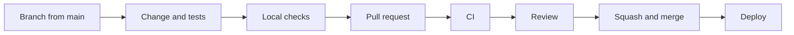

# Contributing to Anvaya

This file tells how we work together on GitHub, with or without a coding agent. [AGENTS.md](AGENTS.md) has the rules for the code and for writing. They apply to people too.

## Set up

- **API** (`agents/`): Python 3.14 (`agents/.python-version`) and [uv](https://docs.astral.sh/uv/). Run `cd agents && uv sync --group dev`.
- **Web app and admin portal** (`web/`): Node 24 LTS (`web/.nvmrc`). Run `cd web && npm ci`.
- **Git hooks**, once per clone: `git config core.hooksPath .githooks`. They stop commits and pushes on `main`, for people and agents alike.

Then follow "Run locally" in the [README](README.md).

## The flow



1. **Start from the latest `main`:** `git fetch origin && git switch -c feat/short-name origin/main` (or `fix/…`, `chore/…`, `docs/…`).
2. **Make one change per branch, with tests.** People review small PRs faster, and small PRs are easier to undo.
3. **Run the checks locally.**
   ```bash
   cd agents && uv run --group dev ruff check . && uv run --group dev pytest -q
   cd web && npm run lint && npm run build
   ```
4. **Open a pull request** (`gh pr create`). Fill in the template. Link the roadmap item (`PR-x.y`) or issue. Say how you checked the change. If the PR isn't ready, open it as a draft.
5. **CI runs the same checks** on every PR. Fix all failures before you ask for review.
6. **Another person reviews.** Changes to the paths in [.github/CODEOWNERS](.github/CODEOWNERS) need the owner's review. These paths are the vault, the handover, sign-in, governance, the admin portal, `firestore.rules`, hosting, deploys and the agent rules.
7. **Squash and merge.** The PR title becomes the commit on `main`. Write it in the commit style below. Then delete the branch.
8. **Merging deploys.** Every merge to `main` deploys what changed to production ([deploy.yml](.github/workflows/deploy.yml)). Docs-only changes deploy nothing. Merge only when the change is ready to go live. Then check the Deploy run in Actions. Never push to `main` directly. Never deploy by hand, except through Actions → Deploy.

To keep an open branch up to date, run `git pull --rebase origin main` on your own branch. Never rebase a branch someone else is also pushing to.

## Commit messages and PR titles

Copy the style in `git log`:

```
Limits per request from the registry (PR-10.2)

The gateway now enforces each agent's limits from agents/registry.yaml:
- max_input_tokens: estimated before the call; larger requests are refused …

Six new tests; real Gemini calls confirm the output caps leave room.
```

- The subject is a plain imperative sentence of under about 72 characters. It has no full stop. Add the roadmap item if there is one.
- The body says what changed and why. Mention new tests.
- Avoid subjects like "Updates", "fix" or "wip" on `main`.

## Using coding agents

Any agent is fine (Claude Code, Codex, Cursor, Copilot, Gemini CLI). You are responsible for what you commit, whoever typed it.

- **Shared instructions are in `AGENTS.md`.** Claude Code loads them through `CLAUDE.md`, and Codex, Cursor and Copilot read `AGENTS.md` directly. For Gemini CLI, set `"context": {"fileName": ["AGENTS.md"]}` in `.gemini/settings.json`.
- **Change the shared instructions through a PR** when you find something that every agent should know. Examples are a new rule, a pitfall or a command. Don't keep it in your own local notes.
- **Give each parallel session its own worktree.** If two agents run in one folder, one switches branches under the other. Then files go missing or end up in the wrong commit. Use `git worktree add ../Anvaya-<topic> -b feat/<topic> origin/main`. When the branch is merged, remove the worktree with `git worktree remove`.
- **Keep personal agent settings out of git.** Use `.claude/settings.local.json` and `CLAUDE.local.md`. Git ignores them.
- **Read the whole diff before you commit.** Look for:
  - code that the agent deleted or "simplified";
  - tests that were weakened to pass;
  - new dependencies;
  - changes to files you didn't ask about.
- **Say what the agent did** in the PR description, and add a `Co-Authored-By:` trailer when it wrote a substantial part.
- **Don't paste secrets or real personal data** into an agent: no `.env` contents, no keys, no real family or account details. The demo data is synthetic. Keep it that way.
- **Use the latest stable versions.** The rules are in AGENTS.md ("Dependencies and versions"). The inventory is [docs/dependencies.md](docs/dependencies.md).
- **Agents never deploy.** They never change cloud resources or GitHub settings. A person does that.

## Reviewing

- Check that the PR does what its description says, and nothing else.
- Read the tests first. Do they test the behaviour, or only the code that was written?
- Check more carefully anything that touches the vault, the handover, sign-in, governance or the deploy workflow.
- Approve only what you would be happy to see deployed. Merging deploys.

## Secrets and access

- Secrets live in GitHub (*Settings → Environments → production*) and in Google Secret Manager, never in the repo. `.env` files stay local.
- If someone commits a secret by mistake, tell the owner at once so they can rotate it. Deleting the commit isn't enough.
