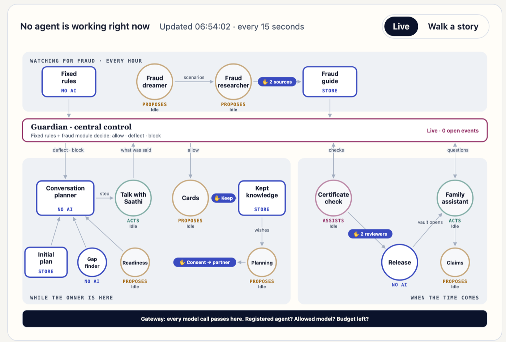
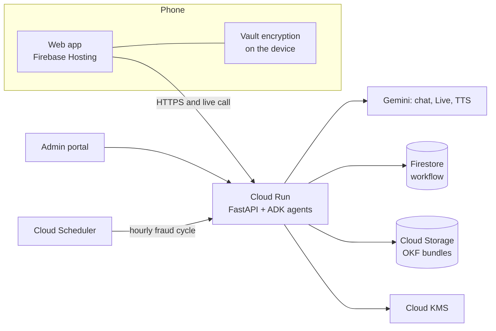

<p align="center">
  
</p>

<p align="center"><strong>Your stories, your wishes, and everything your family will need.</strong></p>

**When someone dies suddenly, their family can't find the money.** Anvaya is an app with a warm AI companion, **Saathi**. While people are alive, they talk to Saathi about their stories, money matters, family and wishes. When the time comes, Anvaya hands everything over safely to the right person.

Built for the **AI Builder Cup 2026** · Track: **BFSI** · Google Gemini + Google Cloud.

> All demo data is synthetic. No real person's data is used anywhere.

## For judges: start here

| | |
| --- | --- |
| **Try the app** | **https://anvaya-saathi.web.app**. Sign in with Google. Each account gets its own private demo copy. |
| **First visit** | A short **"Start here" tour** opens on its own. Its five steps go from Vikram's first conversation to Priya's questions, with a button for each step. "Demo → Show the tour" opens it again. |
| **Play every person** | The row of names under the header switches who is acting: **Vikram** (the owner), **Priya** (his daughter), **Anjali** and **Rahul** (our two reviewers), and **Admin**. The server checks each person's role on every action. |
| **No documents needed** | The tour and Priya's upload steps offer **specimen certificates**. The checks flag them, so you see the checks at work. |
| **See the system** | **https://anvaya-admin.web.app**, the admin portal, with the same Google account. The **Agents** page shows every AI loop live, around the guardian. It also has the guardian's events, the fraud knowledge graph, usage and the audit log. |
| **Your own Gemini key** | Optional. "Demo → Your own model key". Without one, the demo uses ours, within a daily allowance. |

**Documents**

| Document | What it covers |
| --- | --- |
| [Concept](docs/concept.md) | The idea in plain language (start here) |
| [Pitch: individuals](docs/pitch-individuals.md) | Why a person and their family would use Anvaya |
| [Pitch: banks and insurers](docs/pitch-institutions.md) | Why an institution would offer Anvaya to its customers |
| [Business model](docs/business-model.md) | Revenue, costs, margins and the assumptions behind them |
| [Architecture](docs/architecture.md) | How it's built: the loops, the guardian, data, security and design decisions |
| [Release notes](docs/release-notes.md) | What's built, and the known limitations |
| [Libraries and services](docs/dependencies.md) | Every library, version and licence, and the Google services used |

## The problem

- **India:** ₹72,454 crore in unclaimed bank deposits (January 2026), plus ₹8,974 crore in unclaimed insurance (February 2026).
- **Japan:** a record ¥129.2 billion in estates went to the national treasury in financial year 2024 because no heir came forward.
- **South Korea:** more than ₩10 trillion in unclaimed insurance money (2026).
- **Malaysia:** RM13.3 billion in unclaimed money (April 2025).
- **Australia:** A$21.2 billion in lost and unclaimed superannuation (June 2026).
- **Singapore:** 2 in 5 CPF members lost before 65 had no nominee (2023).
- Most people never write down their accounts, policies, passwords or wishes.

Sources and dates are in [docs/concept.md](docs/concept.md#sources).

## What Saathi does

1. **Talk.** Tap the microphone and talk as in a phone call (Gemini Live). You can also type, or share a photo of a document. Saathi follows a plan: it knows what to talk about next, who starts, and the right tone. Sad or tired? The plan changes.
2. **Keep.** Saathi offers cards: stories, advice, wishes, accounts, family. Each card holds only what was said. Nothing is saved until the owner taps **Keep**.
3. **The family book.** Everything kept becomes a book for the family, with the date each page was kept, a readiness score and the pages still to write.
4. **The vault.** The phone encrypts passwords and secrets. The owner chooses one person to receive them. Nobody at Anvaya, and no AI, can read them.
5. **A careful handover.** Gemini checks the certificate sign by sign against a fraud reference guide. Two different reviewers confirm. A waiting period lets the owner cancel.
6. **For the family.** The chosen person opens the vault on their phone. They ask about anything that was kept, and every answer shows its sources. They also get a claims checklist with draft letters.

**AI-first, with people in control.** Every feature is a loop with a set autonomy level: it acts within limits, proposes, or only assists. Anything saved or shared waits for a person's yes. The AI only assists with death and legal checks; people decide.

## How we use Gemini and Google Cloud

| Service | What it does in Anvaya |
| --- | --- |
| **Gemini 3.1 Flash-Lite** (fallback: Gemini 3.5 Flash-Lite) | Reads each conversation, writes Saathi's replies, extracts cards, checks certificates, plans next steps, drafts letters, and runs fraud research and dreaming |
| **Gemini Live** (`gemini-3.8-live`) | Hands-free voice calls. Saathi reads the plan's current step through tools during the call. |
| **Gemini TTS** | Saathi's spoken replies to typed messages |
| **Google ADK** | The family's assistant: answers only from what the owner kept, with sources |
| **Cloud Run** | The agents service (Python, FastAPI) |
| **Firebase Hosting and Authentication** | The app and the admin portal; Google sign-in |
| **Cloud Storage** | Each owner's kept knowledge, and the platform's fraud knowledge, in the open OKF format |
| **Firestore** | Workflow only: pending cards, cases, guardian records, plans |
| **Cloud KMS** | The outer layer of the vault key, and people's own Gemini keys |
| **Cloud Scheduler** | The hourly fraud research and dreaming |
| **Cloud Billing export to BigQuery** | Real spend for the admin portal |

Fraud research also uses **Exa** web search, for public fraud reports only.

## Trust and safety

- **One guardian for every loop.** Everything new the owner says, and every family question, passes the guardian first. Fixed rules and a fraud reference decide: continue, add a check, deflect to a safer route, pause for a reviewer, or block. It never approves a case; people decide. [More](docs/architecture.md#41-the-guardian)
- **A fraud reference that grows every hour.** A research agent and a "dreaming" agent, which red-teams our safeguards, add what 2 independent websites confirm. The same fraud is never added twice. A reviewer can remove anything they added. The portal shows the reference as a connected graph.
- **Governed agents.** 15 agents are registered, each with one policy for its models, tools and limits. Every Gemini call passes one gateway, with daily allowances, a service-wide ceiling and a kill switch. [More](docs/architecture.md#8-governance-and-cost-control)
- **Auditable.** A reviewer can follow one conversation turn to the guardian's decision, the card, the Keep and the plan change, by ids only. The admin portal never shows conversation text or names.
- **Private by design.** The vault is encrypted on the phone. Each judge's demo copy is closed to everyone else. [More](docs/architecture.md#6-security-and-privacy)

## Architecture

The admin portal's Agents page is the system view: every loop around the guardian, with its autonomy and the gates where a person decides.





Details: [docs/architecture.md](docs/architecture.md).

## Measured quality

Three Gemini steps are measured against real Gemini on a small synthetic test set (`agents/evals/`). It checks our own steps; it is not a full benchmark. Latest results, 9 October 2026, `gemini-3.1-flash-lite`:

| Step | Measure | Result |
| --- | --- | --- |
| Certificate check (15 made-up certificates) | Forgeries flagged | 7 of 7 |
| | The right warning sign named | 6 of 7 |
| | Genuine certificates passed | 2 of 6 |
| | Wrong person or wrong kind of document caught | 2 of 2 |
| Priya's questions (20 questions) | Right source cited | 14 of 14 |
| | "Never recorded" when nothing was kept | 4 of 6 |
| | Made-up sources | 0 |
| Cards (15 exchanges with traps) | Cases with a detail nobody said | 1 of 15 |
| | True details kept | 23 of 23 |

**Main limitation:** genuine certificates are often flagged for a closer look, because the model raises free-text concerns. A reviewer always decides, so this costs reviewer time but never releases anything. Full results: [agents/evals/results/](agents/evals/results/).

**Automated tests:** 721 tests run in about 6 seconds, with no cloud and Gemini stubbed. They enforce the rules in code: every Gemini call goes through the gateway, the guardian never reads the vault, two demo copies never reach each other, and the portal never returns conversation text.

## Demo walkthrough

The "Start here" tour in the app walks these steps.

1. **Vikram → Talk:** tap **Talk to Saathi**. Talk about family, a first job, and an LIC policy ("make Ajay the nominee"). Tap **End call**. Saathi sums it up and marks everything to keep. Tap **Keep**. Open **Kept** to see the book, its readiness score and the pages still to write.
2. **Vikram → Family:** choose Priya and invite her. **Priya:** accept and keep the recovery code. **Vikram:** check that the codes match, then seal. **Vault:** lock a secret.
3. **Priya:** start the handover with the specimen certificate. **Anjali**, then **Rahul**: two different reviewers confirm. To go against a "not valid" check, a reviewer must write a reason.
4. After the waiting period, **Priya** opens the vault. She asks "What insurance did Papa have?" and prepares the claim letters.
5. **Admin:** open the admin portal. The Agents page shows the loops that just ran, and the Guardian page shows the audit chain for a conversation.

## Run it yourself

You need Python 3.14, [uv](https://docs.astral.sh/uv/), Node 24 and a Gemini API key from [Google AI Studio](https://aistudio.google.com).

```bash
cd agents && cp .env.example .env    # add GOOGLE_API_KEY
uv sync && AUTH_REQUIRED=false uv run --env-file .env uvicorn app.main:app --port 8080
cd ../web && npm install && npm run dev    # http://localhost:5173 (admin: /admin.html)
```

Tests, with no cloud credentials: `cd agents && uv run --group dev pytest -q`.
