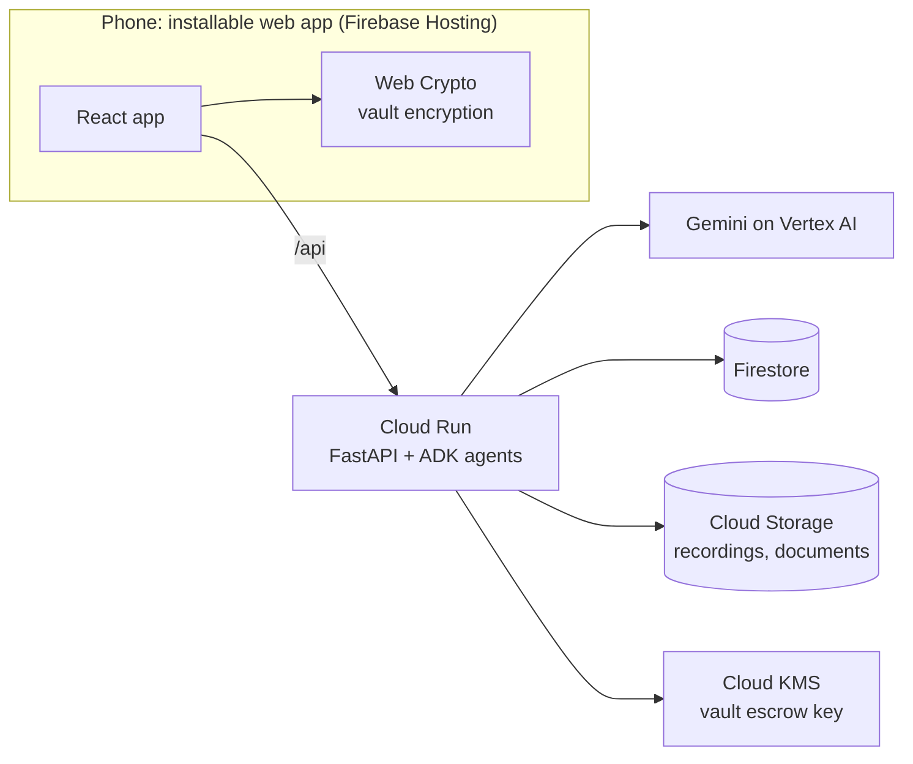

# Life-After

**When someone dies suddenly, their family can't find the money.** Life-After is an AI-first app that makes sure every account, policy and wish reaches the right person: securely, legally, and in the owner's own words.

Built for the **AI Builder Cup 2026** · Track: **BFSI: Intelligent Risk, Fraud & Financial Experiences** · Google Cloud + Gemini.

> All demo data is synthetic. People, institutions and numbers in `agents/demo_data/persona.json` are fictional.

## The problem

- India: about ₹72,000 crore in unclaimed bank deposits sits with the RBI, plus about ₹9,000 crore in unclaimed insurance ([PIB](https://www.pib.gov.in/PressReleasePage.aspx?PRID=2244475&reg=48&lang=2)).
- Australia: about A$21.2 billion in lost and unclaimed superannuation ([ATO](https://www.ato.gov.au/about-ato/research-and-statistics/in-detail/super-statistics/super-accounts-data/super-data-lost-unclaimed-multiple-accounts-and-consolidations/total-lost-fund-held-and-ato-held-super)).
- Most people never write their wishes down, and passwords, policies and accounts are lost when they die.

## What it does: AI-first loops

The app is not screens with AI added. It is a set of loops the AI runs, while people set the goals and limits. Each action shows its autonomy level in the UI.

| Loop | What happens | Autonomy |
| --- | --- | --- |
| **Capture** | The owner talks in any language; Gemini transcribes and splits the recording into story, advice, practical and wish moments. A photo of a policy or statement becomes a financial inventory entry, with numbers masked. | Act within limits |
| **Curation** | Nothing enters the archive until the owner approves it in the weekly review. | Propose |
| **Readiness** | Gemini scores how ready the family would be and asks one gentle question per gap, e.g. "no nominee on this policy". | Act within limits |
| **Planning** | Wishes that need legal force are flagged; with consent, a pre-filled summary goes to a legal partner (mocked). No legal advice. | Propose |
| **Secure vault** | Passwords and account details are encrypted **on the device**. Neither the AI nor the server can read them. | Act within limits |
| **Activation / release** | Death certificate and legal authority are pre-checked by Gemini, **confirmed by a person**, then a waiting period runs while the owner's devices are alerted. | Assist |
| **Handover** | An **ADK agent** answers the family's questions only from the owner's own words and records, cites sources, and says "never recorded" instead of guessing. | Act within limits |
| **Settlement** | Gemini builds a claims checklist and drafts claim letters for the executor to review, and names the national unclaimed-asset searches. | Propose |

### Human boundaries (enforced in code)

- Nothing is saved without the owner's approval (`/proposals/{id}/decision`).
- Nothing is shared with a legal partner without consent (`legal-handoff` rejects `owner_consent=false`).
- A person confirms every death and legal authority; the state machine in `agents/app/release.py` cannot skip steps.
- The owner can cancel a release at any time before it completes (`/alive`).
- The handover assistant has no tool that can reach the vault.

## Architecture

Full details: [docs/architecture.md](docs/architecture.md). The idea in plain language: [docs/concept.md](docs/concept.md).



**Vault key flow.** The owner's device encrypts secrets with an AES-GCM data key. The recipient's device creates an RSA key pair when they accept the role. The owner's device wraps the data key with the recipient's **public** key; the server wraps that again with **Cloud KMS**. On release, KMS removes the outer layer and only the recipient's device can remove the inner one. The server never holds anything it can decrypt. See `agents/app/escrow.py`.

## Repository layout

```
agents/                 Python service (Cloud Run)
  app/main.py           HTTP API (all routes under /api)
  app/loops.py          Gemini steps for each loop, with typed outputs
  app/executor_agent.py ADK handover agent with archive tools
  app/release.py        Vault release state machine (human boundaries)
  app/escrow.py         Cloud KMS wrap/unwrap
  app/schemas.py        Pydantic schemas = Gemini structured outputs
  demo_data/            Synthetic persona
  tests/                Pytest suite (Gemini stubbed)
web/                    React + Vite installable web app (Firebase Hosting)
  src/vaultCrypto.ts    On-device encryption
infra/deploy.sh         One-shot Google Cloud deploy
docs/concept.md         The idea in plain language (start here)
docs/architecture.md    Architecture, security model and design decisions
docs/use-cases.md       Roles, loops and use cases
docs/release-notes.md   What's in each version
```

## Run locally

Prerequisites: Python 3.12+, [uv](https://docs.astral.sh/uv/), Node 20+, a Google Cloud project with Vertex AI enabled, and `gcloud auth application-default login`.

```bash
# 1. Agents API on :8080
cd agents
cp .env.example .env        # set GOOGLE_CLOUD_PROJECT
uv sync
uv run --env-file .env uvicorn app.main:app --reload --port 8080

# 2. Web app on :5173 (proxies /api to :8080)
cd ../web
npm install
npm run dev
```

Open http://localhost:5173 and switch roles with the bottom tabs: **Vikram** (owner), **Our team** (reviewers), **Priya** (daughter and vault recipient).

Tests (no cloud credentials needed):

```bash
cd agents && uv run --group dev pytest -q
```

## Deploy to Google Cloud

Needs `gcloud` and the Firebase CLI, logged in to the same project.

```bash
PROJECT_ID=your-project-id ./infra/deploy.sh
```

This enables the APIs, creates a least-privilege service account, Firestore, a private bucket and a KMS key, deploys the agents to Cloud Run in `asia-southeast1` (Singapore), and deploys the web app to Firebase Hosting with `/api/**` routed to Cloud Run.

## Demo script (under 3 minutes)

1. **Vikram (owner):** record a story in Hindi → approve the moments. Photograph a policy → the AI notes "missing: nominee". Run **Check readiness**. Add a wish, run **Which wishes need a legal document?**, tick consent, send to the partner.
2. **Priya:** **Accept role**. **Vikram:** add a password to the vault and **Seal vault for my recipient**. Show the ciphertext.
3. **Priya:** upload a (sample) death certificate. **Our team:** review the AI pre-check, **Confirm death**. **Priya:** upload proof of authority. **Our team:** **Confirm legal authority**. Optionally show **Vikram** tapping "I'm OK" to cancel, then reset and repeat.
4. **Priya:** after the waiting period, **Unlock** the vault (decrypted on the device), ask "What insurance did Papa have?" and "Did Papa have any crypto?" (answer: never recorded), then **Prepare checklist and letters**.

## Known limitations (MVP)

- **No sign-in yet.** Any caller can use any route, including the review routes. Add Firebase Auth with role checks before any real user data.
- Keys are kept in `localStorage` so one browser can play every role. Production would use non-extractable keys in IndexedDB, backed by passkeys.
- The legal partner is mocked; archive search is keyword-based (next step: Vertex AI RAG Engine).
- Voice capture records then uploads; a live, two-way interview (Gemini Live API) is on the roadmap.

## Roadmap

Gemini Live voice interviews · Vertex AI RAG Engine for the archive · Firebase Auth and roles · email and chat import · evaluation set for extraction accuracy and grounded answers · real legal-partner integration.
