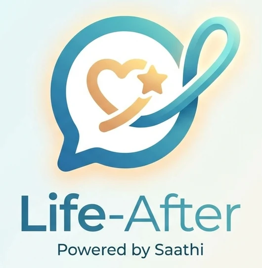
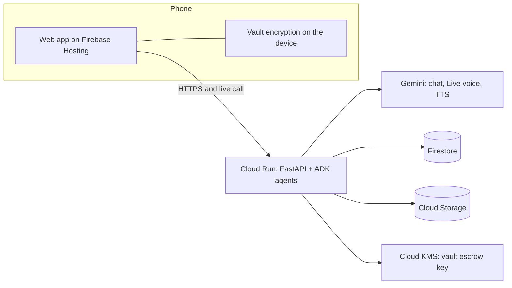

<p align="center">
  
</p>

<p align="center"><strong>Your stories, your wishes, and everything your family will need.</strong></p>

**When someone dies suddenly, their family can't find the money.** Life-After is an app with a friendly AI companion, **Saathi**. People talk to Saathi about their stories, money matters, family and wishes while they are alive. When they pass away, everything is handed over safely to the right person.

Built for the **AI Builder Cup 2026** · Track: **BFSI** · Google Gemini + Google Cloud.

> All demo data is synthetic.

## Documents

| Document | What it covers |
| --- | --- |
| [Concept](docs/concept.md) | The idea in plain language (start here) |
| [Architecture](docs/architecture.md) | How it's built, security, design decisions |
| [Use cases](docs/use-cases.md) | Who uses it, what they do, what the AI does |
| [Release notes](docs/release-notes.md) | What's in each version and known limitations |
| [Demo script](docs/demo-script.md) | A timed 3-minute demo with the lines to say to Saathi |

## The problem

- **India:** about ₹72,000 crore in unclaimed bank deposits, plus about ₹9,000 crore in unclaimed insurance.
- **Australia:** about A$21.2 billion in lost and unclaimed superannuation.
- Most people never write down their accounts, policies, passwords or wishes.

## How it works

1. **Talk to Saathi.** Tap the microphone and talk like a phone call, or type, or share a photo of a document. Saathi suggests cards to keep: stories, advice, wishes, accounts, family.
2. **Next steps.** Saathi shows what the family would still be missing, with a button for each step.
3. **Secure vault.** Passwords are encrypted on the phone. The owner chooses who receives them.
4. **Careful handover.** After a death, the AI pre-checks the certificate, two different reviewers confirm, and a waiting period lets the owner cancel.
5. **For the family.** The chosen person unlocks the vault on their phone, asks Saathi questions (answers only from what was recorded, with sources), and gets a claims checklist with draft letters.

**AI-first:** every part is a loop the AI runs, with clear limits. Routine work runs on its own; anything saved or shared is only proposed until a person says yes; death and legal checks are only assisted, and people decide.

## Architecture



Details: [docs/architecture.md](docs/architecture.md).

## Repository layout

```
agents/                 Python service (Cloud Run)
  app/main.py           HTTP API and live-call WebSocket (all under /api)
  app/loops.py          Gemini steps for each loop, Saathi persona, reply checks
  app/live.py           Live voice calls (Gemini Live)
  app/proposals.py      Suggestion cards: merging, updates, family
  app/tasks.py          Next steps
  app/release.py        Vault release rules (two reviewers, waiting period)
  app/auth.py           Google sign-in and the email allowlist
  tests/                Automated tests (Gemini stubbed)
web/                    React installable web app (Firebase Hosting)
  src/Conversation.tsx  The owner's conversation with Saathi
  src/vaultCrypto.ts    On-device encryption and recovery codes
infra/deploy.sh         One-command Google Cloud deploy
docs/                   Concept, architecture, use cases, release notes
```

## Run locally

Needs Python 3.12+, [uv](https://docs.astral.sh/uv/), Node 20+ and a Gemini API key from [Google AI Studio](https://aistudio.google.com).

```bash
# 1. Agents API on :8080
cd agents
cp .env.example .env        # add GOOGLE_API_KEY, ALLOWED_EMAILS, FIREBASE_PROJECT_ID
uv sync
uv run --env-file .env uvicorn app.main:app --reload --port 8080

# 2. Web app on :5173
cd ../web
cp .env.example .env        # Firebase web config: firebase apps:sdkconfig web
npm install
npm run dev
```

Open http://localhost:5173, sign in with an allowed Google account, and switch roles with the tabs at the bottom: **Vikram** (owner), **Our team** (reviewers), **Priya** (family). To run without sign-in locally, set `AUTH_REQUIRED=false` and leave `web/.env` out.

Tests (no cloud credentials needed):

```bash
cd agents && uv run --group dev pytest -q
```

## Deploy to Google Cloud

Needs `gcloud` and the Firebase CLI, with Firebase added to the project and Google sign-in enabled in Firebase Authentication.

```bash
PROJECT_ID=your-project ALLOWED_EMAILS="you@example.com,@yourteam.com" ./infra/deploy.sh
```

This sets up the service account, Firestore, a private bucket, a KMS key and the Gemini key in Secret Manager; deploys the API to Cloud Run in `asia-southeast1` (Singapore); and deploys the web app to Firebase Hosting.

### Automatic deploys (GitHub Actions)

Every push to `main` deploys **only what changed** ([.github/workflows/deploy.yml](.github/workflows/deploy.yml)):

| Changed | Deployed |
| --- | --- |
| `agents/**` | Tests, then the API to Cloud Run |
| `web/**`, `firebase.json` | The web app to Firebase Hosting |
| `firestore.rules` | Firestore rules |
| Docs only | Nothing |

**Who can use the demo** is kept in GitHub: *Settings → Environments → production → secret `ALLOWED_EMAILS`* (emails and/or `@domains`, comma-separated). Every API deploy applies it; to apply a change straight away, run **Actions → Deploy → Run workflow → allowlist**.

**Actions → Deploy → Run workflow → all** deploys everything. GitHub signs in to Google Cloud with Workload Identity Federation, so no keys are stored in GitHub. One-time setup: `PROJECT_ID=… REPO=owner/repo ./infra/setup-github-actions.sh`.

## Demo in three minutes

Full script with lines to say: [docs/demo-script.md](docs/demo-script.md).


1. **Vikram:** tap 🎤 and talk about family, a first job, and an LIC policy ("make Ajay the nominee"). Keep the cards; open **My plan** to see Next steps.
2. **Vikram → vault:** choose Priya as recipient. **Priya:** accept and save the recovery code. **Vikram:** confirm the matching code, seal, add a secret.
3. **Priya:** upload a death certificate. **Our team:** two different reviewers confirm (a reason is needed to override the AI).
4. After the waiting period, **Priya** unlocks the vault, asks "What insurance did Papa have?", and prepares the claim letters.
