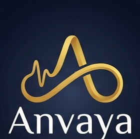
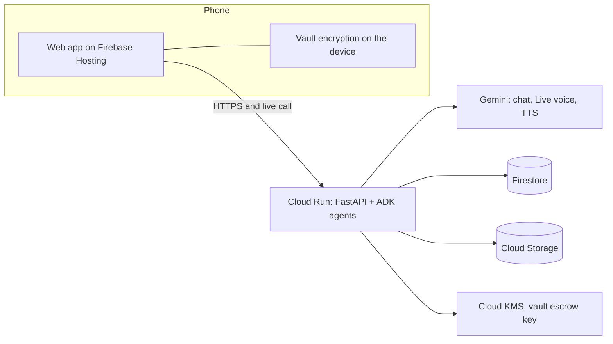

<p align="center">
  
</p>

<p align="center"><strong>Your stories, your wishes, and everything your family will need.</strong></p>

**When someone dies suddenly, their family can't find the money.** Anvaya is an app with a friendly AI companion, **Saathi**. People talk to Saathi about their stories, money matters, family and wishes while they are alive. When they pass away, everything is handed over safely to the right person.

Built for the **AI Builder Cup 2026** · Track: **BFSI** · Google Gemini + Google Cloud.

> All demo data is synthetic.

## Documents

| Document | What it covers |
| --- | --- |
| [Concept](docs/concept.md) | The idea in plain language (start here) |
| [Pitch: individuals](docs/pitch-individuals.md) | Why a person and their family would use Anvaya |
| [Pitch: banks and insurers](docs/pitch-institutions.md) | Why an institution would offer Anvaya to its customers |
| [Business model](docs/business-model.md) | Revenue, costs, margins and the assumptions behind them |
| [Architecture](docs/architecture.md) | How it's built, security, design decisions |
| [Use cases](docs/use-cases.md) | Who uses it, what they do, what the AI does |
| [Release notes](docs/release-notes.md) | What's in each version and known limitations |
| [Demo script](docs/demo-script.md) | A timed 3-minute demo with the lines to say to Saathi |
| [Libraries and services](docs/dependencies.md) | Every library, version and licence, and the Google services used, with the purpose of each |
| [Brand](docs/brand.md) | The name, taglines by country and language, and the companion's name in each language |
| [Proposal: agent governance](docs/proposals/agent-governance.md) | Agent identity, permissions, budgets and the admin portal (agreed, mostly built) |
| [Proposal: fraud foresight](docs/proposals/fraud-foresight.md) | Imagining and checking fraud before it happens, and learning from kept knowledge without reading it (agreed, partly built) |

## The problem

- **India:** ₹72,454 crore in unclaimed bank deposits (January 2026), plus ₹8,974 crore in unclaimed insurance (February 2026).
- **Japan:** a record ¥129.2 billion in estates went to the national treasury in financial year 2024 because no heir came forward.
- **South Korea:** more than ₩10 trillion in unclaimed insurance money (2026).
- **Malaysia:** RM13.3 billion in unclaimed money (April 2025).
- **Australia:** A$21.2 billion in lost and unclaimed superannuation (June 2026).
- **Singapore:** 2 in 5 CPF members lost before 65 had no nominee (2023).
- Most people never write down their accounts, policies, passwords or wishes.

Sources and dates are in [docs/concept.md](docs/concept.md#sources).

## How it works

1. **Talk to Saathi.** Tap the microphone and talk like a phone call, or type, or share a photo of a document. Saathi suggests cards to keep: stories, advice, wishes, accounts, family.
2. **Next steps.** Saathi shows what the family would still be missing, with a button for each step.
3. **Secure vault.** Passwords are encrypted on the phone. The owner chooses who receives them.
4. **Careful handover.** After a death, the AI pre-checks the certificate, two different reviewers confirm, and a waiting period lets the owner cancel.
5. **For the family.** The chosen person unlocks the vault on their phone, asks Saathi questions (answers only from what was recorded, with sources), and gets a claims checklist with draft letters.
6. **Guardian at every step** *(in progress)*. An independent layer watches every agent step for fraud and corrects course before anything takes effect (see below).

**AI-first:** every part is a loop the AI runs, with clear limits. Routine work runs on its own; anything saved or shared is only proposed until a person says yes; death and legal checks are only assisted, and people decide.

## Guardian layer (in progress)

Fraud can enter at any step of agentic execution, not only at the handover. The **guardian** watches every loop and course-corrects before an action takes effect. Design: [architecture.md §4.1](docs/architecture.md#41-guardian-layer-planned-for-the-prototype-release).

- **Observe:** every loop records an event before it acts: who, action, data without secrets, autonomy level, device.
- **Detect:**
  - fixed rules for hard facts;
  - Gemini detectors for pressure in conversations, probing questions, synthetic audio and prompt injection;
  - fraud reference guides for each document type and country, kept current by a research agent (Gemini reading web pages found with Exa search) and red-teamed by a dreaming agent that also produces a safeguard coverage map.
- **Intervene:** continue, add a check, reduce autonomy one level, pause for a reviewer, or block. Enforced where actions happen, independent of the agents, with no vault access.
- **Govern:** people review and can reverse every intervention. Interventions, false alarms and reviewer patterns are measured.

The guardian never approves or rejects a case; people decide.

## Governance layer and platform admin portal

One governance layer governs every agent: the **registry** ([agents/registry.yaml](agents/registry.yaml)), the **gateway** checks and usage **ledger**, the **guardian**'s interventions, the **kill switch**, platform **roles** and the **audit log**. Code: [agents/app/governance/](agents/app/governance/).

The **platform admin portal**, at https://anvaya-admin.web.app, is a separate site for the Anvaya governance team. It covers:
- spend against budget and forecast;
- the agent registry with use per agent, and blocked calls;
- budget approvals;
- guardian interventions (confirm or reverse);
- the fraud coverage map and reference guides;
- judges' demo copies;
- the audit log.

Roles are enforced on the server (platform admin, budget approver, risk reviewer, viewer) and set with the `PLATFORM_ROLES` secret. Anyone else who can sign in is a read-only viewer. The portal never shows conversation text or names. Spend (from Google Cloud billing), use and refused calls are always real. Everything else is real too: budget requests, guardian interventions, fraud scenarios and demo copies appear as those features record them.

Live today:
- every Gemini call names its agent: the conversation, extraction, documents, readiness, legal, certificate and settlement steps, the live call, spoken replies and the ADK handover agent;
- the registry, the kill switch and each person's daily allowance are checked before each call, and every call is recorded in the ledger;
- spend comes only from Google Cloud billing.

## Live now, and coming

What's built is recorded as numbered requirements (P0-1 to P0-11) in the completed [Prototype 0.1 milestone](https://github.com/sachiachar/anvaya/milestone/3?closed=1).

| Live now on https://anvaya-saathi.web.app | Coming in the prototype release (18 October) |
| --- | --- |
| Live voice conversation with Saathi (Gemini Live), typing, photos and documents | Opening the demo to every judge, clean-up of unused copies and a guided tour (PR-1.1, 1.7, 1.9) |
| Suggestion cards with Keep; merging and updates; next steps | Guardian layer: two real reviewers, owner alert with cancel, fraud reference guides, fixed checks and a reviewer trace (PR-2) |
| Vault encrypted on the phone; recipient invitation with key code | Claim file for each institution and a Bank view (PR-3) |
| Certificate pre-check by Gemini; two reviewers; waiting period; owner cancel | Accounts discovered and readiness checked at the source: simulated Account Aggregator flow and real statement upload (PR-11) |
| Family's assistant (ADK) reading what the owner kept, in any wording or language, with cited sources; claims checklist and draft letters | Only the owner can reach their conversation; sensitive details masked; retention and deletion (PR-6) |
| Sign-in with Google; access requests | Reminders when accounts go stale, export of the kept knowledge, readiness as link coverage (F-7) |
| Kept knowledge as an open-format (OKF) graph: Keep is the commit, items link to the people they name, Saathi asks gently about what's missing, and a live knowledge map (PR-7) | Fraud research that starts from common gaps in kept knowledge, counted but never read (fraud foresight, step 4) |
| Certificate of passing checked sign by sign against a fraud reference guide; "Dream now" and "Research now" in the admin portal, checked against web sources (PR-2.3, 2.5, 2.6) | The guardian core: every step recorded, set responses, enforced where actions happen (PR-2.7) |
| A private demo for each person who signs in, with switching between Vikram, Priya, two reviewers and the platform admin, checked on the server (PR-1) | AI quality measured on a synthetic test set (PR-8); live "inside the agents" panel (PR-9) |
| Agent gateway, limits per request, daily allowances, "ask for more" with approval, costs from Google Cloud billing, kill switch (PR-10) | Backstops and Model Armor (PR-10.5, 10.8) |
| Platform admin portal with real data only, on desktop and phone; each judge is the platform admin of their own demo copy (PR-12) | The guardian core (PR-2.7) |

## Prototype release plan

Tracked in the [Prototype release milestone](https://github.com/sachiachar/anvaya/milestone/1), due 18 October 2026. Issues are tiered against the judging criteria: **must-have** (the submission fails without it), **high-value** (highest score per day) and **trimmed** (kept at reduced scope).

| ID | Requirement | Tier | Issue |
| --- | --- | --- | --- |
| PR-1 | **Mostly built:** each judge gets a private demo and can switch between its people. Still to come: open sign-in, 30-day clean-up, guided tour | Must-have | [#1](https://github.com/sachiachar/anvaya/issues/1) |
| PR-5 | Submission package for the judges | Must-have | [#3](https://github.com/sachiachar/anvaya/issues/3) |
| PR-6 | Secure each owner's conversation (prototype: owner-only access, masking, retention) | Must-have | [#17](https://github.com/sachiachar/anvaya/issues/17) |
| PR-2 | Guardian layer: catch fraud at every agent step (PR-2.1 to PR-2.8, PR-2.10). Built so far: two different reviewers inside the demo (PR-2.1), the India certificate guide (PR-2.3), and dreaming and research checked against web sources (PR-2.5, 2.6) | High-value / trimmed | [#2](https://github.com/sachiachar/anvaya/issues/2) |
| PR-3 | Claim file for banks and insurers, with a Bank view | High-value | [#10](https://github.com/sachiachar/anvaya/issues/10) |
| PR-7 | **Built:** kept knowledge as an OKF graph; Keep is the commit; typed links; the family's assistant reads it; gaps drive the conversation; a live knowledge map | High-value | [#18](https://github.com/sachiachar/anvaya/issues/18) |
| PR-8 | Measure AI quality on a synthetic test set and publish the numbers | High-value | [#22](https://github.com/sachiachar/anvaya/issues/22) |
| PR-9 | Inside the agents: a live panel for judges | High-value | [#23](https://github.com/sachiachar/anvaya/issues/23) |
| PR-12 | **Built:** platform admin portal: governance dashboard, approvals, guardian and fraud operations, demo management; judges approve their own copy's requests | High-value | [#42](https://github.com/sachiachar/anvaya/issues/42) |
| PR-11 | Connect to financial institutions (Account Aggregator, statements) and check each account's readiness for handover | High-value | [#41](https://github.com/sachiachar/anvaya/issues/41) |
| PR-10 | **Mostly built:** agent governance: gateway, registry, limits, allowances, costs from billing ([proposal](docs/proposals/agent-governance.md)). Still to come: backstops, Model Armor | High-value | [#24](https://github.com/sachiachar/anvaya/issues/24) |

Moved to the [Grand finale milestone](https://github.com/sachiachar/anvaya/milestone/2) (4 December): real recordings (#11), signs of pressure (#14, #20), insider collusion (#16, #19), voice letters (#21), cloned-voice signals (#25), cooling-off delay (#26), per-tenant buckets and keys (#27), OKF export and coverage map (#28), and governance for a bank pilot (#29).

## Architecture



Details: [docs/architecture.md](docs/architecture.md).

## Repository layout

```
agents/                 Python service (Cloud Run)
  app/main.py           HTTP API and live-call WebSocket (all under /api)
  app/loops.py          Gemini steps for each loop, Saathi persona, reply checks
  app/live.py           Live voice calls (Gemini Live)
  app/proposals.py      Suggestion cards: merging, updates, family
  app/tasks.py          Next steps
  app/release.py        Vault release rules (two reviewers, waiting period)
  app/auth.py           Google sign-in and the email allowlist
  tests/                Automated tests (Gemini stubbed)
web/                    React installable web app (Firebase Hosting)
  src/Conversation.tsx  The owner's conversation with Saathi
  src/vaultCrypto.ts    On-device encryption and recovery codes
infra/deploy.sh         One-command Google Cloud deploy
docs/                   Concept, architecture, use cases, release notes
```

## Run locally

Needs Python 3.14, [uv](https://docs.astral.sh/uv/), Node 24 and a Gemini API key from [Google AI Studio](https://aistudio.google.com).

```bash
# 1. Agents API on :8080
cd agents
cp .env.example .env        # add GOOGLE_API_KEY, ALLOWED_EMAILS, FIREBASE_PROJECT_ID
uv sync
uv run --env-file .env uvicorn app.main:app --reload --port 8080

# 2. Web app on :5173
cd ../web
cp .env.example .env        # Firebase web config: firebase apps:sdkconfig web
npm install
npm run dev
```

Open http://localhost:5173, sign in with an allowed Google account, and switch people with the **Demo** button at the top right: **Vikram** (owner), **Priya** (family), **Anjali** and **Rahul** (our team). To run without sign-in locally, set `AUTH_REQUIRED=false` and leave `web/.env` out.

Tests (no cloud credentials needed):

```bash
cd agents && uv run --group dev pytest -q
```

## Deploy to Google Cloud

Needs `gcloud` and the Firebase CLI, with Firebase added to the project and Google sign-in enabled in Firebase Authentication.

```bash
PROJECT_ID=your-project ALLOWED_EMAILS="you@example.com,@yourteam.com" ./infra/deploy.sh
```

The app is live at **https://anvaya-saathi.web.app**; the old address, life-after-509907.web.app, redirects there. `firebase.json` names both Hosting sites, so a new project needs its own site IDs there.

This sets up the service account, Firestore, a private bucket, a KMS key and the Gemini key in Secret Manager; deploys the API to Cloud Run in `asia-southeast1` (Singapore); and deploys the web app to Firebase Hosting.

### Automatic deploys (GitHub Actions)

Every push to `main` deploys **what changed since each part last deployed** ([.github/workflows/deploy.yml](.github/workflows/deploy.yml)), so a release that GitHub cancelled because a newer merge arrived never loses changes:

| Changed since that part's last successful deploy | Deployed |
| --- | --- |
| `agents/**` | Tests, then the API to Cloud Run |
| `web/**`, `firebase.json`, `firestore.rules` | The web app to Firebase Hosting, and the Firestore rules |
| Docs only | Nothing |

**Who can use the demo** is kept in GitHub: *Settings → Environments → production → secret `ALLOWED_EMAILS`* (emails and/or `@domains`, comma-separated). Every API deploy applies it; to apply a change straight away, run **Actions → Deploy → Run workflow → allowlist**.

**Actions → Deploy → Run workflow → all** deploys everything. GitHub signs in to Google Cloud with Workload Identity Federation, so no keys are stored in GitHub. One-time setup: `PROJECT_ID=… REPO=owner/repo ./infra/setup-github-actions.sh`.

## Demo in three minutes

Full script with lines to say: [docs/demo-script.md](docs/demo-script.md).


1. **Vikram → Talk:** tap **Talk to Saathi** and talk about family, a first job, and an LIC policy ("make Ajay the nominee"). Tap **End call**: Saathi sums it up, everything is marked to save; tap **Save**. Open **Kept** to see the book and the pages still to write.
2. **Vikram → Family:** choose Priya and invite her. **Priya** (Demo menu): accept and keep the recovery code. **Vikram:** check the codes match, seal; **Vault:** lock a secret.
3. **Priya:** start the handover with a certificate. **Anjali**, then **Rahul**: two different reviewers confirm (going against a "not valid" check needs a written reason).
4. After the waiting period, **Priya** opens the vault, asks "What insurance did Papa have?", and prepares the claim letters. Optional: **Demo → Open the knowledge map** in a second window shows each item appear as it's kept.
