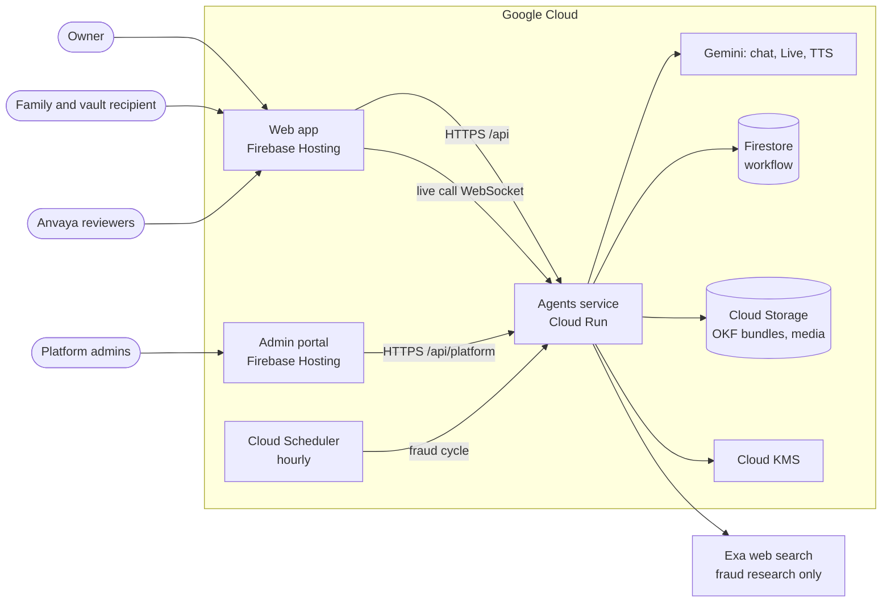
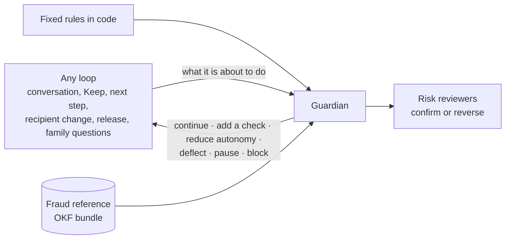
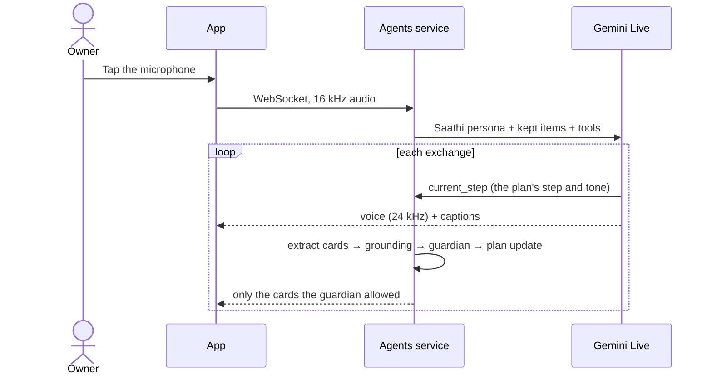
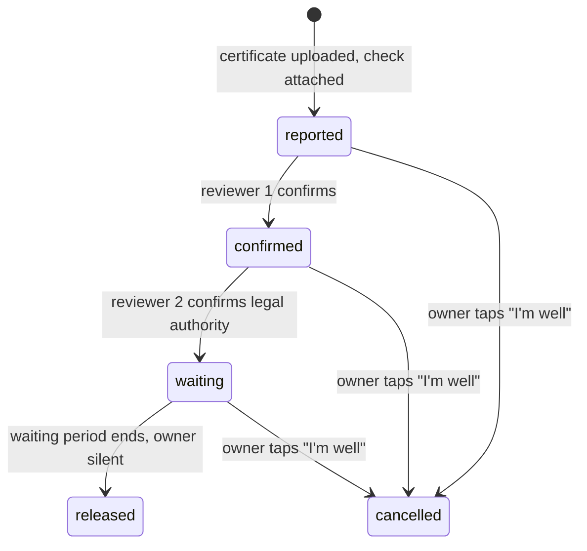
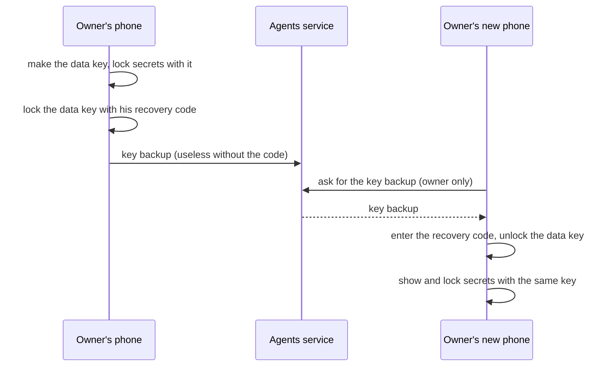

# Anvaya: Architecture

*Status: working prototype for the AI Builder Cup 2026 (BFSI track). Last updated 12 October 2026.*

Anvaya is a family succession service. People talk with **Saathi**, a warm companion built on Gemini. Saathi helps them record their stories, money matters, family, wishes and secrets. When the time comes, a verified handover gives the right people what they need. All demo data is synthetic.

## 1. Design principles

| Principle | What it means in the build |
| --- | --- |
| **AI-first loops** | Every feature is a loop with a declared autonomy level: Assist, Propose, or Act within limits. |
| **People decide** | The AI proposes. Nothing is kept without the owner's Keep. Nothing is released without two reviewers and a waiting period. |
| **Rules in code, not only in prompts** | A light model follows a prompt most of the time. Code checks make it always. Tests enforce each rule. |
| **The vault is unreadable to us** | Secrets are encrypted on the phone. No server part and no agent can open them. |
| **One guardian** | Every loop asks the guardian before an action takes effect. |
| **Governed and affordable** | Every model call passes one gateway: a registered agent, an allowed model, and budget left. |

**Not built, by choice:** voice cloning or speech "as the owner"; legal or financial advice (licensed partners give it).

## 2. System context

| Part | Stack |
| --- | --- |
| Web app | React 19, TypeScript, Vite. Installable, mobile first. Holds all vault cryptography (Web Crypto), the microphone and the playback. |
| Admin portal | A separate site for the platform team: agents, guardian, fraud, usage, model keys, audit. Charts and graphs use Apache ECharts. |
| Agents service | Python 3.14, FastAPI on Cloud Run. Runs the Gemini steps, the live-call relay, the Google ADK handover agent, the guardian and the gateway. |
| Models | Gemini through the Gemini API: `gemini-3.1-flash-lite` for most steps (with a fallback), `gemini-3.8-live` for voice calls, Gemini TTS for spoken replies. Each agent's models are set in `agents/registry.yaml`, never in an environment variable. |

## 3. Main components

| Component | Code | Role |
| --- | --- | --- |
| Saathi | `loops.py`, `live.py` | Typed chat, photos, documents and live voice. One persona everywhere. |
| Conversation planner | `planner.py` | The only source of what Saathi talks about. Each step has a tone and says who starts it. The owner's mood changes the plan, in code. |
| Grounding | `grounding.py` | Drops a card whose quote the owner didn't say, and clears any value with no support. |
| Cards and Keep | `proposals.py` | Suggestions become cards. Only the owner's Keep saves them. |
| Kept knowledge | `knowledge.py` | Each owner's knowledge as an open, portable bundle (OKF v0.2), with typed links between people, accounts and wishes. |
| Gaps | `gaps.py` | Fixed rules find what's missing (a nominee, a will, where papers are) and rank it by harm to the family. |
| Guardian | `governance/guardian.py`, `guardian_inputs.py` | Central control for every loop. See section 4.1. |
| Gateway | `governance/core.py` | Every model call: registered agent, allowed model and tools, budget, kill switch. |
| Certificate check | `loops.check_document` | Reads a certificate against the fraud reference guide, sign by sign. Assists reviewers only. |
| Release | `release.py`, `escrow.py` | Two reviewers, a waiting period and the owner's cancel; Cloud KMS for the outer key layer. |
| Handover assistant | `executor_agent.py` (Google ADK) | Answers the family from the kept bundle, with real sources. Only after release. |
| Fraud foresight | `fraud_pipeline.py`, `fraud_bundle.py` | Hourly research and "dreaming" that grow the fraud reference. See section 4.1. |
| Audit chain | `audit_chain.py` | Follows one conversation turn to its decisions, by ids only. |
| Step guard | `step_guard.py`, `step_types.py` | Never pursues a next step that could be part of a fraud: typed steps, flags worked out in code. |
| Next steps | `tasks.py` | The owner's list from the readiness loop: at most 5 open, merged, and never back once done or dismissed. |
| Knowledge map | `knowledge_map.py` | The kept knowledge as a graph for the demo. Read-only. |
| Spoken replies | `speech.py` | Gemini text-to-speech in Saathi's own voice. Never imitates anyone. |
| Own model key | `model_access.py`, `governance/keys.py` | A visitor's own Gemini key, used first for the calls they cause; the platform key is the failover. |
| Fraud guides | `fraud_guides.py`, `fraud_graph.py`, `fraud_cues.py` | The reference guides, their graph for the portal, and anonymous gap counts that seed dreaming. |
| Web search | `web_search.py` | Exa search for fraud research. Gemini only reads what came back. |
| Hourly fraud cycle | `scheduler.py` | Cloud Scheduler runs the fraud cycle once an hour; "Run now" runs the same job. |
| Spend | `governance/billing.py` | Dollar figures from the Cloud Billing export to BigQuery only. |

## 4. AI-first loops

The admin portal's Agents page draws every loop live, around the guardian. It is the system view:

*The Agents page in local development, with synthetic data. ACTS, PROPOSES and ASSISTS are autonomy levels. NO AI marks code and people. A hand marks a gate where a person must act.*

| Loop | Input → output | Autonomy | Person in control |
| --- | --- | --- | --- |
| Conversation and live call | Words, voice, photos → reply and cards | Act within limits | Cards wait for Keep |
| Curation | Cards → kept knowledge | Propose | The owner taps Keep |
| Readiness | Kept knowledge → score and up to 5 next steps | Act within limits | The owner acts or dismisses |
| Planning | Wishes → legal needs | Propose | Consent before anything reaches a legal partner |
| Certificate check | Document + fraud guide → verdict per warning sign | Assist | Two reviewers; going against "not valid" needs a reason |
| Handover | Family question → answer with sources | Act within limits | Only after release |
| Settlement | Accounts → checklist and draft letters | Propose | The family reviews and sends |
| Fraud foresight | Guide + safeguards → scenarios and new tactics | Propose | Only what 2 independent sites confirm joins on its own; a reviewer can remove it |

**Rules enforced in code** (each has tests):
- A reply uses the owner's script, never claims "saved", and never talks about the owner's own passing. A broken rule makes one rewrite.
- A card must match the owner's words. A value with no support stays empty.
- A next step that involves an OTP, a password or a PIN, or matches an approved fraud tactic, is never pursued.
- The certificate verdict has hard caps: the wrong document scores 0 %, the wrong person at most 30 %.
- Every Gemini call returns a typed schema (Pydantic). The app never parses free text.

### 4.1 The guardian

Fraud can enter at any loop, not only at the handover. So every loop asks the guardian first.

- **Decisions:** fixed rules and the fraud reference give a risk level. A policy file (`agents/guardian.yaml`) maps it to one response. Code sets a floor: the file can make a response stricter, never weaker.
- **The owner's conversation:** everything new the owner says is screened before any card exists. A secret passed on, or a payment someone else asked for, is deflected. The planner then adds a safe-route step. Words aimed at Saathi are blocked.
- **Another voice:** Saathi notices a second voice on a call and asks, warmly, who is there. No audio and no voiceprint are stored.
- **The family:** questions are checked lightly, so the family can get what was kept. Only a vault secret and words aimed at the assistant are stopped. A fee request gets a gentle note and a quiet look from the team.
- **Held actions:** a paused recipient change or release waits on the server until a reviewer decides.
- **No access to secrets:** the guardian never reads the vault, the escrow or media. A test checks this.

**The fraud reference grows every hour.** A research agent (Gemini with Exa search) and a dreaming agent (red-teaming our safeguards) run in Cloud Scheduler.
- What 2 independent websites confirm joins the guide on its own, add-only. One source makes a draft for a reviewer.
- A new warning sign always waits for a reviewer, because it reaches every certificate check.
- The same fraud is never added twice, even when it is worded differently.
- Two removals in a week pause adding for that guide.
- The reference is an OKF bundle with a history of every change. The portal shows it as a connected graph.

## 5. Data and storage

| Store | Holds | Why |
| --- | --- | --- |
| **Cloud Storage: owner bundle** (OKF v0.2) | Each owner's kept knowledge: one Markdown file per item, typed links, a history per change | Open and portable. Keep is the commit, so only owner-confirmed knowledge enters. |
| **Cloud Storage: platform fraud bundle** (OKF v0.2) | Fraud guides, scenarios, drafts and reviewer decisions | Open format with a history per item. Holds no owner data. |
| **Firestore** | Workflow only: pending cards, cases, guardian records, plans, next steps, run logs | Needs fast atomic updates. Never holds kept knowledge or fraud knowledge. |
| **Vault** | Ciphertext only | The phone encrypts. See section 6. |

- Both bundles use conditional writes, so two saves at once never lose a change.
- Identifiers keep only their last 4 characters.
- Fixed-code readers (the gap check, anonymous fraud cues) read only an item's type and links, never its text.

## 6. Security and privacy

| Threat | Mitigation |
| --- | --- |
| A database leak exposes secrets | The vault is ciphertext. The owner's phone seals its key for one approved recipient. |
| An insider or the AI reads the vault | No server part can open the inner layer. No agent has a vault tool. |
| Someone makes themselves the recipient | The owner invites. Both phones show a key code, worked out from the key itself, and the owner confirms it. |
| A false report that someone is no longer here | The certificate check flags warning signs; two different reviewers; a reason to go against "not valid"; a waiting period; the owner can cancel. |
| A lost phone | The owner's key and the recipient's key are each backed up under that person's 125-bit recovery code, which Anvaya never sees. |
| A second owner key, made by mistake | The app makes an owner key only when none exists on the device, in the cloud, or behind locked secrets or a seal. |
| One visitor reaching another's demo | Each Google account gets its own copy, chosen from the verified sign-in. Any other copy's data answers 404. |
| Someone acting outside their role | The server checks the acting person on every action. One reviewer can't confirm both steps. |
| Personal data in the admin portal or logs | Users appear only as hashed keys. No conversation text or names. |
| A person's own model key leaking | Encrypted with its own KMS key, bound to its owner, never returned or logged. |
| Deploys from the wrong place | Workload Identity Federation lets only the deploy workflow on `main` deploy. The deployer has no broad roles. |

## 7. Key flows

**Live call**

**Release**

On release, Cloud KMS removes the outer layer. The recipient's phone decrypts the vault locally.

**Vault keys**

- The device keeps a copy of the key while in use. "Forget the key on this phone" removes it, and the code brings it back.
- The owner's key backup never goes to the recipient, the release bundle or the admin portal. Tests check this.
- If the owner loses his code and every device, he can't open his secrets any more. A sealed vault still opens for the recipient after release.

## 8. Governance and cost control

- **Registry and policies.** 15 agents are registered in `agents/registry.yaml`. Each has one policy in `agents/policies.yaml`: autonomy, allowed models and tools, and limits. A broken file stops the service at start-up.
- **The gateway denies by default.** An unregistered agent, or a model or tool its policy doesn't list, is refused and recorded.
  - The ADK handover agent is checked at three points: before each model call (`gateway_check`), for each model the fallback chain tries (`KeyedGemini`), and before each tool (`tool_check`).
- **Budgets.** Each person has a daily allowance. The whole service has a daily ceiling. Optional agents stop first. Safety checks (certificate checks, the guardian) never stop.
- **Own model key.** A visitor may add their own Gemini key. Their calls use it first. The platform key is only the failover.
- **Visibility.** The portal shows each agent's use, live status and recent steps, the guardian's events and the audit chain. It never shows conversation text.
- **Kill switch.** A platform admin can stop all agents at once.

## 9. Quality and testing

- **749 automated tests** (`agents/tests/`) run in about 15 seconds, with no cloud and a stubbed Gemini.
- Tests enforce the rules above. Some examples:
  - every Gemini call goes through the gateway;
  - the guardian never imports the vault;
  - two demo copies never reach each other;
  - the portal never returns conversation text;
  - the release keeps two reviewers and the waiting period.
- **CI** runs the linters (ruff, Biome), the tests and the web build on every pull request.
- **Supply chain.** Every dependency is the latest stable release, with a permissive licence. A test checks the inventory and the licences.
- **Checked by hand:** the vault and recovery round trip, live calls, and real Gemini runs.

## 10. Design decisions

| Decision | Choice | Why |
| --- | --- | --- |
| Capture | Hands-free live call (Gemini Live) | A live call is how people really talk. |
| Suggestions as cards | The AI proposes, the owner keeps | AI-first, but nothing is saved without consent. |
| Knowledge format | OKF bundles in Cloud Storage | Open, portable, versioned; no lock-in. |
| Vault cryptography | On the phone, sealed for one person, plus KMS | Anvaya and the AI can never read secrets. |
| Models | Flash-Lite for most steps, with fallbacks | Low cost per family, resilient to overload. |
| Gemini API, not Vertex AI (for now) | The same model names locally and in Cloud Run | On Vertex AI, the Live and TTS models aren't served in every region yet. |
| Store abstraction | Memory, file or Firestore behind one interface | Tests run without the cloud. |

## 11. Known gaps and roadmap

**Before real users:**
- In the demo, one person plays every role in their own copy. Production needs separate sign-in for each person, and passkey-backed keys.
- The API can both encrypt and decrypt with KMS. Decrypting should move to a separate release service.
- The owner is alerted only inside the app. Push, SMS and email are next.
- A live call ends after about 15 minutes (Gemini Live limit). A spoken reply is checked only after it is said.

**Next:** a real legal-partner integration · a bank's claim file and view · accounts discovered and checked at the source · session resumption for long calls · an evaluation set in CI · a pilot with a bank or insurer.
