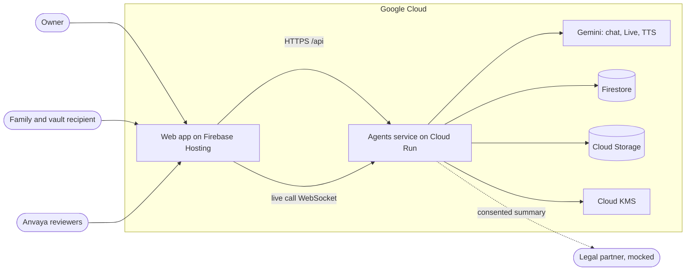
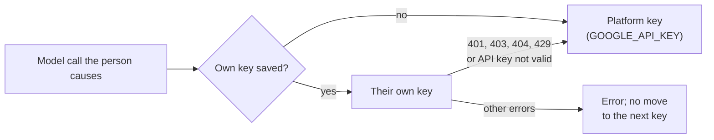
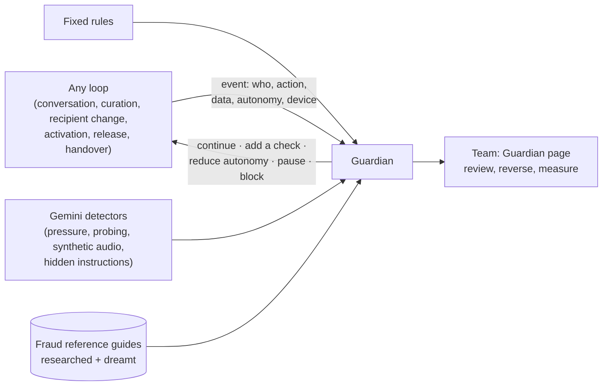
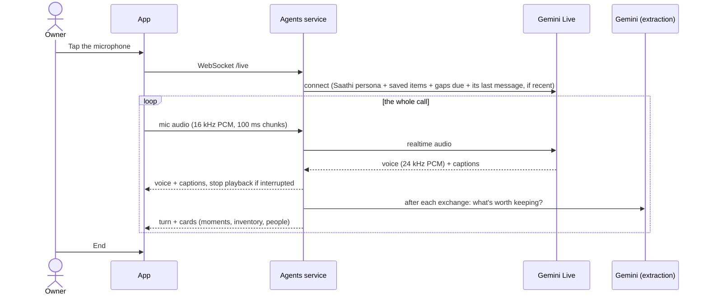
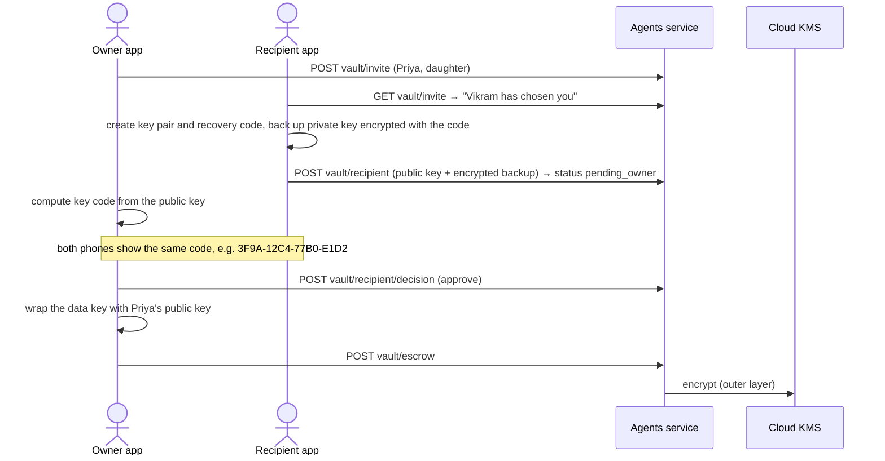
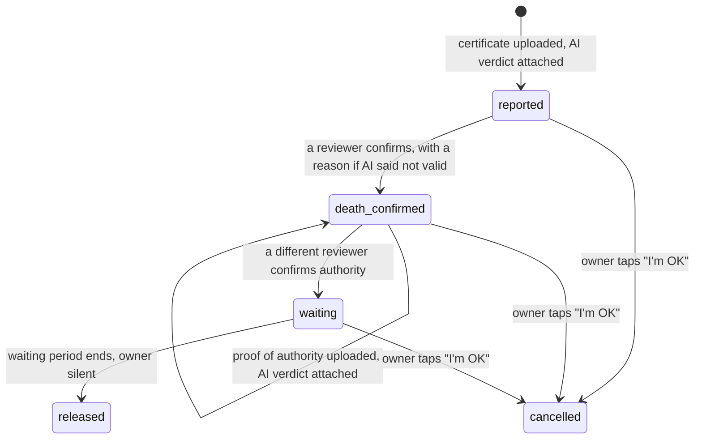

# Anvaya: Architecture

*Status: working prototype for the AI Builder Cup 2026 (BFSI track). Last updated 28 September 2026.*

Anvaya is an app-based service. People talk with Saathi, an AI companion. They record their stories, financial inventory, family, wishes and secrets while they are alive. After a death is verified, the right people receive them. For the plain-language version, see [concept.md](concept.md).

## 1. Goals and non-goals

**Goals**

- Run every part of the product as an **AI-first loop**. Each loop has an explicit autonomy level: Assist, Propose, or Act within limits.
- Keep a person in control of every step that can't be undone: saving to the archive, sharing with a legal partner, choosing the vault recipient, confirming a death, releasing the vault.
- Make the vault unreadable to the AI and to Anvaya itself.
- Make capture as easy as a conversation: hands-free live voice, plus typing, photos and documents.
- Run entirely on **Google Cloud** with **Gemini**.

**Non-goals**

- Voice cloning, avatars or generated speech "as the owner". We will never build these.
- Legal or financial advice. Licensed partners give it.
- Per-role permissions and multi-tenant access control. Only sign-in with an email allowlist is built; see section 8.

## 2. System context

- The **web app** is an installable, mobile-first React app. It holds all vault cryptography, the microphone capture and the audio playback.
- The **agents service** is a Python FastAPI app on Cloud Run. It runs the Gemini steps, the live-call relay, the ADK handover agent, and the rules that keep people in control.
- Firebase Hosting rewrites `/api/**` to Cloud Run.
  - Its CDN keeps any answer that doesn't say otherwise. For example, it keeps a 404 for 10 minutes. A poll then keeps seeing an old answer. So every API answer says `Cache-Control: no-store`.
  - Firebase Hosting can't proxy WebSockets. So in production the live call connects **directly to the Cloud Run URL** (`VITE_LIVE_URL`, set by `infra/deploy.sh`).

## 3. Components

### 3.1 Web app (`web/`)

| File | Responsibility |
| --- | --- |
| `index.html`, `src/v2/main.tsx`, `src/v2/App.tsx` | The app. Its screens are in `src/v2/`. It has sign-in, the owner's tabs (Talk, Kept, Family, Vault), the family and reviewer screens, the "I'm well, cancel this" alert, and the Demo drawer. The Demo drawer has: whose screen to show, "Show how Saathi works" (the readiness score), the nickname, Reset my demo, the knowledge map, and "Simulate a lost or new phone" when acting as Priya |
| `src/v2/v2.css`, `icons.tsx`, `copy.ts`, `FilePick.tsx` | Brand tokens (navy, gold, mist; daylight and dark), self-hosted fonts, line icons and the thread mark, customer wording and plain error messages, and the file picker |
| `src/v2/owner/Talk.tsx`, `Transcript.tsx`, `Review.tsx`, `items.ts` | Talk: one screen from hello to saved. It shows a suggested topic and a microphone that goes live in place. The microphone has rings that move with whoever is speaking (`liveCall.ts` reports how loud each side is). During a call, the conversation shows underneath in its own scrolling box. Typing and photos are in the same place. At the end, a short summary shows everything Saathi picked up, marked to save. The owner can Remove what isn't wanted, use one Save for the rest, Decide later, or Discard the conversation |
| `src/v2/owner/Book.tsx` | Kept: the book of the owner's life. It has chapters (stories and advice, money matters, wishes, people), Remove with a confirmation, and the wish and legal-document tools. Instead of a score, it shows "pages still to write" from gaps and next steps. Next steps are worked out only on request |
| `src/v2/owner/FamilyTab.tsx`, `VaultTab.tsx` | Who receives the vault (invite, they accept, the codes match, seal), and access requests. Whether the vault is sealed and for whom. Locking new secrets on the phone: the tab shows each secret's name only, never its locked text |
| `src/v2/family/` | The family side, one stage at a time (`Journey.tsx`): accept the vault (a key made on the phone and a recovery code), match the code, restore on a new phone, "When the time comes", and Start the handover. `Tracker.tsx`: the handover tracker, with the waiting countdown and the proof-of-authority upload. `After.tsx`, after release: the vault opened on the phone, Ask about the owner with sources, and the claims checklist with draft letters |
| `src/v2/team/Team.tsx` | Our team's review. It shows each check sign by sign. Each of the two steps has its own Confirm, by different reviewers; the server enforces this. To go against a "not valid" check, the reviewer writes a reason in the page. It also shows the audit log, and access requests after a passing |
| `src/v2/KnowledgeMap.tsx` | The demo's knowledge map. It opens from the Demo drawer in its own window (`/#knowledge-map`). It shows the owner's kept knowledge as a live graph. Remove is confirmed in the page |
| `src/liveCall.ts` | Live call client. It sends microphone audio as 16 kHz PCM over WebSocket and plays 24 kHz PCM. It stops playback when interrupted. It also has mute and reports how loud each side is |
| `public/pcm-recorder.js` | AudioWorklet that turns microphone audio into 100 ms PCM chunks |
| `src/vaultCrypto.ts` | All vault cryptography (Web Crypto): data key, recipient key pair, recovery-code backup (PBKDF2), key fingerprint |
| `src/api.ts`, `src/ui.tsx`, `src/ErrorBoundary.tsx` | Typed API client. `useAction`: a busy flag and an error message for one action. The crash screen with Reload, shared with the admin portal |
| `public/fonts/` | Lora, Inter and Mukta (Devanagari) as woff2, each with its `OFL.txt`. The app loads them; the admin portal doesn't |

### 3.2 Agents service (`agents/app/`)

| Module | Responsibility |
| --- | --- |
| `main.py` | HTTP routes under `/api`, the live-call WebSocket, access gating, and readable errors for Gemini failures |
| `gaps.py` | Gaps and conflicts drive the conversation (PR-7.10). **What it finds:** fixed rules find what's missing in kept knowledge. This is an account or policy with no nominee; a wish that gives an account to someone other than its nominee; property that nobody is named to receive; a person with no relationship; or property or insurance with no record of where its papers are. It also finds what families most often can't find: a will, loans and debts, who to call first, and email and online accounts. Each of these stays a gap until anything kept mentions it, even "there's no will", in English or Hindi. **Checking again:** something kept with doubt (`unsure`, "I think it's Meena") comes back for a check after two weeks. A nominee, papers or the will come back once a year (`stale_after`, PR-7.6). Each comes back until the owner says it's right or keeps a new version. **Raising a gap:** gaps are ranked by harm. Saathi gets the top two that are due (`open_gaps`, `due`). It raises at most one, when the moment fits. Code records which gap Saathi asked and how the owner answered (`gap_asks`: keys, times and outcomes, no words). **Reminders:** a gap asked before comes back only as a gentle reminder. The wait depends on its harm and grows each time: high 3, 7, 14, 14 days; medium 7, 14, 30; low 14, 30. "Not now" doubles the wait. "I'd rather not say" triples it. A gap never comes twice in one conversation. Saathi gives at most one reminder at a time, and none while a waiting card answers the gap. After the last reminder, Saathi stops raising the gap, but it stays in Kept as a page to write. The owner can skip any gap; then it's never raised again |
| `fraud_guides.py` | Fraud reference guides (PR-2.3). For each document and country, a guide says what a genuine document looks like and how forgeries are made. Every item carries a knowledge label (observed, derived, simulated, validated, invalidated). Every version is kept in Firestore. If none is saved or Firestore is down, a copy built into the code is used. Only checked knowledge reaches the certificate check. Design: `docs/proposals/fraud-foresight.md` |
| `fraud_pipeline.py` | Fraud foresight pipeline (PR-2.5, PR-2.6). `fraud.dreamer` imagines attack scenarios against our safeguards. It uses the guide's checked tactics, the fixed list of safeguards and recent guardian events. `fraud.researcher` checks each scenario against web pages found with Exa (`web_search.py`). Each scenario is mapped to the safeguard that catches it, or marked a gap. "Confirmed" needs a cited page whose quoted sentence really appears in that page and supports the claim (`judge`). Confirmed scenarios and researched tactics wait for a reviewer. Unconfirmed ones fade after 3 runs. Only one run goes at a time. A run has a cap on model calls per agent, a Stop button, and a live log of each step for the portal |
| `fraud_cues.py` | Anonymous starting points for dreaming, from kept knowledge (fraud-foresight §5). Fixed code reads only each owner's graph part (`knowledge.graph_parts`: types, links, which fields are present). It matches a closed list of patterns aligned with the gap check (`policy.nominee_missing`, `property.heir_missing`…) and counts owners. It drops counts under the minimum. The minimum is a platform admin's setting on the portal's Fraud page (audited, default 5). The admin can raise it but never set it below the privacy floor of 5. The dreamer gets only pattern, asset class and count, never a bundle. Twelve clearly labelled synthetic owners let the demo reach the minimum |
| `knowledge.remove` | The owner removes something wrongly recorded, with Remove on a page of the book in Kept or on the knowledge map. The item and every earlier version are deleted from the bundle, with their history files. Other items' links are worked out again. The log keeps one line with no title or content ("An item was removed by the owner"). Owner only. Removal is refused while a release case is open, and for the vault recipient. These are not deleted: the recordings and documents the item came from, and the conversation history |
| `proposals.lookalike` | Some new story or wish cards don't match a kept item by title or quote, but have the same kind, and the same people or a close title or summary. Such a card carries `looks_like`. The card asks the owner to Replace it or Keep both. Replace keeps the card as that item's next version (`replace: true` on the decision). The owner decides. `looks_like` never enters the bundle, and card edits can't set it |
| `knowledge_map.py` | The knowledge map for the demo. It shows the owner's kept knowledge as a graph: the owner, kept concepts, institutions, and people a story mentions who aren't kept yet. Once the concepts' typed links (PR-7.9) exist, the map uses them. Until then, it uses the links the cards imply, marked `derived`: people a story or wish names (by name, or by relationship such as "my wife"); accounts and banks it names; a policy's nominee, holder and institution; and each person's relationship to the owner, or to the kept person they're related through ("wife of brother-in-law", "Bhaskar's son"). Gaps: an account or policy with no nominee. Owner only, read-only. The web app shows it at `/#knowledge-map` like Obsidian's graph view, in the brand's colours. It uses a small force layout with zoom, pan and drag, and no graph library. It refreshes every 2 seconds |
| `loops.py` | One Gemini step per loop. **What Saathi remembers:** only what the owner kept (and cards waiting for Keep), the gaps that are due, and its own last message while it's the same conversation (`last_said`, 30 minutes). The last message lets a short answer still make sense. No earlier conversation is sent to Gemini, in typed chat or at the start of a call. So what the owner discarded or never kept can't steer Saathi. The module also holds the shared **Saathi persona**, the live-call instructions, and `reply_problems`. `reply_problems` checks every typed reply for wrong language or script, false "saved" claims and "shall I add" questions. If needed, it rewrites the reply once |
| `live.py` | Live-call relay between the browser and the Gemini Live API. It makes captions, saves each exchange and extracts cards |
| `speech.py` | Natural voice for typed replies (Gemini TTS). It falls back through a list of TTS models, each with its own quota |
| `proposals.py` | Turns AI suggestions into cards. It merges repeats and turns follow-up details into updates, without losing earlier facts. It creates family cards and applies Keep |
| `grounding.py` | Checks every card against what was said, before it's saved (chat, voice notes and live calls). A card whose quote isn't in the owner's words from this turn is dropped. A value with no support is cleared, so it stays a gap: where papers are, the nominee, who it's for, the last 4 digits, places and new people's names. Support is the owner's words, Saathi's last message (so a "yes" confirms it) and what is kept. For a shared document, its account details and nominee come from the document. A value in another script than the owner's words is kept, because it can't be matched word by word. The log holds counts only, never words |
| `tasks.py` | Next steps from the readiness loop. It rewrites the open list and merges near-duplicates. It never re-adds done or dismissed steps. At most 5 steps are open. Every step passes `step_guard` before it's stored, and again on every read |
| `step_guard.py` | Never pursue a next step that could be part of a fraud (PR-13.3, `docs/proposals/listening.md` §6). Each step is typed from closed lists (`step_types.py`: type, channel, flags). Code also works out flags from the step's words (payment, secret, started by someone else, deadline). So the check never depends on a model setting them. The checks run in this order. (1) An unknown type, channel or flag means no. (2) A secret (OTP, password, PIN, plurals included; not a postal "PIN code") means no. The one exception: adding it to the owner's own vault in the app, when the step doesn't also say to share it. (3) A step that matches an approved tactic's `exploits` tags means no (`fraud_guides.Exploits`, checked against the same lists so a typo is refused; observed, derived or validated tactics only). If the guides can't be read, nothing is pursued, and the stored list stays as it is. A dropped step leaves a count in `steps_not_pursued` (rule, hashed copy key, time; no words or names). The portal's overview shows it. Saathi's instructions say to point to the safer way and never name a fraud |
| `executor_agent.py` | Google ADK agent for the handover (the handover assistant). It reads the owner's kept-knowledge bundle (PR-7.5). While the bundle is small, the whole bundle goes in its instructions. Otherwise it gets `index.md` and the tools `read_bundle_index`, `read_concept` and `list_accounts`. It has a fallback model |
| `release.py` | Vault release state machine: two-person rule, override reasons, waiting period, owner cancel |
| `escrow.py` | Cloud KMS wrap and unwrap of the vault key blob |
| `gemini.py` | Shared Gemini client with retries and backoff. `generate_json` uses Pydantic schemas. It uses the agent's primary model from the registry, then the agent's own fallback. An agent without one reports the model as busy |
| `web_search.py` | Web search for the fraud researcher, with Exa (exa.ai). Our code searches. Gemini answers only from the returned pages and must quote them word for word. A source counts only if its quote is really in the page. Only agents whose policy grants `web_search` may search. Queries carry fraud research only, never owner data |
| `schemas.py` | Pydantic models used as Gemini `response_schema` and as the API contract |
| `store.py` | Document store: `memory` (tests), `file` (local demo, survives restarts), `firestore` (Google Cloud). Its calls block. So the live call, the Talk route and sign-in run them in worker threads (`asyncio.to_thread`). Saving cards holds the owner's `proposals.saving` lock, so two saves at once can't make the same card |
| `media.py`, `config.py` | Original media (Cloud Storage or local folder); settings from the environment |

### 3.3 Models (set per agent in `agents/registry.yaml`, allowed in `agents/policies.yaml`)

Each agent's models, in the order it tries them, are in the registry; its policy lists the models it may use. Neither comes from an environment variable, so changing a model is a reviewed change to those files (PR-10.11).

| Use | Default | Why |
| --- | --- | --- |
| Chat, extraction, reasoning | `gemini-3.1-flash-lite` | Cheapest model that is served and fast (~2–3 s) |
| Fallback when overloaded | `gemini-3.5-flash-lite` | Separate capacity; used after retries on 429/5xx |
| Live voice call | `gemini-3.8-live` | Two-way audio, ~1.3 s response, can be interrupted |
| Spoken replies (TTS) | `gemini-3.8-flash-lite-tts`, then `gemini-3.8-flash-tts`, then `gemini-3.1-flash-tts-preview` | Each has its own quota; tried in order |
| Voice | `Sulafat` (`GEMINI_TTS_VOICE`) | A warm voice, used for both TTS and live calls |

**Your own model key (PR-10.10, `governance/keys.py`).** Anyone who signs in may add their own Gemini key. This is optional. It can be a Google AI Studio key (free or paid) or a Vertex AI express-mode key.

- Every model call that a person causes goes down a chain of keys, whatever the agent: Saathi, the live call, spoken replies, handover, safety checks, and fraud runs they start.
- Their own key comes first. The platform key (`GOOGLE_API_KEY`) is used only as failover.
- A call moves to the next key on 401, 403, 404, 429 or "API key not valid". Other errors don't move on.
- Someone without a key uses the platform key, as before.
- A fraud run stores who started it. So every step uses their key, even after the request has finished.
- The handover assistant's ADK models (`KeyedGemini`) choose the client on each call. So the one shared Runner serves everyone with their own key.
- A key is tested before it's saved (`access.tester`). The test makes one tiny call per model, on that key alone. A person can run at most 10 tests a minute.
- The ledger records which key answered (`key_sources`, and per person in `key_usage`). Calls on a person's own key don't count against their daily allowance. The registry, limits and kill switch still apply.
- The portal's **Model keys** page reports whose key answered and each person's key status. A platform admin can turn the feature off or limit the kinds of key, for everyone or for one person. The admin can also test a saved key again, or remove it.

## 4. AI-first loops

| Loop | Code | Input → output | Autonomy | Human checkpoint |
| --- | --- | --- | --- | --- |
| Conversation (typed, photo, document) | `loops.converse` | Message or file → reply + moments, inventory, people | Act within limits | Cards start as `pending` |
| Live call | `live.call` + `loops.extract_from_exchange` | Streaming audio → spoken reply + captions; after each exchange → cards | Act within limits | Cards start as `pending` |
| Curation | `proposals.save_*`, `proposals.approve` | Cards → merged or updated archive items | Propose | Owner taps Keep |
| Readiness → next steps | `loops.assess_readiness` + `tasks.refresh` | Archive, vault state, closed steps → score + up to 5 actionable steps | Act within limits | Owner acts, marks done or dismisses |
| Planning | `loops.find_legal_needs` | Wishes + inventory → legal needs | Propose | Owner consent before `legal-handoff` |
| Activation | `loops.check_document` + `loops.review_summary` | Certificate or proof image, with the fraud reference guide → verdict, likelihood genuine and a result for each warning sign | Assist | Two reviewers; override needs a reason |
| Handover | `executor_agent.ask` (ADK) | Question → answer with cited sources | Act within limits | Only after release |
| Settlement | `loops.plan_settlement` | Inventory → checklist + draft letters | Propose | Executor reviews and sends |
| Fraud foresight | `fraud_pipeline.dream` + `fraud_pipeline.research` | Guide, safeguards, guardian events → scenarios with sources and the safeguard that catches each; new tactics with sources | Propose | A risk reviewer approves before anything joins a guide; only source-confirmed items can be approved |

**Rules enforced in code, not just in prompts**

- *Replies* (`loops.reply_problems`):
  - A reply uses the script of the owner's latest message.
  - It never claims "noted" or "saved". It never asks "shall I add".
  - It never talks about the owner's own death ("final wishes", "after you're gone"; `tone.py`).
  - A reply that breaks a rule is regenerated once, with the broken rule named.
  - Live audio can't be regenerated. So for live calls, the rules are in the instructions only.
- *Next steps* (`tone.step_problems`): the owner is alive. So a step's title, reason and question use no death words at all. The readiness planner writes such a step again once, then leaves it out. Such steps saved earlier are hidden when the list is read.
- *Cards* (`proposals`): a repeat of a kept item adds nothing. A follow-up detail becomes an update card. It **combines** with the saved summary instead of replacing it. The same institution and last 4 digits update the same card.
- *Documents* (`loops.review_summary`):
  - The wrong document type scores 0 %. The wrong person is capped at 30 %.
  - A warning sign that our team has reviewed, if found, caps the score at 50 %.
  - Any concern or any warning sign found means "Needs a closer look".
  - Every sign in the guide gets a result (found, ruled out or can't tell). Signs the model invents are dropped.
  - Imagined (`simulated`) signs never reach the check. Projections are at most a third of its signs.
- *Next steps* (`tasks`): near-duplicates are merged, except when they name different institutions (LIC vs SBI). Done or dismissed steps never come back, even reworded. At most 5 steps are open.
- *Structured output*: every Gemini call returns a Pydantic schema. So the app never parses free text.

**One companion everywhere.** `loops.persona` defines Saathi once. Saathi is warm and addresses the owner as "{first name} ji". It matches their language and is honest about what is saved. It gives no legal advice, and it asks who unknown people are. Both the typed chat and the live call use it.

### 4.1 Guardian layer (partly built: fraud guide, dreaming and research; the core is planned)

Fraud can enter at any loop, not only at activation. So a **guardian** watches every loop. It changes the course of a loop before an action takes effect. It is tracked as PR-2 ([#2](https://github.com/sachiachar/anvaya/issues/2)).

| Part | What it does |
| --- | --- |
| **Event record** | Every loop records what it is about to do, before it takes effect: who, action, data without secrets, autonomy level, device. |
| **Detectors** | Fixed rules for hard facts. For example: the owner was active recently, a recipient change came from a new device, or a certificate was used before. Gemini detectors for softer signals: pressure in a conversation, probing questions, synthetic or replayed audio, hidden instructions in documents. Fraud reference guides for each document type and country. A research agent (Gemini with Google Search) keeps them current, and a dreaming agent red-teams them. |
| **Responses** | Continue; add a check (key code, liveness phrase, delay); reduce autonomy one level (Act within limits → Propose → a person decides); pause for a reviewer and alert the owner; block. A readable policy file maps risk to response. |
| **Enforcement** | Saving, recipient changes, release and the handover assistant ask the guardian first and obey it. The guardian runs with its own permissions. Agents can't bypass it. It has no vault access. |
| **Governance** | A Guardian page shows every intervention with its reason. People confirm or reverse each one, and the decision is logged. The page also shows false-alarm rates, reviewer pattern analytics, and the dreaming agent's safeguard coverage map. |

**How it's built** (`agents/app/governance/`, one layer shared by the gateway, the guardian and the portal):
- `core.py`: the registry and policies, roles and permissions, the audit log, the gateway's `check_call` (registry, policy, kill switch, the service's daily ceiling and the person's allowance), `record_usage` (daily ledger with calls, tokens and minutes; never dollars), `record_blocked` and `record_intervention`;
- `billing.py`: actual spend from the Cloud Billing export to BigQuery (PR-10.9). This is the only source of dollar figures. It's cached for an hour and covers up to yesterday. The portal says "not available yet" rather than estimating;
- `portal.py`: the platform admin portal API under `/api/platform` (PR-12), with roles checked on the server;
- `files.py`: strict schemas for the two files, and the checks between them (PR-10.11).
  - `agents/registry.yaml` says what each agent is: its purpose, status, kind and the models it tries in order. It also lists every model and tool.
  - `agents/policies.yaml` says what each agent may do: its autonomy, allowed models and thinking level, tools with their scope, limits per call and per run, and its per-person budget pool. It also holds the daily allowances and the service's daily ceiling.
  - **The service's daily ceiling** (PR-15.1, `service_ceiling`): 10 million tokens and 300 voice minutes a day, for all demo copies together. It counts only what our key spends. Calls on a person's own key don't count. As it fills, the gateway refuses optional agents (live voice, spoken replies, summaries) from 80%, and every other agent from 90%. The last 10% is the safety reserve. Safety-critical agents (certificate checks, the guardian) are never refused, even past 100%, because a handover must never wait on the budget. A live call also ends when the service's voice minutes run out. Each refusal is recorded as a blocked call of kind `ceiling`. The portal overview shows today's use. A Google Cloud budget alert (`infra/budget-alert.sh`, run by a person) backs this up by email.
  - The gateway denies by default. It refuses and records an agent with no policy, an agent that isn't active, and a model or tool that the policy doesn't list.
  - The gateway reads the validated files, never the raw YAML. A broken file stops the API at start-up.
  - Still planned: a daily cap per agent, who may start each agent, guardrails, one decision point for the AI and tool gateways, and the decision log ([agent-security.md](proposals/agent-security.md));
- `seed.py`: nothing is seeded; the portal shows only real data. On the first portal request after a release, it removes any examples that earlier versions seeded. It keeps real data and the kill switch.

The portal is a separate entry point (`web/admin.html`). Its own Firebase Hosting site, `anvaya-admin`, serves it.

**Rules for the guardian:**
- It never approves or rejects a case; people decide.
- Hard rules are fixed rules, never the model's judgment.
- Unconfirmed scenarios can only raise "needs attention".
- Interventions are explained and feel like care, not accusation.
- Voice alone never authorises an important action, because cloned voices can't be reliably detected.

## 5. Data model

| Collection | Key fields | Notes |
| --- | --- | --- |
| `owners` | name, age, city, country, `family[]`, `language`, `readiness_score`, `vault_invite`, `vault_recipient` (name, relationship, public_key_jwk, key_backup, **status**), `vault_escrow` | The family list only grows when the owner keeps family cards |
| `turns` | role (owner or assistant), text, heard, attachment, language, proposals {moments, inventory, people} | The conversation, from typed and live turns |
| `moments` | kind, title, summary, quote, people, places, year, status, `updates?` | `updates` points to the kept moment an update card changes |
| `inventory` | category, institution, product, account_hint (last 4), nominee, missing_fields, status, `updates?` | Merged by institution and last 4 digits |
| `people` | name, relationship, status | Family cards; kept ones are added to `owners.family` |
| `tasks` | title, why_it_matters, action (talk, legal, vault, institution, family), steps, severity, status (open, done, dismissed) | Next steps |
| `vault_items` | category, iv, ciphertext, ai_label? | Ciphertext only |
| `cases` | state, certificate_check, authority_check (with verdict), death_confirmed_by, wait_until, history | Release case and audit log |
| `access_requests` | name, relationship, contact, note, status (pending_owner, pending_review, approved, declined) | Family members who weren't listed |
| `handoffs`, `legal_documents` | Consented legal summaries; signed documents | Never contain vault data |

### 5.1 Storage layout (kept-knowledge bundle built; buckets per tenant planned)

**Buckets per tenant and region; inside each, a folder per owner, a key per owner, and access tokens limited to one owner.** Tracked in [PR-6 (#17)](https://github.com/sachiachar/anvaya/issues/17) and [PR-7 (#18)](https://github.com/sachiachar/anvaya/issues/18).

| Layer | Design |
| --- | --- |
| **Buckets** | One per region (`anvaya-in`, `anvaya-sg`), one per licensing bank or insurer (encrypted with that institution's own key), and one for judges' demos. Never one per owner: bucket creation is rate-limited, and the names can be probed. |
| **Folder per owner** | `owners/<owner-id>/`, holding the kept-knowledge bundle (OKF), uploads and recordings. |
| **Key per owner** | Envelope encryption: a data key per owner, wrapped by Cloud KMS. Destroying it makes the owner's data unreadable everywhere, including backups. |
| **Tokens limited to one owner** | For each request, the API exchanges its credential for a short-lived token. The token is restricted to that owner's folder (Credential Access Boundaries). So Cloud Storage itself refuses access to any other owner. |

**What lives where**
- **Kept knowledge is an OKF bundle in Cloud Storage** ([OKF v0.2](https://github.com/GoogleCloudPlatform/open-knowledge-format/blob/main/SPEC.md)). **Built (PR-7.1, 7.2, 7.4, `knowledge.py`).** Until PR-6's buckets exist, it is in the owner's folder of the private media bucket (`<owner>/kept/`):
  - one Markdown concept per kept item, with `type`, `sources`, `generated`, `verified: human:owner-<id>`, `status` and `stale_after`;
  - an `index.md` that is regenerated after each Keep, and a history log per date.
  - **Keep is the commit:** only owner-confirmed knowledge enters the bundle. The draft leaves Firestore. An update writes a new version and marks the old one `deprecated`.
  - each concept keeps its **graph part** (`type`, `status`, typed links) apart from its content. So fixed-code readers never read text or sources. These readers are the gap check and the anonymous fraud cues in `docs/proposals/fraud-foresight.md` §5;
  - a machine copy (`.catalog.json`) is written with conditional writes. It can be rebuilt from the concept and event files. `index.md` and `log.md` are rewritten from it the same way. So overlapping Keeps never lose an item, and an older Keep never overwrites a newer index. Each request reads the catalog once;
  - identifiers (9 or more digits with any separators, and PAN) keep only their last 4 characters. Dates and amounts are left alone. The vault can't enter. Only the demo's own seeding may add something the owner didn't confirm, and it is labelled as such.
- **Firestore holds workflow data only:** pending cards, cases and reviews, guardian events, next steps and access requests.
- **The conversation:**
  - sensitive details are masked before storage (Sensitive Data Protection);
  - only the owner can reach it;
  - it's kept only while useful;
  - it's never released in the handover;
  - the owner can delete it, by destroying its key.
- **The family's assistant** (the handover assistant; built, PR-7.5):
  - While the kept bundle is under about 20,000 tokens, the assistant gets the whole bundle in its instructions. The bundle is built fresh for each question, from current versions only.
  - Above that size, it gets `index.md` and the concepts it opens.
  - Kept text is fenced as information, never instructions.
  - Every source shown is a real kept item, with its title.
  - It never reads the conversation, another owner's bundle or the vault.
  - Context caching can come later.
- **The bundle is a graph** (typed links built, PR-7.3 and 7.9). Each kept item links to the people it names:
  - an account or policy links to its `nominee` and `holder`;
  - property or a wish links to who it's `intended_for`;
  - a story links to the `people` it mentions.

  Links are frontmatter fields (bundle paths) and ordinary Markdown links in the body. A full name must match a kept person. A first name matches only if exactly one kept person has it. Keeping or replacing a person relinks the items that name them. The graph part also records which key fields are present (`has`: nominee, holder, intended for, papers), never their values. Still to come: `covered_by` (a will) and `contact`. No graph database.
- **Statements and wishes** (PR-13.1, `docs/proposals/listening.md` §3). Each card also carries what was said as statements: subject, predicate and object. The predicate comes from a closed list in `schemas.py` (facts, wishes and feelings). A predicate outside the list is stored as `other` with its words, and is never acted on. A wish predicate (wants to give, wants done, wants the family to know, wants to change, wants to do, promised to) makes the card a wish; code decides this. A kept wish starts in `wish_state: kept` and links to the people in it (`wants`, `promised_to`, `worries_about`). The graph part adds only closed values: the predicates used and the wish state.
  - A fixed-rule check against the expected links for each type finds **gaps and conflicts**. It ranks them by impact on the family (built, PR-7.10, `gaps.py`).
  - Saathi raises at most one gently, and "skip" is remembered (built).
  - Still to come (F-7): readiness as **link coverage**, shown as a knowledge coverage map, with the family's checklist from the graph.

## 6. API surface

All routes are under `/api`.

| Area | Routes |
| --- | --- |
| Conversation | `GET/POST /owners/{id}/conversation`, `POST /owners/{id}/conversation/prompt` (the companion asks from a next step), `POST /owners/{id}/conversation/summary` (a few sentences that sum up a conversation that just ended. It is shown, never stored. Numbers are masked in code), `POST /owners/{id}/conversation/forget` (Discard. It deletes those turns, and their shared files and cached spoken replies. It also deletes every card from them that is still waiting for Keep and that no other conversation mentions. It never deletes anything kept). A live-call exchange is stored as soon as it ends. It is marked `saving` until its cards are ready, so the end-of-call review can wait for it. The call's request waits up to 30 seconds for its saves before ending. A `saving` mark older than two minutes no longer counts. `WS /owners/{id}/live`, `POST /speech` |
| Cards | `POST /proposals/{id}/decision` (moments, inventory, people; approve or reject) |
| Legacy capture (older routes) | `POST /owners/{id}/capture/audio`, `POST /owners/{id}/documents`, `POST /owners/{id}/wishes`, `GET /owners/{id}/review`, `GET /owners/{id}/archive` |
| Next steps | `POST /owners/{id}/readiness`, `GET /owners/{id}/tasks`, `POST /tasks/{id}` |
| Legal | `POST /owners/{id}/legal-needs`, `POST /owners/{id}/legal-handoff`, `POST /owners/{id}/legal-documents` |
| Vault | `POST/GET /owners/{id}/vault/invite`, `POST/GET /owners/{id}/vault/recipient`, `POST /owners/{id}/vault/recipient/decision`, `POST /owners/{id}/vault/escrow`, `POST/GET /owners/{id}/vault/items` |
| Release | `POST /owners/{id}/death-report`, `POST /owners/{id}/release/authority`, `GET /owners/{id}/release`, `POST /owners/{id}/alive`, `GET /owners/{id}/vault/release-bundle` |
| Review | `GET /admin/cases`, `POST /admin/cases/{id}/confirm-death`, `POST /admin/cases/{id}/confirm-authority` (body: `reviewer`, `override_reason?`) |
| Access | `POST/GET /owners/{id}/access-requests`, `GET /admin/access-requests`, `POST /access-requests/{id}/decision` |
| Handover | `POST /owners/{id}/ask`, `POST /owners/{id}/settlement` |
| Other | `POST /demo/seed` (resets the caller's own copy), `GET /owners/{id}`, `GET /me` (includes the caller's `owner_id`), `GET /healthz` |

Every route works only on the caller's own demo copy. Another copy's owner or document gets **404** (`demo.py`). `ask`, `settlement` and `vault/release-bundle` return **403** until the case is `released`. Gemini failures return readable errors: 503 for no credentials or voice unavailable, 502 for model errors.

## 7. Key flows

### 7.1 Live call

### 7.2 Choosing and approving the vault recipient

A new phone downloads the encrypted key backup and unlocks it with the recovery code. The recovery code can be lost while the owner is alive. Then the recipient creates a new key, the old seal is cleared, and the owner approves and seals again. Once a case is open, the key can't be replaced.

### 7.3 Release

On `released`, KMS removes the outer layer. The recipient's phone then decrypts the vault locally.

## 8. Security and privacy

| Threat | Mitigation |
| --- | --- |
| Database leak exposes secrets | Secrets are ciphertext. The owner's phone seals the data key with the recipient's public key |
| Insider or AI reads the vault | No server component can open the inner layer. The ADK agent has no vault tool. The AI never asks for passwords |
| Someone makes themselves the recipient | The owner must invite. The owner confirms a key code that each phone computes from the key itself |
| Lost phone | The private key is backed up, encrypted with a 125-bit recovery code (PBKDF2-SHA256, 600,000 iterations). Anvaya never sees the code |
| False death report | AI verdict; reason required to override "not valid"; two different reviewers; waiting period; owner cancel |
| Sensitive numbers leak through the AI | Masking rules in prompts; last 4 digits only; never asks for full numbers |
| Sharing without consent | `legal-handoff` needs consent. While the owner is alive, access requests go to the owner. Neutral replies reveal nothing to strangers |
| Public access to storage | Firestore rules deny clients; private bucket; least-privilege service account |
| One judge reaching another judge's demo | Each Google account gets its own copy. The copy is chosen from the verified sign-in, never from the browser (`demo.py`). Every route checks that the owner or document belongs to the caller's copy, and answers **404** otherwise. Team lists show only the caller's copy. The live call closes for another copy's owner. Resetting touches only the caller's copy, including its recordings |
| Someone acting outside their part | The switcher sends who is acting (`X-Acting-As`; `acting_as` on the live call). The server accepts only the people in the copy. It checks the person for each action (`demo.only`): only Vikram changes his vault, keeps cards or answers alerts; only Priya registers as recipient, reports, sends proof and opens the vault; only a reviewer confirms. The reviewer is the person acting, never a typed name. So one reviewer can't confirm both steps |
| Identifying demo visitors | The portal lists demo copies by hashed key. After sign-in, a visitor may give their copy an optional nickname, once. The nickname is cleaned to one short line and shown only to platform admins. It is never written to logs or the audit log (`demo.set_nickname`, `portal.get_demos`) |
| Someone seeing or using another person's model key | A key is found only from the verified sign-in (`governance.current_user`), never from an ID the browser sends. It is used only for calls that person causes. It is encrypted with its own Cloud KMS key (`MODEL_KEYS_KMS_KEY_NAME`, separate from the vault's). The person's user key is bound in as additional authenticated data, so a record copied to someone else won't decrypt. The key is never sent back to anyone, its owner included. The app and the portal see only its kind, last 4 characters and status. A platform admin sees everyone's usage and can test or remove a key, but never sees it. Key-shaped text is removed from every log record and from Gemini error messages. A request with a malformed key never repeats it. Without a KMS key on Firestore, saving is refused, and an unencrypted record there is never used |
| Uninvited people using the demo | Google sign-in (Firebase Auth). The server verifies the ID token on every request (`auth.py`) and checks `ALLOWED_EMAILS` (addresses or `@domains`). The live call passes the token as `?token=`. For judging, `OPEN_SIGN_IN=true` lets any Google account with a verified email in (off by default). Each account still gets only its own copy, and the `demo_admin` role for that copy only, from its first request. In the portal, a `demo_admin` sees only its own approvals, audit entries and refused calls. A decision someone else made shows as "Anvaya team", never with that person's email or written reason. Per-person daily allowances limit what each account can spend, and a daily ceiling limits what the whole service spends |
| A workflow on another branch deploying, or using the deployer's access | Workload Identity Federation gives Google credentials only to `deploy.yml` running on `main`, in environment `production` (limited to `main`), in this repository by its numeric id (`infra/setup-github-actions.sh`). The deployer has no broad project-wide roles. It acts only as the API's and the build's service accounts. It uses storage only on the source and build buckets. It writes only to the source-deploy image repository. It can update the Cloud Run service, but not change who may call it (#110) |

**Known gaps before real users**

1. **One judge plays every person in their copy.** Everyone signs in with Google (Firebase Auth), and only emails or domains on `ALLOWED_EMAILS` get in, or any Google account when `OPEN_SIGN_IN=true`. Each account has its own demo copy, and the server keeps copies apart. Inside a copy, the switcher chooses who acts (Vikram, Priya, Anjali, Rahul or the platform admin). The server checks that person on every action. In production, each person would sign in separately.
2. **Keys in `localStorage`**, so one browser can play every role. Production needs non-extractable keys in IndexedDB, with passkeys.
3. **KMS decrypt scope.** The API has both encrypt and decrypt. Move decrypt to a separate release service.
4. **No notifications.** During the waiting period, the owner is alerted only inside the app. Add push, SMS and email.
5. **Live calls** end after about 15 minutes (Gemini Live limit). `reply_problems` can't check spoken replies.
6. **Handover questions** aren't stored for audit yet (ADK sessions are in memory).
7. **Participant consent** for other voices in live calls is a notice only.

## 9. Environments and configuration

| Setting | Local | Google Cloud |
| --- | --- | --- |
| `STORE` | `file` (`agents/data/store.json`, survives restarts) | `firestore` |
| Gemini auth | `GOOGLE_API_KEY` (AI Studio) in `agents/.env` | Same AI Studio key, stored in Secret Manager (`gemini-api-key`) and injected as `GOOGLE_API_KEY`; `GOOGLE_GENAI_USE_VERTEXAI=false` |
| `KMS_KEY_NAME` | empty (dev mode) | vault escrow key |
| `MODEL_KEYS_KMS_KEY_NAME` | empty (dev mode: keys stored unencrypted, local only) | the `model-keys` KMS key; empty means people can't save their own key |
| `MEDIA_BUCKET` | empty (local folder) | private bucket |
| `GEMINI_TTS_VOICE` | `Sulafat` | same. Models aren't environment variables: they're in `agents/registry.yaml` and `agents/policies.yaml` (section 3.3); confirm they are served in your region |
| `AUTH_REQUIRED`, `FIREBASE_PROJECT_ID`, `ALLOWED_EMAILS` | `true`, the project, your email | same (from `agents/.env` or `ALLOWED_EMAILS=… ./infra/deploy.sh`) |
| `OPEN_SIGN_IN` | `false` | `true` lets any Google account in, for judging; then `ALLOWED_EMAILS` may be empty |
| `VITE_FIREBASE_*` (web) | `web/.env` (public Firebase config) | same |
| `RELEASE_WAIT_SECONDS` | 60 | 60 for the demo; days in production |
| `VITE_LIVE_URL` | not set (Vite proxies the WebSocket) | `wss://<cloud-run-url>` (set by `deploy.sh`) |

`infra/deploy.sh` does these steps:

1. It enables the APIs.
2. It creates the service account, Firestore, the private bucket, the KMS key and the `gemini-api-key` secret (from `agents/.env`).
3. It deploys Cloud Run from `agents/`, with a 1-hour timeout for live calls.
4. It builds `web/` with `VITE_LIVE_URL`.
5. It deploys Firebase Hosting.

Add Firebase to the Google Cloud project first (`firebase projects:addfirebase <project>`).

**Why AI Studio, not Vertex AI (for now):** the same model names work locally and on Cloud Run. On Vertex AI, `gemini-3.8-live` is served only in `us-central1` (not `global`), and the 3.8 TTS models aren't served. So a later switch to Vertex AI needs region-specific model settings.

**Free-tier note:** Gemini API keys on the free tier have small per-model limits (for example, 10 requests for one TTS model). Turn on billing for testing and demos.

## 10. Testing

Automated tests (`agents/tests/`) stub Gemini, so they run without credentials. They cover:

- release rules: two-person rule, override reasons, waiting period, owner cancel;
- more gaps: a will, papers, loans, who to call first and online accounts. Anything kept that mentions one closes it (Hindi too). "I will go" doesn't count as a will. Something kept with doubt is checked after two weeks, and things that change are checked once a year. Both stop once the owner says it's right;
- what Saathi remembers: no earlier conversation reaches Gemini. A gap comes back only as a reminder, after its wait, at most one at a time, and never twice in one conversation. It stops after its last reminder. Discard forgets the questions Saathi asked;
- access gating and consent; recipient invitation, approval and key changes;
- sign-in: every API route and the live call need an allowed Google account;
- people in a copy: the server knows who is acting, each person can only do their part, and one reviewer can't confirm both steps;
- private demos: two judges at once never reach each other's copy, whoever they act as. This holds through any owner route, any document ID, the team lists or the live call. Resetting one copy leaves the other alone;
- card merging (repeats, follow-ups that keep earlier facts, family), using real cases from test runs;
- next-step rules (duplicates, reworded done steps, LIC vs SBI);
- reply rules (script, false claims, "shall I add");
- document verdict rules (wrong document scores 0);
- governance: server-side roles, approvals, the kill switch, and a portal that never returns conversation text or names;
- registry and policies: every agent has exactly one policy, and every policy has an agent. Each part lives in one file only. The check refuses each of these, with the reason: a missing policy, a model the policy doesn't allow, an unknown model, tool or pool, a wrong tool scope, a duplicate, a typo, an unknown value and a quoted number. No code takes a model from settings. The gateway follows the policy and refuses an agent that isn't active. Tools, limits, pools and thinking come from the policy. A call uses the registry's primary model, then its fallback. The portal shows both files;
- the deploy identity (`test_ci_identity.py`): only `deploy.yml` signs in to Google, and every such job uses environment `production`. Google trusts only that workflow on `main`, by repository id. The deployer has no broad project-wide roles;
- the gateway: every file that calls Gemini goes through it, every agent named in code is registered, and every call is recorded in the ledger;
- limits per request: output caps, retries, input size, call length and reply length. Each agent's thinking level comes from its policy. An answer cut off at its output limit, or both models busy, gives a plain error;
- fraud runs: one failed model call costs one item, not the run. A run that tried checks and got none to work fails, and so does a run where no imagining worked. Imagining that finds nothing new is still a finished run. A reason that stops every item (no search key, refused by the gateway, stopped) still stops the run;
- no API answer, found or not, is kept by a cache;
- responsiveness: Google's sign-in certificates are fetched once until they expire. A slow store doesn't hold up a live call. Two exchanges saved at once make one card;
- people's own model keys:
  - two people at once each use only their own key;
  - ours is only the failover, never tried first, and a server error doesn't move on;
  - safety checks, the handover assistant, the live call and fraud runs fail over too;
  - a key is tested before it's saved, and a test stores nothing;
  - a stored key never decrypts for anyone else;
  - a key never reaches a response, a log record, the ledger, the store in plain text, or the audit log;
  - platform admins see everyone's usage but no key; a demo user sees only their own;
- dependencies: every direct dependency is in the inventory, and every installed package has an allowed licence. Every font folder carries its OFL licence and is in the inventory. The Python and Node versions agree everywhere.

Every pull request runs the linters (ruff for `agents/`, Biome for `web/`), these tests and the web build ([.github/workflows/ci.yml](../.github/workflows/ci.yml)).

We also checked these by hand: the vault and recovery round trip (Node Web Crypto), live calls through the WebSocket, and real Gemini runs of conversations and next steps.

## 11. Design decisions

| Decision | Choice | Why |
| --- | --- | --- |
| Capture | Hands-free live call (Gemini Live) as the main voice mode | Record-and-stop felt unnatural; a live call is how people actually talk |
| One companion | Shared persona for chat and live | Consistent character, language and honesty |
| Suggestions as cards | AI proposes, the owner keeps | AI-first, but nothing is saved without consent |
| Rules in code | Merging, reply checks, card grounding, verdicts, next steps | Light models follow prompts most of the time; code makes it always |
| Vault crypto | On the device, sealed for one approved person, plus KMS | Anvaya and the AI can never read secrets |
| Cheaper models | Flash-Lite for most steps, with fallbacks | Low cost per family; resilient to overload and quotas |
| Store abstraction | Memory, file or Firestore behind one interface | Tests run without the cloud; the local demo survives restarts |

## 12. Roadmap

Separate sign-in for each person outside the demo · notifications · a real legal-partner integration · Vertex AI RAG Engine for archive search · email and chat import · passkey-backed keys · a separate KMS release service · session resumption for long live calls · an evaluation set in CI · a pilot with a bank or insurer.
