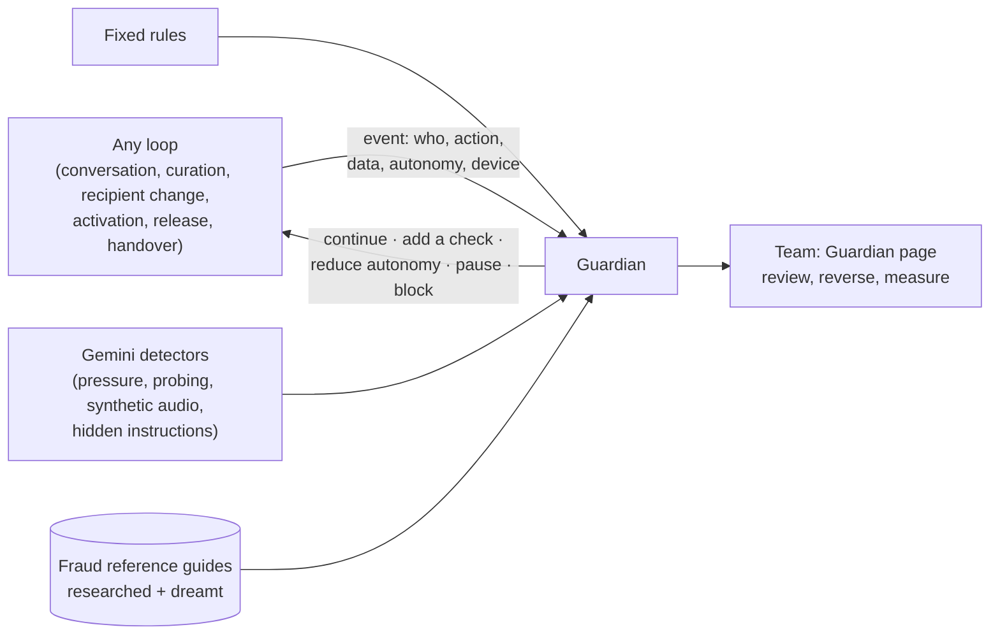
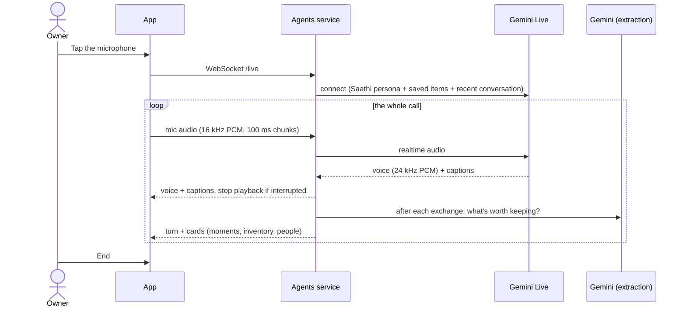
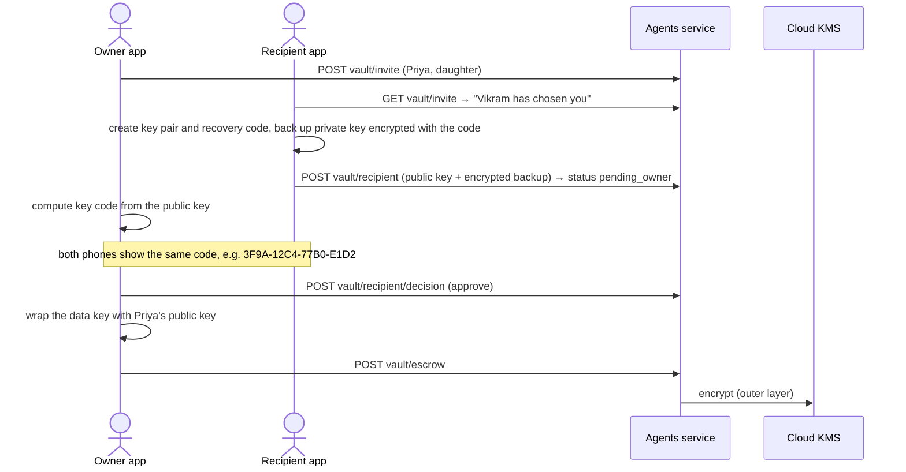
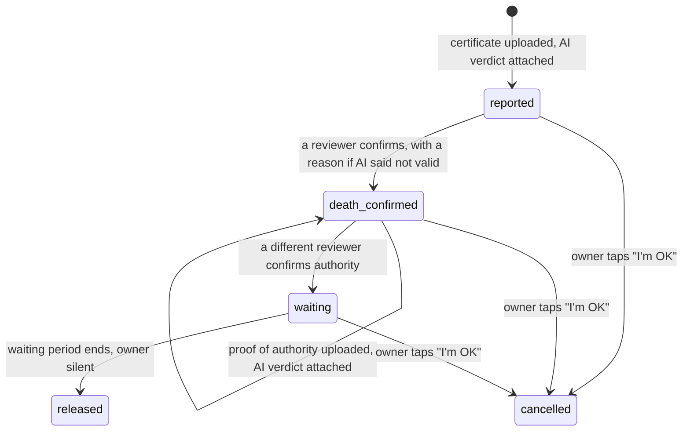

# Anvaya: Architecture

*Status: working prototype for the AI Builder Cup 2026 (BFSI track). Last updated 28 September 2026.*

Anvaya is an app-based service. People talk with Saathi, an AI companion, to record their stories, financial inventory, family, wishes and secrets while alive. After a verified death, the right people receive them. For the plain-language version, see [concept.md](concept.md).

## 1. Goals and non-goals

**Goals**

- Run every part of the product as an **AI-first loop** with an explicit autonomy level: Assist, Propose, or Act within limits.
- Keep a person in control of every irreversible step: saving to the archive, sharing with a legal partner, choosing the vault recipient, confirming a death, releasing the vault.
- Make the vault unreadable to the AI and to Anvaya itself.
- Make capture as easy as a conversation: hands-free live voice, plus typing, photos and documents.
- Run entirely on **Google Cloud** with **Gemini**.

**Non-goals**

- Voice cloning, avatars or generated speech "as the owner". These will never be built.
- Legal or financial advice. Licensed partners provide it.
- Per-role permissions and multi-tenant access control. Only sign-in with an email allowlist is built; see section 8.

## 2. System context

- The **web app** is an installable, mobile-first React app. It holds all vault cryptography, the microphone capture and the audio playback.
- The **agents service** is a Python FastAPI app on Cloud Run. It runs the Gemini steps, the live-call relay, the ADK handover agent, and the rules that keep people in control.
- Firebase Hosting rewrites `/api/**` to Cloud Run. Firebase Hosting can't proxy WebSockets, so in production the live call connects **directly to the Cloud Run URL** (`VITE_LIVE_URL`, set by `infra/deploy.sh`).

## 3. Components

### 3.1 Web app (`web/`)

| File | Responsibility |
| --- | --- |
| `src/App.tsx` | Role switcher for the demo (Vikram, Our team, Priya); "Show how the AI works" toggle for the autonomy labels |
| `src/Conversation.tsx` | The owner's single conversation: 🎤 starts a live call; typing, 📷 photo and 📄 document; suggestion cards with Keep, Not now and Keep all; spoken replies |
| `src/liveCall.ts` | Live call client: microphone to 16 kHz PCM over WebSocket, 24 kHz PCM playback, stops playback when interrupted |
| `public/pcm-recorder.js` | AudioWorklet that turns microphone audio into 100 ms PCM chunks |
| `src/Owner.tsx` | Talk / My plan tabs. My plan holds Next steps, People (access requests), review, wishes and legal handoff, and the vault (choose recipient, approve with key code, seal, add secrets). Also the "I'm OK" cancel banner |
| `src/Team.tsx` | Case review with AI verdicts, reviewer name, override reasons, audit log; access requests after a death |
| `src/Family.tsx` | Request access; accept the vault invitation (recovery code, key code); restore on a new phone; start the handover; unlock the vault; ask the assistant; settlement |
| `src/vaultCrypto.ts` | All vault cryptography (Web Crypto): data key, recipient key pair, recovery-code backup (PBKDF2), key fingerprint |
| `src/api.ts`, `src/ui.tsx` | Typed API client; shared UI and the autonomy badge context |
| `v2.html`, `src/v2/` | The new design (v2), served at `/v2.html` beside the classic app, which keeps working unchanged. Brand tokens and self-hosted fonts in `v2.css`; line icons and the thread mark in `icons.tsx`; customer wording and plain error messages in `copy.ts`. `App.tsx` holds sign-in, the owner's tabs (Talk, Kept, Family, Vault) and the Demo drawer (whose screen to show, "Show how Saathi works", nickname, reset, knowledge map, classic design). It reuses `api.ts`, `auth.ts`, `liveCall.ts` and `vaultCrypto.ts` and never loads `styles.css`. `owner/Talk.tsx` is the Talk tab, one light screen from hello to saved: a suggested topic, a microphone that goes live in place with rings that move with whoever is speaking (`liveCall.ts` reports how loud each side is), the conversation underneath (`owner/Transcript.tsx`), typing and photos in the same place, and at the end `owner/Review.tsx`: a short summary, everything Saathi picked up marked to save, Remove for what the owner doesn't want, one Save for the rest, Decide later, or Discard the conversation. The Kept, Family and Vault tabs are filled in by later changes |
| `public/fonts/` | Lora, Inter and Mukta (Devanagari) as woff2, each with its `OFL.txt`; only v2 loads them |

### 3.2 Agents service (`agents/app/`)

| Module | Responsibility |
| --- | --- |
| `main.py` | HTTP routes under `/api`, the live-call WebSocket, access gating, readable error handling for Gemini failures |
| `gaps.py` | Gaps and conflicts drive the conversation (PR-7.10). Fixed rules find what's missing in kept knowledge: an account or policy with no nominee, a wish that gives an account to someone other than its nominee, property nobody is named to receive, a person with no relationship. Ranked by harm; Saathi gets the top two (`open_gaps`) and raises at most one when the moment fits. The owner can skip any gap, and it's never raised again |
| `fraud_guides.py` | Fraud reference guides (PR-2.3): what a genuine document looks like and how forgeries are made, for each document and country. Every item carries a knowledge label (observed, derived, simulated, validated, invalidated). Every version is kept in Firestore; a copy built into the code is used if none is saved or Firestore is down. Only checked knowledge reaches the certificate check. Design: `docs/proposals/fraud-foresight.md` |
| `fraud_pipeline.py` | Fraud foresight pipeline (PR-2.5, PR-2.6): `fraud.dreamer` imagines attacks on our safeguards from the guide's checked tactics, the fixed list of safeguards and recent guardian events; `fraud.researcher` checks each one against web pages found with Exa (`web_search.py`); each is mapped to the safeguard that catches it, or marked a gap. "Confirmed" needs a cited page whose quoted sentence really appears in that page and supports the claim (`judge`). Confirmed scenarios and researched tactics wait for a reviewer; unconfirmed ones fade after 3 runs. One run at a time, with a cap on model calls per agent, a Stop button, and a live log of each step for the portal |
| `fraud_cues.py` | Anonymous starting points for dreaming from kept knowledge (fraud-foresight §5): fixed code reads only each owner's graph part (`knowledge.graph_parts`: types, links, which fields are present), matches a closed list of patterns aligned with the gap check (`policy.nominee_missing`, `property.heir_missing`…), counts owners, and drops counts under the minimum: a platform admin's setting on the portal's Fraud page (audited, default 5), which can be raised but never set below the privacy floor of 5. The dreamer gets only pattern, asset class and count, never a bundle. Twelve clearly labelled synthetic owners let the demo reach the minimum |
| `knowledge.remove` | The owner removes something wrongly recorded ("What you've kept" on My plan, or the knowledge map): the item and every earlier version are deleted from the bundle with their history files, other items' links are worked out again, and the log keeps one line with no title or content ("An item was removed by the owner"). Owner only; refused while a release case is open, and for the vault recipient. Recordings and documents the item came from, and the conversation history, are not deleted |
| `proposals.lookalike` | A new story or wish card that doesn't match a kept one by title or quote, but has the same kind and the same people or a close title or summary, carries `looks_like`. The card asks Replace it (kept as that item's next version, `replace: true` on the decision) or Keep both. The owner decides; `looks_like` never enters the bundle, and card edits can't set it |
| `knowledge_map.py` | The knowledge map for the demo: the owner's kept knowledge as a graph (owner, kept concepts, institutions, and people a story mentions but who aren't kept yet). Links are the concepts' typed links (PR-7.9) once they exist; until then the links the cards imply, marked `derived`: people a story or wish names (by name, or by relationship such as "my wife"), accounts and banks it names, a policy's nominee, holder and institution, and each person's relationship to the owner, or to the kept person they're related through ("wife of brother-in-law", "Bhaskar's son"). Gaps: an account or policy with no nominee. Owner only, read-only; the web app shows it at `/#knowledge-map` like Obsidian's graph view (a small force layout, zoom, pan and drag, no graph library), refreshing every 2 seconds |
| `loops.py` | One Gemini step per loop. Also holds the shared **Saathi persona**, the live-call instructions, and `reply_problems`, which checks every typed reply for wrong language or script, false "saved" claims and "shall I add" questions, and rewrites it once if needed |
| `live.py` | Live-call relay between the browser and the Gemini Live API; captions; saves each exchange and extracts cards |
| `speech.py` | Natural voice for typed replies (Gemini TTS), falling back through a list of TTS models, each with its own quota |
| `proposals.py` | Turns AI suggestions into cards: merges repeats, turns follow-up details into updates (without losing earlier facts), creates family cards, and applies Keep |
| `tasks.py` | Next steps from the readiness loop: rewrites the open list, merges near-duplicates, never re-adds done or dismissed steps, at most 5 |
| `executor_agent.py` | Google ADK agent for the handover, reading the owner's kept-knowledge bundle (PR-7.5): the whole bundle in its instructions while small, otherwise `index.md` with the tools `read_bundle_index`, `read_concept` and `list_accounts`; a fallback model |
| `release.py` | Vault release state machine: two-person rule, override reasons, waiting period, owner cancel |
| `escrow.py` | Cloud KMS wrap and unwrap of the vault key blob |
| `gemini.py` | Shared Gemini client with retries and backoff; `generate_json` with Pydantic schemas, falling back to the agent's own fallback model from the registry (an agent without one reports the model as busy) |
| `web_search.py` | Web search for the fraud researcher with Exa (exa.ai): our code searches, Gemini answers only from the returned pages and must quote them word for word, and a source counts only if its quote is really in the page. Only agents the registry allows `web_search` may search; queries carry fraud research only, never owner data |
| `schemas.py` | Pydantic models used as Gemini `response_schema` and as the API contract |
| `store.py` | Document store: `memory` (tests), `file` (local demo, survives restarts), `firestore` (Google Cloud) |
| `media.py`, `config.py` | Original media (Cloud Storage or local folder); settings from the environment |

### 3.3 Models (all configurable in `.env`)

| Use | Default | Why |
| --- | --- | --- |
| Chat, extraction, reasoning | `gemini-3.1-flash-lite` | Cheapest model that is served and fast (~2–3 s) |
| Fallback when overloaded | `gemini-3.5-flash-lite` | Separate capacity; used after retries on 429/5xx |
| Live voice call | `gemini-3.8-live` | Two-way audio, ~1.3 s response, can be interrupted |
| Spoken replies (TTS) | `gemini-3.8-flash-lite-tts`, then `gemini-3.8-flash-tts`, then `gemini-3.1-flash-tts-preview` | Each has its own quota; tried in order |
| Voice | `Sulafat` | A warm voice, used for both TTS and live calls |

## 4. AI-first loops

| Loop | Code | Input → output | Autonomy | Human checkpoint |
| --- | --- | --- | --- | --- |
| Conversation (typed, photo, document) | `loops.converse` | Message or file → reply + moments, inventory, people | Act within limits | Cards start as `pending` |
| Live call | `live.call` + `loops.extract_from_exchange` | Streaming audio → spoken reply + captions; after each exchange → cards | Act within limits | Cards start as `pending` |
| Curation | `proposals.save_*`, `proposals.approve` | Cards → merged or updated archive items | Propose | Owner taps Keep |
| Readiness → next steps | `loops.assess_readiness` + `tasks.refresh` | Archive, vault state, closed steps → score + up to 5 actionable steps | Act within limits | Owner acts, marks done or dismisses |
| Planning | `loops.find_legal_needs` | Wishes + inventory → legal needs | Propose | Owner consent before `legal-handoff` |
| Activation | `loops.check_document` + `loops.review_summary` | Certificate or proof image, with the fraud reference guide → verdict, likelihood genuine and a result for each warning sign | Assist | Two reviewers; override needs a reason |
| Handover | `executor_agent.ask` (ADK) | Question → answer with cited sources | Act within limits | Only after release |
| Settlement | `loops.plan_settlement` | Inventory → checklist + draft letters | Propose | Executor reviews and sends |
| Fraud foresight | `fraud_pipeline.dream` + `fraud_pipeline.research` | Guide, safeguards, guardian events → scenarios with sources and the safeguard that catches each; new tactics with sources | Propose | A risk reviewer approves before anything joins a guide; only source-confirmed items can be approved |

**Rules enforced in code, not just in prompts**

- *Replies* (`loops.reply_problems`): reply in the script of the owner's latest message; never claim "noted" or "saved"; never ask "shall I add". A reply that breaks a rule is regenerated once with the broken rule named. Live audio can't be regenerated, so there the rules live in the instructions only.
- *Cards* (`proposals`): a repeat of a kept item adds nothing. A follow-up detail becomes an update card and **combines** with the saved summary instead of replacing it. The same institution and last 4 digits update the same card.
- *Documents* (`loops.review_summary`): the wrong document type scores 0 %; the wrong person is capped at 30 %; a warning sign our team has reviewed, if found, caps it at 50 %; any concern or any warning sign found means "Needs a closer look". Every sign in the guide gets a result (found, ruled out or can't tell); signs the model invents are dropped. Imagined (`simulated`) signs never reach the check, and projections are at most a third of its signs.
- *Next steps* (`tasks`): near-duplicates are merged, except when they name different institutions (LIC vs SBI); done or dismissed steps never come back, even reworded; at most 5 steps are open.
- *Structured output*: every Gemini call returns a Pydantic schema, so the app never parses free text.

**One companion everywhere.** `loops.persona` defines Saathi once: warm, addresses the owner as "{first name} ji", matches their language, honest about what is saved, no legal advice, and asks who unknown people are. Both the typed chat and the live call use it.

### 4.1 Guardian layer (partly built: fraud guide, dreaming and research; the core is planned)

Fraud can enter at any loop, not only at activation, so a **guardian** watches every loop and corrects course before an action takes effect. It is tracked as PR-2 ([#2](https://github.com/sachiachar/anvaya/issues/2)).

| Part | What it does |
| --- | --- |
| **Event record** | Every loop records what it is about to do (who, action, data without secrets, autonomy level, device) before it takes effect. |
| **Detectors** | Fixed rules for hard facts, for example the owner was active recently, a recipient change came from a new device, or a certificate was used before. Gemini detectors for softer signals: pressure in a conversation, probing questions, synthetic or replayed audio, hidden instructions in documents. Fraud reference guides for each document type and country, kept current by a research agent (Gemini with Google Search) and red-teamed by a dreaming agent. |
| **Responses** | Continue; add a check (key code, liveness phrase, delay); reduce autonomy one level (Act within limits → Propose → a person decides); pause for a reviewer and alert the owner; block. A readable policy file maps risk to response. |
| **Enforcement** | Saving, recipient changes, release and the handover assistant ask the guardian first and obey. The guardian runs with its own permissions, agents can't bypass it, and it has no vault access. |
| **Governance** | A Guardian page shows every intervention with its reason. People confirm or reverse each one, and the decision is logged. It also shows false-alarm rates, reviewer pattern analytics, and the dreaming agent's safeguard coverage map. |

**How it's built** (`agents/app/governance/`, one layer shared by the gateway, the guardian and the portal):
- `core.py`: the registry, roles and permissions, the audit log, the gateway's `check_call` (registry and kill switch), `record_usage` (daily ledger with calls, tokens and minutes; never dollars), `record_blocked` and `record_intervention`;
- `billing.py`: actual spend from the Cloud Billing export to BigQuery (PR-10.9), the only source of dollar figures. Cached for an hour, up to yesterday; the portal says "not available yet" rather than estimating;
- `portal.py`: the platform admin portal API under `/api/platform` (PR-12), with roles checked on the server;
- `seed.py`: nothing is seeded; the portal shows only real data. On the first portal request after a release, it removes any examples earlier versions seeded, keeping real data and the kill switch.

The portal is a separate entry point (`web/admin.html`), served by its own Firebase Hosting site, `anvaya-admin`.

**Rules for the guardian:**
- It never approves or rejects a case; people decide.
- Hard rules are fixed rules, never the model's judgment.
- Unconfirmed scenarios can only raise "needs attention".
- Interventions are explained and feel like care, not accusation.
- Voice alone never authorises an important action, because cloned voices can't be reliably detected.

## 5. Data model

| Collection | Key fields | Notes |
| --- | --- | --- |
| `owners` | name, age, city, country, `family[]`, `language`, `readiness_score`, `vault_invite`, `vault_recipient` (name, relationship, public_key_jwk, key_backup, **status**), `vault_escrow` | The family list only grows when the owner keeps family cards |
| `turns` | role (owner or assistant), text, heard, attachment, language, proposals {moments, inventory, people} | The conversation, from typed and live turns |
| `moments` | kind, title, summary, quote, people, places, year, status, `updates?` | `updates` points to the kept moment an update card changes |
| `inventory` | category, institution, product, account_hint (last 4), nominee, missing_fields, status, `updates?` | Merged by institution and last 4 digits |
| `people` | name, relationship, status | Family cards; kept ones are added to `owners.family` |
| `tasks` | title, why_it_matters, action (talk, legal, vault, institution, family), steps, severity, status (open, done, dismissed) | Next steps |
| `vault_items` | category, iv, ciphertext, ai_label? | Ciphertext only |
| `cases` | state, certificate_check, authority_check (with verdict), death_confirmed_by, wait_until, history | Release case and audit log |
| `access_requests` | name, relationship, contact, note, status (pending_owner, pending_review, approved, declined) | Family members who weren't listed |
| `handoffs`, `legal_documents` | Consented legal summaries; signed documents | Never contain vault data |

### 5.1 Storage layout (kept-knowledge bundle built; buckets per tenant planned)

**Buckets per tenant and region; inside each, a folder per owner, a key per owner, and access tokens limited to one owner.** Tracked in [PR-6 (#17)](https://github.com/sachiachar/anvaya/issues/17) and [PR-7 (#18)](https://github.com/sachiachar/anvaya/issues/18).

| Layer | Design |
| --- | --- |
| **Buckets** | One per region (`anvaya-in`, `anvaya-sg`), one per licensing bank or insurer (encrypted with that institution's own key), and one for judges' demos. Never one per owner: bucket creation is rate-limited, and the names can be probed. |
| **Folder per owner** | `owners/<owner-id>/`, holding the kept-knowledge bundle (OKF), uploads and recordings. |
| **Key per owner** | Envelope encryption: a data key per owner, wrapped by Cloud KMS. Destroying it makes the owner's data unreadable everywhere, including backups. |
| **Tokens limited to one owner** | For each request, the API exchanges its credential for a short-lived token restricted to that owner's folder (Credential Access Boundaries), so Cloud Storage itself refuses access to any other owner. |

**What lives where**
- **Kept knowledge is an OKF bundle in Cloud Storage** ([OKF v0.2](https://github.com/GoogleCloudPlatform/open-knowledge-format/blob/main/SPEC.md)). **Built (PR-7.1, 7.2, 7.4, `knowledge.py`)**, for now in the owner's folder of the private media bucket (`<owner>/kept/`) until PR-6's buckets exist:
  - one Markdown concept per kept item, with `type`, `sources`, `generated`, `verified: human:owner-<id>`, `status` and `stale_after`;
  - an `index.md` that is regenerated after each Keep, and a history log per date.
  - **Keep is the commit:** only owner-confirmed knowledge enters the bundle. The draft leaves Firestore; an update writes a new version and marks the old one `deprecated`.
  - each concept keeps its **graph part** (`type`, `status`, typed links) apart from its content, so fixed-code readers (the gap check, and the anonymous fraud cues in `docs/proposals/fraud-foresight.md` §5) never read text or sources;
  - a machine copy (`.catalog.json`, rebuildable from the concept and event files) is written with conditional writes, and `index.md` and `log.md` are rewritten from it the same way, so overlapping Keeps never lose an item and an older Keep never overwrites a newer index. Each request reads the catalog once;
  - identifiers (9 or more digits, any separators, and PAN) keep only their last 4 characters; dates and amounts are left alone. The vault can't enter, and only the demo's own seeding may add something the owner didn't confirm, labelled as such.
- **Firestore holds workflow data only:** pending cards, cases and reviews, guardian events, next steps and access requests.
- **The conversation:**
  - sensitive details are masked before storage (Sensitive Data Protection);
  - only the owner can reach it;
  - it's kept only while useful;
  - it's never released in the handover;
  - the owner can delete it, by destroying its key.
- **The family's assistant** (built, PR-7.5) gets the whole kept bundle in its instructions while it's under about 20,000 tokens, built fresh for each question from current versions only; above that, `index.md` and the concepts it opens. Kept text is fenced as information, never instructions. Every source shown is a real kept item, with its title. It never reads the conversation, another owner's bundle or the vault. Context caching can come later.
- **The bundle is a graph** (typed links built, PR-7.3 and 7.9). Each kept item links to the people it names: an account or policy to its `nominee` and `holder`, property or a wish to who it's `intended_for`, a story to the `people` it mentions. Links are frontmatter fields (bundle paths) and ordinary Markdown links in the body. A full name must match a kept person, and a first name only if exactly one kept person has it; keeping or replacing a person relinks the items that name them. The graph part also records which key fields are present (`has`: nominee, holder, intended for, papers), never their values. Still to come: `covered_by` (a will) and `contact`. No graph database.
  - A fixed-rule check against the expected links for each type finds **gaps and conflicts**, ranked by impact on the family (built, PR-7.10, `gaps.py`).
  - Saathi raises at most one gently, and "skip" is remembered (built).
  - Still to come (F-7): readiness as **link coverage**, shown as a knowledge coverage map, with the family's checklist from the graph.

## 6. API surface

All routes are under `/api`.

| Area | Routes |
| --- | --- |
| Conversation | `GET/POST /owners/{id}/conversation`, `POST /owners/{id}/conversation/prompt` (the companion asks from a next step), `POST /owners/{id}/conversation/summary` (a few sentences summing up a conversation that just ended; shown, never stored; numbers masked in code), `POST /owners/{id}/conversation/forget` (Discard: deletes those turns and every card from them still waiting for Keep, never anything kept), `WS /owners/{id}/live`, `POST /speech` |
| Cards | `POST /proposals/{id}/decision` (moments, inventory, people; approve or reject) |
| Legacy capture (older routes) | `POST /owners/{id}/capture/audio`, `POST /owners/{id}/documents`, `POST /owners/{id}/wishes`, `GET /owners/{id}/review`, `GET /owners/{id}/archive` |
| Next steps | `POST /owners/{id}/readiness`, `GET /owners/{id}/tasks`, `POST /tasks/{id}` |
| Legal | `POST /owners/{id}/legal-needs`, `POST /owners/{id}/legal-handoff`, `POST /owners/{id}/legal-documents` |
| Vault | `POST/GET /owners/{id}/vault/invite`, `POST/GET /owners/{id}/vault/recipient`, `POST /owners/{id}/vault/recipient/decision`, `POST /owners/{id}/vault/escrow`, `POST/GET /owners/{id}/vault/items` |
| Release | `POST /owners/{id}/death-report`, `POST /owners/{id}/release/authority`, `GET /owners/{id}/release`, `POST /owners/{id}/alive`, `GET /owners/{id}/vault/release-bundle` |
| Review | `GET /admin/cases`, `POST /admin/cases/{id}/confirm-death`, `POST /admin/cases/{id}/confirm-authority` (body: `reviewer`, `override_reason?`) |
| Access | `POST/GET /owners/{id}/access-requests`, `GET /admin/access-requests`, `POST /access-requests/{id}/decision` |
| Handover | `POST /owners/{id}/ask`, `POST /owners/{id}/settlement` |
| Other | `POST /demo/seed` (resets the caller's own copy), `GET /owners/{id}`, `GET /me` (includes the caller's `owner_id`), `GET /healthz` |

Every route works only on the caller's own demo copy: another copy's owner or document is **404** (`demo.py`). `ask`, `settlement` and `vault/release-bundle` return **403** until the case is `released`. Gemini failures return readable errors: 503 for no credentials or voice unavailable, 502 for model errors.

## 7. Key flows

### 7.1 Live call

### 7.2 Choosing and approving the vault recipient

A new phone downloads the encrypted key backup and unlocks it with the recovery code. If the code is lost while the owner is alive, the recipient creates a new key, the old seal is cleared, and the owner approves and re-seals. Once a case is open, the key can't be replaced.

### 7.3 Release

On `released`, KMS removes the outer layer and the recipient's phone decrypts the vault locally.

## 8. Security and privacy

| Threat | Mitigation |
| --- | --- |
| Database leak exposes secrets | Secrets are ciphertext; the data key is sealed with the recipient's public key on the owner's phone |
| Insider or AI reads the vault | No server component can open the inner layer; the ADK agent has no vault tool; the AI never asks for passwords |
| Someone makes themselves the recipient | The owner must invite; the owner confirms a key code computed on each phone from the key itself |
| Lost phone | Private key backed up, encrypted with a 125-bit recovery code (PBKDF2-SHA256, 600,000 iterations); Anvaya never sees the code |
| False death report | AI verdict; reason required to override "not valid"; two different reviewers; waiting period; owner cancel |
| Sensitive numbers leak through the AI | Masking rules in prompts; last 4 digits only; never asks for full numbers |
| Sharing without consent | `legal-handoff` needs consent; access requests go to the owner while alive; neutral replies reveal nothing to strangers |
| Public access to storage | Firestore rules deny clients; private bucket; least-privilege service account |
| One judge reaching another judge's demo | Each Google account gets its own copy, chosen from the verified sign-in, never from the browser (`demo.py`). Every route checks that the owner or document belongs to the caller's copy and answers **404** otherwise; team lists show only the caller's copy; the live call closes for another copy's owner. Resetting touches only the caller's copy, including its recordings |
| Someone acting outside their part | The switcher sends who is acting (`X-Acting-As`; `acting_as` on the live call). The server accepts only the people in the copy and checks each action's person (`demo.only`): only Vikram changes his vault, keeps cards or answers alerts; only Priya registers as recipient, reports, sends proof and opens the vault; only a reviewer confirms. The reviewer is the person acting, never a typed name, so one reviewer can't confirm both steps |
| Identifying demo visitors | The portal lists demo copies by hashed key. A visitor may give their copy an optional nickname once, after sign-in; it's cleaned to one short line, shown only to platform admins, never written to logs or the audit log (`demo.set_nickname`, `portal.get_demos`) |
| Uninvited people using the demo | Google sign-in (Firebase Auth); the server verifies the ID token on every request (`auth.py`) and checks `ALLOWED_EMAILS` (addresses or `@domains`); the live call passes the token as `?token=` |

**Known gaps before real users**

1. **One judge plays every person in their copy.** Everyone signs in with Google (Firebase Auth), and only emails or domains on `ALLOWED_EMAILS` get in. Each account has its own demo copy, and the server keeps copies apart. Inside a copy, the switcher chooses who acts (Vikram, Priya, Anjali, Rahul or the platform admin). The server checks that person on every action, but in production each person would sign in separately.
2. **Keys in `localStorage`** so one browser can play every role. Production needs non-extractable keys in IndexedDB with passkeys.
3. **KMS decrypt scope.** The API has both encrypt and decrypt; move decrypt to a separate release service.
4. **No notifications.** The owner is alerted only inside the app during the waiting period. Add push, SMS and email.
5. **Live calls** end after about 15 minutes (Gemini Live limit), and spoken replies can't be checked by `reply_problems`.
6. **Handover questions** aren't stored for audit yet (ADK sessions are in memory).
7. **Participant consent** for other voices in live calls is a notice only.

## 9. Environments and configuration

| Setting | Local | Google Cloud |
| --- | --- | --- |
| `STORE` | `file` (`agents/data/store.json`, survives restarts) | `firestore` |
| Gemini auth | `GOOGLE_API_KEY` (AI Studio) in `agents/.env` | Same AI Studio key, stored in Secret Manager (`gemini-api-key`) and injected as `GOOGLE_API_KEY`; `GOOGLE_GENAI_USE_VERTEXAI=false` |
| `KMS_KEY_NAME` | empty (dev mode) | vault escrow key |
| `MEDIA_BUCKET` | empty (local folder) | private bucket |
| `GEMINI_*_MODEL(S)`, `GEMINI_TTS_VOICE`, `GEMINI_LIVE_MODEL` | see section 3.3 | same; confirm they are served in your region |
| `AUTH_REQUIRED`, `FIREBASE_PROJECT_ID`, `ALLOWED_EMAILS` | `true`, the project, your email | same (from `agents/.env` or `ALLOWED_EMAILS=… ./infra/deploy.sh`) |
| `VITE_FIREBASE_*` (web) | `web/.env` (public Firebase config) | same |
| `RELEASE_WAIT_SECONDS` | 60 | 60 for the demo; days in production |
| `VITE_LIVE_URL` | not set (Vite proxies the WebSocket) | `wss://<cloud-run-url>` (set by `deploy.sh`) |

`infra/deploy.sh` enables the APIs; creates the service account, Firestore, the private bucket, the KMS key and the `gemini-api-key` secret (from `agents/.env`); deploys Cloud Run from `agents/` with a 1-hour timeout for live calls; builds `web/` with `VITE_LIVE_URL`; and deploys Firebase Hosting. The Google Cloud project must have Firebase added first (`firebase projects:addfirebase <project>`).

**Why AI Studio, not Vertex AI (for now):** the same model names work locally and on Cloud Run. On Vertex AI, `gemini-3.8-live` is only served in `us-central1` (not `global`), and the 3.8 TTS models aren't served, so switching to Vertex AI later needs region-specific model settings.

**Free-tier note:** Gemini API keys on the free tier have small per-model limits (for example, 10 requests for one TTS model). Turn on billing for testing and demos.

## 10. Testing

Automated tests (`agents/tests/`), with Gemini stubbed so they run without credentials:

- release rules: two-person rule, override reasons, waiting period, owner cancel;
- access gating and consent; recipient invitation, approval and key changes;
- sign-in: every API route and the live call need an allowed Google account;
- people in a copy: the server knows who is acting, each person can only do their part, and one reviewer can't confirm both steps;
- private demos: two judges at once never reach each other's copy (whoever they act as), through any owner route, any document ID, the team lists or the live call, and resetting one copy leaves the other alone;
- card merging (repeats, follow-ups that keep earlier facts, family), using real cases from test runs;
- next-step rules (duplicates, reworded done steps, LIC vs SBI);
- reply rules (script, false claims, "shall I add");
- document verdict rules (wrong document scores 0);
- governance: server-side roles, approvals, the kill switch, and a portal that never returns conversation text or names;
- the gateway: every file that calls Gemini goes through it, every agent named in code is registered, and every call is recorded in the ledger;
- limits per request: output caps, retries, input size, call length and reply length.
- dependencies: every direct dependency is in the inventory, every installed package has an allowed licence, every font folder carries its OFL licence and is in the inventory, and the Python and Node versions agree everywhere.

Every pull request runs the linters (ruff for `agents/`, Biome for `web/`), these tests and the web build ([.github/workflows/ci.yml](../.github/workflows/ci.yml)).

Also verified by hand: the vault and recovery round trip (Node Web Crypto), live calls through the WebSocket, and real Gemini runs of conversations and next steps.

## 11. Design decisions

| Decision | Choice | Why |
| --- | --- | --- |
| Capture | Hands-free live call (Gemini Live) as the main voice mode | Record-and-stop felt unnatural; a live call is how people actually talk |
| One companion | Shared persona for chat and live | Consistent character, language and honesty |
| Suggestions as cards | AI proposes, the owner keeps | AI-first, but nothing is saved without consent |
| Rules in code | Merging, reply checks, verdicts, next steps | Light models follow prompts most of the time; code makes it always |
| Vault crypto | On the device, sealed for one approved person, plus KMS | Anvaya and the AI can never read secrets |
| Cheaper models | Flash-Lite for most steps, with fallbacks | Low cost per family; resilient to overload and quotas |
| Store abstraction | Memory, file or Firestore behind one interface | Tests run without the cloud; the local demo survives restarts |

## 12. Roadmap

Separate sign-in for each person outside the demo · notifications · a real legal-partner integration · Vertex AI RAG Engine for archive search · email and chat import · passkey-backed keys · a separate KMS release service · session resumption for long live calls · an evaluation set in CI · a pilot with a bank or insurer.
