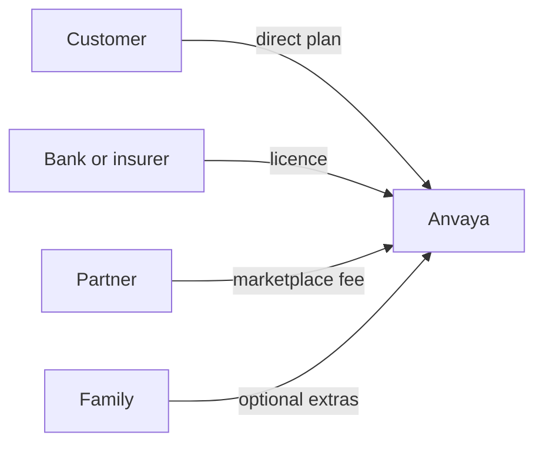

# Anvaya: Business model and unit economics

*Team Saathi · Revision 1, 30 September 2026 · the idea is in [concept.md](concept.md); how it is built is in [architecture.md](architecture.md)*

*All figures here are **illustrative**. The prices are proposals. The costs are estimates from published list prices and our own assumptions. We list each assumption below, so that pilot data can replace it.*

---

## In short

Anvaya earns money from four sources:

- yearly plans for customers who come directly;
- licences for banks and insurers;
- fees from partners in the marketplace;
- optional extras for families.

Families never pay for the handover itself.

The largest cost of serving a customer is in the **first year**. Most of the conversation happens then. After that, a customer mostly keeps their records up to date. So the margin on each customer **rises every year they stay**.

| Per customer, per year | Year 1 | Year 2 onwards |
| --- | --- | --- |
| **Direct plan, paid through the app stores** | 48% margin | 69% margin |
| **Direct plan, paid on the web** | 60% margin | 81% margin |
| **Bank or insurer licence** | 72% margin | 72% margin |
| **Marketplace introductions** | about 85% margin | about 85% margin |
| **Family extras** | high; priced above the cost of the extra use | high |

These are contribution margins: revenue less the cost of serving that customer. A separate section below covers the fixed costs of running the company.

## Illustrative prices

| Stream | Illustrative price | Who pays |
| --- | --- | --- |
| Direct plan | ₹1,499 a year for one person (about US$17) | The customer |
| Family plan | A higher price covering a spouse and parents | The customer |
| Licence | ₹499 a year per enrolled customer (about US$5.70) | The bank or insurer |
| Marketplace | A flat listing fee, or a fee per introduction where the rules allow | The partner |
| Family extras | A small top-up once the family has used its included allowance | The family, only if they want more |

Anvaya takes no commission where professional rules forbid it, for example for legal advice. The first conversations with Saathi are free. People can see the value before they choose a plan.

## What it costs to serve one customer

### Direct plan (₹1,499 a year)

| Cost | Year 1 | Year 2 onwards | What drives it |
| --- | --- | --- | --- |
| Voice conversations | ₹317 | ₹79 | 120 minutes in the first year, 30 minutes a year after, at ₹2.64 a minute[^voice] |
| Typed chat, reading documents, spoken replies | ₹88 | ₹35 | Low-cost language services; each message costs a fraction of a paisa[^text] |
| Cloud hosting, storage and encryption keys | ₹53 | ₹53 | Servers, database, document and voice-recording storage, and key management on Google Cloud. An hour of compressed voice is only tens of megabytes |
| Handover reviews | ₹13 | ₹13 | About ₹1,320 per case for two reviewers, the forgery checks and family support, assuming 1 in 100 customers needs a handover each year |
| Customer support and partner vetting | ₹88 | ₹53 | More help while people get started |
| Payment and app-store fees | ₹225 | ₹225 | 15% through the app stores[^stores] |
| **Total cost** | **₹784** | **₹458** | |
| **Margin** | **48%** | **69%** | |

On the web, payment fees are about 3% (₹45) instead of 15%. Then the total cost falls to ₹604 in year 1 and ₹278 after. The margins become **60%** and **81%**.

### Licence (₹499 a year per enrolled customer)

Not every enrolled customer is active in a given year. We assume that 4 in 10 are active. Each active customer uses about as much as a direct customer in year two.

| Cost per enrolled customer | Per year |
| --- | --- |
| Voice conversations | ₹32 |
| Typed chat, documents, spoken replies | ₹14 |
| Cloud hosting, storage and encryption keys | ₹26 |
| Handover reviews | ₹13 |
| Customer support | ₹26 |
| Integration and account management for the institution | ₹26 |
| **Total cost** | **₹137** |
| **Margin** | **72%** |

A licence has no app-store fees. The institution brings the customers, so Anvaya has no cost to win them one by one.

### The family's allowance and extras

When the time comes, the family receives the handover and a **generous included allowance** at no cost. The allowance includes:

- unlocking the vault;
- a set number of questions to Saathi;
- the checklist and draft letters for every institution.

The cost of the allowance is part of the handover cost above. The plan or licence already pays for it.

The family can buy extras if they want more than the allowance. Examples are more questions, more letters, or keeping the records open for longer. The price of an extra is above the cost of the extra use, so extras add margin, not cost. The family can also move to a plan of their own. This is how the next generation becomes a customer.

### Marketplace

A partner fee has almost no cost of service. The introduction is a short summary that the customer already approved. The main costs are vetting partners and handling payments. The margin is about **85%**.

## What keeps costs low

- **The lowest-cost services that do the job.** Chat, extraction and document reading use the lowest-cost tier of language services. More capable services are only a fallback.[^text]
- **Voice when people want it.** Voice is the largest variable cost. Typing and photos cost a small fraction of it. Many people use both.
- **The vault lives on the phone.** The customer's device encrypts the secrets. So Anvaya has no large, costly store of secrets to run and protect.
- **People decide; automated checks prepare.** An automated check examines every certificate before a reviewer sees it. Reviewers spend their time on decisions, not paperwork.
- **Conversation decreases.** Most of the talking happens in year one. After that, Saathi mostly helps keep records up to date.

## Fixed costs of running the company

These costs don't grow with each customer. So their share of revenue falls as Anvaya grows:

- **Product and engineering**: the app, the service and new languages
- **Security and compliance**: independent security audits, certification (such as ISO 27001), and data-protection compliance (such as India's Digital Personal Data Protection Act)
- **The review team**: a trained, always-available team with two-person cover, audit logging and quality checks
- **Partner network**: vetting, contracts and keeping listings current
- **Institution partnerships**: sales, integration and regulatory reviews with each bank or insurer

## Why the margins grow over time

- **Recurring revenue, falling cost.** Plans and licences renew each year. The cost of serving each customer falls after year one.
- **Institutions bring many customers.** One licence can reach millions of customers. Anvaya does not pay to win each one.
- **Every handover introduces the next generation.** The son or daughter who receives a vault is the most likely next customer. That customer costs almost nothing to acquire.
- **The marketplace grows with every gap.** Each missing will or nominee is a real need. A partner meets it, at close to pure margin.
- **Possible further cost cuts.** As volumes grow, these can lower the cost per customer:
  - caching the conversation context;
  - batch processing for work that isn't urgent;
  - newer, lower-cost service tiers.

## Assumptions to validate in the pilot

| Assumption | Used above | How we'll measure it |
| --- | --- | --- |
| Voice minutes per customer | 120 in year 1, 30 after | Usage logs |
| All-in cost of a voice minute | ₹2.64 (US$0.03), above the list price to allow for context and extraction[^voice] | Cloud billing |
| Share of licensed customers active each year | 4 in 10 | Usage logs |
| Customers needing a handover each year | 1 in 100 | Case volumes |
| Share of families who buy extras beyond the allowance | Not counted above (upside) | Purchase data |
| Reviewer and support time per handover | About ₹1,320 per case | Time tracking |
| Payment channel | App stores at 15%, or web at 3% | Payment mix |
| Exchange rate | ₹88 to the US dollar | Update at each revision |

---

[^voice]: Google's list price for its live voice service is about US$0.005 per minute of audio in. It is about US$0.018 per minute of audio out ([Gemini API pricing](https://ai.google.dev/gemini-api/docs/pricing), updated 24 September 2026). We use US$0.03 a minute. This allows for conversation context and for turning each exchange into cards.
[^text]: The lowest-cost language tier is listed at US$0.25 per million input tokens and US$1.50 per million output tokens ([Gemini API pricing](https://ai.google.dev/gemini-api/docs/pricing)). Spoken replies cost about US$0.0015 per 10 seconds of audio until December 2026. From January 2027 they cost US$0.003.
[^stores]: Apple and Google both charge 15% on subscriptions under their standard subscription or small-business terms. Otherwise they charge up to 30%.
