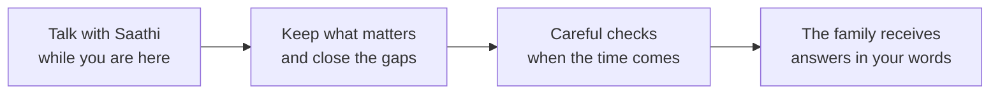

# Anvaya

*Team Saathi · BFSI track · Revision 8, 17 October 2026 · for individuals, see [pitch-individuals.md](pitch-individuals.md); for banks and insurers, [pitch-institutions.md](pitch-institutions.md); how it is built, [architecture.md](architecture.md); what is available, [release-notes.md](release-notes.md)*

*Anvaya (अन्वय) is Sanskrit for lineage: the thread that connects one generation to the next. Its companion, Saathi, takes the everyday word for "companion".*

---

## The problem

A father goes for his morning walk and doesn't come home. There is no goodbye, and no folder on the shelf. Within days, his family faces questions only he could answer: which accounts, which policies, who the nominee is, what he wanted, and the passwords.

Because nobody knows, money goes unclaimed. In India, **₹72,454 crore** sits unclaimed in bank deposits and **₹8,974 crore** in insurance.[^in] In Japan, a record **¥129.2 billion** went to the treasury in one year because no heir came forward.[^jp] In Singapore, **2 in 5** people lost before 65 had never named a nominee.[^sg]

Banks and insurers carry the cost too. In India, they must now settle a family's claim within **15 days** of a complete file, or pay a penalty.[^rbi] Files arrive incomplete, nominees are missing, forged certificates slip through, and heirs who suffer a painful claim take the money elsewhere.

## Anvaya, in one sentence

**People talk with Saathi, a warm companion, about their accounts, nominees, wishes and stories while they are here. When the time comes, the right person receives everything, safely and in their own words.**

## Saathi: a true friend, for everyone

Most of us have one friend we call when something is hard to say. You tell him, *"I want my daughter to have the flat."* He doesn't take sides. He finds a few good lawyers and lets you pick. Later he asks, *"Is the will done?"* And one day, he tells your daughter everything you wanted her to know.

Saathi is that friend. It listens first, never sells, follows up, remembers what you said as you said it, and keeps your confidences.

## How it works

1. **Talk.** By voice or text, in your own language. Snap a photo of a policy and Saathi reads it.
2. **Keep.** Small cards appear: a story, an account, a nominee. Only what you **Keep** is passed on. Each card says only what you said.
3. **Close the gaps.** "No nominee on this policy." "No will for the flat." Saathi turns each gap into a next step, and shows a few vetted partners, with prices, in a neutral order. You choose.
4. **Lock your secrets.** Passwords are encrypted on your own phone, for one person you choose. Nobody else can read them, not even Anvaya.
5. **Hand over, safely.** The family uploads the official certificate. Checks look for forgery, two different people confirm, and a waiting period follows, during which one tap on your phone cancels everything. Then your chosen person opens the vault, asks questions, and gets answers from what you kept, with sources, plus a checklist and draft claim letters.

## Protected at every step

A **guardian** watches the whole journey, not only the end:

- Everything new passes the guardian before it can be kept. A password someone asked for, or a payment someone else wants, is never kept.
- Another voice on a call is noticed. A wish, money or people card said then waits until the owner confirms on it that it's what they want. A voice alone can't change anything important. A voice check for the owner is being tested: a card that doesn't sound like the owner waits until they confirm on it that it was them.
- The owner hears first about any report of their passing, and can cancel.
- A fraud reference grows every hour. A new trick is added only when two independent sources confirm it, and a person can remove anything.
- People decide every outcome. Every decision is logged, and our team can follow one conversation end to end, by decisions only, never words.

## One customer becomes generations

Anvaya works for anyone who downloads it. Its biggest impact comes when a bank or insurer offers it, inside the app their customers already trust. *This institution side is a design we will build with our first partners.*

Vikram's memories are kept where his money already is. They pass to his daughter Priya. His bank is ready on day one, with a complete, checked claim file, and Priya stays. She starts her own book, and adds her memories to his. **One customer becomes a family, and a family becomes generations.**

For the institution: nominees complete, claims settled on time, less fraud, deposits that stay after the handover, and the next generation as customers. The family owns the thread; the institution hosts it, and sees counts, never names.

## How Anvaya earns

| Who pays | How |
| --- | --- |
| **People who come directly** | A simple yearly plan, for one person or the family. The first conversations are free |
| **Banks and insurers** | A yearly licence per enrolled customer |
| **Partners** | A flat listing fee, never paid placement, and no commission where professional rules forbid it |

**Families never pay to receive what was left for them.**

## Our promises

- **You decide.** Only what you keep is passed on, and nothing is shared without your agreement.
- **No made-up answers.** If you never said it, Saathi says so.
- **Your real voice, never a copy.** No voice cloning, no avatars.
- **No paid influence, and no unlicensed advice.** Legal and financial advice comes only from licensed partners.
- **Yours to take with you.** What you keep is stored in an open, standard format.

## Where we are today

| Runs today (synthetic data) | Coming next | With our first institutional partners |
| --- | --- | --- |
| Voice and typed conversation; Keep cards; the family book with next steps; the vault on the phone, with a recovery code; two-person checks, a waiting period and one-tap cancel; the family's questions with sources; checklists and claim letters; the guardian and an hourly fraud reference; an admin portal | The voice check fully live; real voice and voice letters for the family; SMS and email alerts; the full choice of partners; extra protection for big changes | Anvaya inside the bank's app; pre-filled accounts; the claim file; rule-change prompts; help with the money after the handover |

## Sources

[^in]: Bank deposits as of 28 January 2026, written reply in Parliament, reported in [Free Press Journal](https://www.freepressjournal.in/business/unclaimed-bank-deposits-in-rbis-dea-fund-reach-72454-crore-government-promotes-udgam-portal-multiple-nominations); insurance as of 28 February 2026, [Press Information Bureau](https://www.pib.gov.in/PressReleasePage.aspx?PRID=2244475).
[^jp]: Supreme Court of Japan figures for financial year 2024, reported by [Bloomberg](https://www.bloomberg.com/jp/news/articles/2025-12-08/T6Q1AWKGIFQM00), 8 December 2025.
[^sg]: CPF Board, [*CPF nominations*](https://www.cpf.gov.sg/member/infohub/reports-and-statistics/cpf-trends/cpf-nominations) (2023 data).
[^rbi]: Reserve Bank of India, [*Commercial Banks – Responsible Business Conduct Directions, 2025*](https://www.rbi.org.in/Scripts/BS_ViewMasDirections.aspx?id=13140), on the settlement of claims.

---

*Nobody can choose when they leave. Anvaya makes sure the people they love are not left without answers.*
