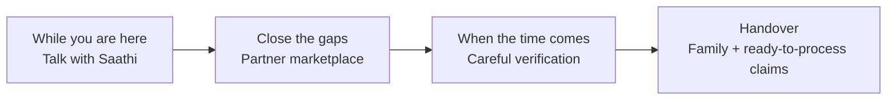

# Anvaya

*Team Saathi · BFSI track · Revision 7, 17 October 2026*

*The full picture. The focused pitches are [pitch-individuals.md](pitch-individuals.md) and [pitch-institutions.md](pitch-institutions.md); how it is built is in [architecture.md](architecture.md); what is available in each version is in [release-notes.md](release-notes.md).*

*Anvaya (अन्वय) is Sanskrit for lineage and succession: the thread that connects one generation to the next. Its companion, Saathi, takes the everyday word for "companion" in each language.*

---

## Nobody plans to leave suddenly

We all mean to sit down one day and write it all out: the accounts, the policies, who should have the flat, where the papers are. We tell ourselves there is time.

And then, sometimes, there isn't.

A father goes for his morning walk and doesn't come home. A mother who ran the whole household is gone after a short illness. There is no goodbye, no conversation at the kitchen table, no folder left on the shelf. The family is still in shock, and within days they are facing questions nobody prepared them for:

- Which bank accounts, insurance policies and investments were there?
- Who is the nominee? Where are the papers?
- What did they want for the house, the savings, the watch?
- What are the passwords?

The person who knew every answer is the one person they can no longer ask.

## Anvaya, in one sentence

**Anvaya is a family succession service that anyone can download, and that banks and insurers can offer their customers: people talk with Anvaya's warm companion, Saathi, about their accounts, nominees and wishes while they are here; trusted partners help close the gaps; and when the time comes, the right family member receives a safe, fraud-checked handover. With a bank or insurer, the institution would also receive claims that are ready to process.**

## What is lost when nobody knows

Because families don't know what was there, a great deal of money is simply never claimed:

| Where | What is waiting to be claimed | As of |
| --- | --- | --- |
| **India** | ₹72,454 crore in bank deposits, moved to the Reserve Bank of India's Depositor Education and Awareness Fund after ten years untouched[^in-bank] | 28 Jan 2026 |
| | ₹8,974 crore in insurance, still with the insurers[^in-ins] | 28 Feb 2026 |
| | ₹3,749 crore in mutual funds[^in-ins] | 28 Feb 2026 |
| **Japan** | ¥129.2 billion in estates handed to the national treasury because no heir came forward, the highest since records began in 2013[^jp] | Financial year 2024 |
| **South Korea** | More than ₩10 trillion in unclaimed insurance money[^kr] | 2026 |
| **Malaysia** | RM13.3 billion with the Accountant General; only about RM4 billion has ever been claimed back since 1977[^my] | April 2025 |
| **Australia** | A$21.2 billion in lost and unclaimed superannuation, across about 7.5 million accounts[^au] | 30 Jun 2026 |

And it is the sudden losses that leave families least prepared. In Singapore, **2 in 5 CPF members lost before the age of 65 had named no nominee**, against about 1 in 5 overall. Without a nomination, their savings go to the Public Trustee, a fee is deducted, and it can take up to six months to work out who in the family may claim.[^sg]

These totals count all unclaimed money, not only what was left behind by someone who is gone. But every family who has lost someone suddenly knows how it happens: the one person who knew about the account is the one person they can no longer ask.

Most people never write any of this down: forms are tedious, and nobody likes to think about the day they won't be here.

### Banks and insurers carry the cost too

| For the institution | What it means |
| --- | --- |
| Settlement deadlines | In India, a 15-day clock with penalties when the delay is the institution's (see below); elsewhere, regulators are pushing for faster, simpler estate payouts |
| Incomplete files | Families don't know what to submit, so files go back and forth and the clock can't start |
| Missing or outdated nominees | Claims that need legal heirship papers, take months and generate complaints |
| Slow, paper-heavy claims | Staff check certificates and legal papers by hand, one case at a time |
| Unclaimed balances | Regulatory reporting, transfers to a regulator's fund, and scrutiny of how well the institution reunites money with families |
| Fraud | Forged certificates, false heirs, and people quietly using the accounts of a customer who is no longer here |
| Losing the next generation | Heirs who go through a painful claims experience take their money elsewhere |

### Why now

Regulators across Asia are making the family's claim faster, simpler and measured.

**In India** *(these deadlines and penalties are Indian rules)*

- **Banks** must settle claims on the deposit accounts of a customer who is no longer here within **15 calendar days** of receiving all required documents. If the delay is the bank's, it pays interest of at least Bank Rate + 4%, or ₹5,000 a day for lockers.[^rbi-claims]
- **Life insurers** must settle within **15 days of intimation**, or 45 days where investigation is needed, or pay interest at bank rate + 2%.[^irdai]
- **Up to four nominees** per bank account are allowed from 1 November 2025.[^nominees]
- **Data protection** under the DPDP Rules arrives in phases, with full obligations from May 2027.[^dpdp]

**Across the rest of Asia** *(different rules, the same direction)*

- **Hong Kong:** the HKMA backed a practice (April 2025) that lets banks pay estate balances without waiting for the grant to be amended.[^hk]
- **South Korea:** since November 2024, life insurance payouts can be placed in trust and paid to family on a schedule the policyholder chose.[^kr-trust]
- **Japan:** heirs can ask one bank to locate accounts at other banks, where those accounts were linked to the family member's My Number.[^jp-mynumber]
- **Singapore:** without a CPF nomination, savings go to the Public Trustee, after a fee and up to six months to identify the family.[^sg]
- **Malaysia:** since August 2024, unclaimed money goes to government revenue after 10 years instead of 15.[^my-act]

A complete, pre-checked claim file is exactly what these rules reward. Building it with institutions is our next step. The detail is in [pitch-institutions.md](pitch-institutions.md#why-now).

## Our answer: a conversation, not a form

Anvaya makes getting your affairs in order as easy as **talking to someone you trust**, and it connects everything that follows.

1. **Talk with Saathi.** No forms. You talk with a warm companion the way you would with an old family friend, and Saathi quietly gathers everything your family will one day need. Only what you choose to keep becomes part of the handover.
2. **Close the gaps with trusted partners.** When something is missing, such as a will, a nominee or a safe place for original papers, Saathi points you to vetted partners in a **marketplace**, and you choose.
3. **A careful, fraud-resistant handover.** When the time comes, automated checks and two human reviewers confirm the official certificate and the family member's authority. The family gets their answers. With a bank or insurer, the institution would receive a claim that has already been checked.

## A true friend

Most of us have one friend we call when something is hard to say out loud. You tell him, *"I want my daughter to have the flat."* He doesn't lecture you, and he doesn't take sides. He says, *"You'll need a will. Let me find you a few good lawyers who don't overcharge. You pick one."* A month later, he asks, *"Is the will done?"* He remembers what you told him, and keeps your confidences. And one day, he tells your daughter everything you wanted her to know, in your words.

Not everyone has a friend like that. **Saathi is that friend, for everyone:** it listens first, never takes sides or sells, follows up, remembers what you said as you said it, keeps your confidences, and is there for your family when the time comes.

## Who it is for

| Who | What they receive |
| --- | --- |
| **The customer** (for example, Vikram), whether they download it themselves or find it through their bank | A gentle, private way to put their affairs in order, by voice, in their own language |
| **The family** (for example, Priya) | Answers in their loved one's own words, a secure vault, a claims checklist and draft letters |
| **Banks and insurers** (with our first partners) | More nominees on file, fewer unclaimed balances, faster claims, less fraud, and a relationship with the next generation |
| **Partners** (lawyers, will writers, safekeeping services) | Customers who need them, at the moment they need them, with a clear summary |
| **The Anvaya review team** | Every document pre-checked, so reviewers spend their time on decisions |

## How it works, in four chapters

### 1. While you are here: talk with Saathi

- **Tap the microphone and just talk.** It feels like a phone call. Saathi answers out loud, in your language, and you can interrupt at any time. If the phone blocks the microphone, Saathi says why and how to allow it, or you can simply type.
- **Saathi knows what to talk about next.** It follows one gentle plan: first the people who matter, then a story, then where money matters are kept, and later wishes and advice. Saathi asks about most things, but for wishes it waits until you are ready.
- **Saathi listens to how you feel.** Its tone fits the moment: warm for stories, gentle for wishes, clear for money matters. If you sound sad, it simply listens, and the practical questions wait for another day. If you sound tired, it offers to stop.
- **Or type, or share a photo or document.** Snap a photo of an insurance policy and Saathi reads it for you.
- **Saathi suggests what to keep.** Small cards appear: a story, a piece of advice, a bank account, a family member. You tap **Keep** or **Not now**.
- **Your words, as you said them.** Each card says only what you said. A detail nobody said stays empty, and Saathi asks about it later instead of guessing.
- **Checked before it is offered.** Everything new you say passes the guardian (see below) before it becomes a card. A password someone asked you for, or a payment someone else wants, never becomes part of what you keep.
- **Another voice is noticed.** If someone else joins the conversation, Saathi warmly asks who is there. What was said then is marked, so you decide calmly what to keep. Saathi never tries to tell who it is, and keeps no voiceprint of anyone else.
- **Saathi is learning your voice (being tested).** If you choose, Saathi learns your voice from three short sentences. Today it marks words that don't sound like you, so you can check them before you keep them. Once it is fully live, nobody else will be able to keep anything in your name. Only numbers that describe your voice are kept, never the recording.
- **A book for your family.** Everything you keep becomes a book, with chapters for stories and advice, money matters, wishes and people. Each page shows the day you kept it.
- **Keep your real voice** (coming next). For any story, you can choose to keep the recording of you telling it, so your family can one day hear it from you. Each recording is kept only if you say so.
- **Voice letters** (coming next). Record a message for a particular person or moment, such as "for Priya's wedding" or "for Ajay when he turns 18". It stays sealed until the handover, and then reaches only the person you chose.
- **Next steps.** Saathi notices what your family would still be missing, such as "no nominee on this policy" or "no will for the flat", and offers simple next steps, each with a button.
- **Gentle questions about what matters most.** Saathi knows how the pieces fit together: each policy should have a nominee, each property its papers and the person it's meant for. When the moment is right, it asks about the most important missing piece, one at a time. "Skip" is always respected, and never asked again. The cover of your book shows how ready it is, as a score out of 100, with the pages still to write.
- **A secure vault.** Passwords and account details are locked on your own phone. Nobody else can read them: not Anvaya, not your bank, not Saathi. You can see your own secrets on your phone with **Show**, and a recovery code that only you hold brings your vault back on a new phone.
- **You choose who receives the vault**, usually a son, daughter or spouse. They accept in their own app, and you confirm a matching code.

### 2. Close the gaps: the partner marketplace

- Partners appear **only when a next step needs one**. "No will for the flat" shows will-writing partners; "originals in a cupboard" shows safekeeping options.
- You **compare and choose**. Saathi shows a few vetted partners, usually three, with the same facts for each and prices up front, in a neutral order. It explains what each partner does and what it costs, but never recommends one over another.
- With your **consent**, Saathi sends the partner a short, pre-filled summary, so they don't start from zero. The vault is never shared.
- Your own bank or insurer can appear among the options, clearly labelled as its own, never placed first. Nominee updates go through **the institution's own journey**: Saathi takes you there, but never changes the institution's records itself.

### 3. When the time comes: careful verification

- A family member uploads the **official certificate** from the registrar.
- Automated checks look for signs of forgery, the wrong person, or the wrong kind of document, and explain what they found. If it isn't a genuine certificate, the family is told so.
- **Two different people** on the review team decide: one confirms the loss, the other confirms the family member's legal authority. Overriding the automated checks needs a written reason, and every step is logged.
- A **waiting period** follows. If there has been a mistake and the person is well, one tap on their phone cancels everything.

### 4. The handover: for the family and the institution

- The person you chose **unlocks the vault on their own phone**.
- Your family can **ask Saathi questions**, such as "What insurance did Papa have?". Saathi answers only from what you actually recorded, shows where each answer came from, and says so honestly when something was never recorded. Each source shows what kind of item it is, such as a policy or a story, and your own words appear as a quote.
- Your family can **ask freely**. Only two kinds of question are turned away: one for a vault secret, and one that tries to steer Saathi. If they mention someone asking for a fee, the answer adds one helpful line, such as "banks don't ask for fees on a call".
- When a story was kept with your voice (coming next), Saathi offers to play it: *"Would you like to hear him tell it?"* What plays is **your real recording**, never an imitation.
- Each **voice letter** reaches the person it was meant for (coming next).
- Saathi prepares a **checklist and draft claim letters** for each bank and insurer.
- A participating bank or insurer would receive a **complete, pre-checked claim file** (a design we will build with our first partners): the verified documents, the review record and the nominee details for its own products. Anvaya doesn't certify legal heirship; the institution's own staff verify and make the final decision.
- Partners help the family with what comes next, such as a succession certificate or transferring property.

## The partner marketplace

| Kind of partner | What they help with |
| --- | --- |
| Legal | Writing a will, registering it, succession certificates, probate |
| Safekeeping | Storing original papers, safe deposit lockers, digital document lockers |
| The customer's bank or insurer | Updating nominees, consolidating old accounts, claims |
| Claims help | Handling claims across many institutions for the family |
| Tax and accounts | The final tax return, closing accounts |
| Property | Transferring land and housing records |
| Licensed advisers | Financial planning, only from licensed partners |

**The promises every partner makes**

- **Neutral.** No partner can pay to be shown first or to be recommended by Saathi. The institution offering Anvaya can show its own products among the options, clearly labelled as its own, never placed first.
- **Clear prices.** Fees are shown before you choose.
- **Vetted.** Only licensed or checked providers are listed.
- **Consent first.** A partner hears about you only after you agree, and receives only the summary they need.
- **No access to the vault**, ever.

**Families across borders.** Many families hold assets in more than one country, or more than one state: an engineer in Singapore with a flat in Karnataka and investments in Mumbai. Saathi gives no legal advice, so it doesn't decide which country's law applies. What it does:
- records **where each asset is**: the country and, in India, the state, since property transfer rules differ by state;
- flags the complexity plainly: *"You have assets in two countries; your family may need a lawyer in each"*;
- shows **partners licensed in each jurisdiction**, and cross-border estate specialists where available;
- groups the family's **checklist and letters by country**, so they can see what each place needs.

Which law applies, and in what order, stays with licensed lawyers.

The marketplace doesn't replace Anvaya's own vault. The vault keeps secrets such as passwords; partners look after physical originals and legal documents.

## Why banks and insurers will want to offer it

*The institution side is a design we will build with our first partners. The service people use runs today.*

**One customer becomes generations.** Vikram's memories are kept where his money already is, in his bank's app. They pass to the people he chose. His bank is ready on day one, and Priya stays. She starts her own book, and adds her memories to his. One customer becomes a family, and a family becomes generations. The family owns the thread; the institution hosts it, and sees counts, never names.

| What the institution wants | How Anvaya delivers it |
| --- | --- |
| More complete nominations | Saathi notices missing or outdated nominees and takes the customer into the institution's own nominee journey |
| Faster settlement | Complete, pre-checked files, so the settlement clock (15 days in India) starts sooner and finishes on time |
| Fewer rejected or reopened claims | Documents and authority are checked before the file reaches the institution |
| Fewer unclaimed balances | Every account the customer mentions lands on the family's checklist |
| Less fraud, at every step | A guardian watches the whole journey: forgery checks, two independent reviewers and in-app alerts to the owner today, with more protection built with partners |
| Keeping the next generation | The heir's first real experience of the institution is a kind and helpful one |
| Engaged customers | A warm, genuinely useful reason to open the app, in the customer's own language |

**After the handover: money well used.** Saathi would stay with the family as the money is received, protected, settled and used as the customer wished. Saathi guides, licensed people advise, and the family decides. For the institution, deposits stay. This is part of the design.

Institutions could offer Anvaya as a branded app, embed it inside their own app, and receive claim files straight into their claims system, without touching their core systems. We propose a six-month pilot with measured outcomes; see [pitch-institutions.md](pitch-institutions.md#the-pilot-we-propose).

## Two ways in, one Anvaya

People can reach Anvaya in two ways. It is the same service, the same Saathi and the same vault either way.

| | Directly | Through a bank or insurer |
| --- | --- | --- |
| How they find it | App store, word of mouth, or a partner such as a will writer | Inside the institution's app, or under its brand |
| Who pays | The customer, with a yearly plan | The institution, as a licence |
| Institutions covered | All of them: Saathi records accounts at any bank or insurer | All of them, with the offering institution's own products labelled as its own |
| Claims | Checklist and draft letters for every institution | The same, plus a ready-to-process claim file for the offering institution (to build with partners) |

Each way strengthens the other. People who come directly show institutions that customers want this; institutions bring customers in large numbers. An account recorded through the direct app is just as useful to the family, and becomes a pre-checked claim the day that institution joins.

## Getting people to start

Nobody opens a succession app on a quiet Tuesday. So Anvaya meets people at the moments when the question already feels natural, and frames it as looking after the family, never as the end:

| Moment | Who sees it | Natural prompt |
| --- | --- | --- |
| Buying or renewing a life policy | Insurer | "Who should receive this, and do they know it exists?" |
| An empty or outdated nominee field | Bank | "Your account has no nominee. It takes two minutes with Saathi." |
| New nomination rules, such as India's four-nominee change (November 2025) | Bank | A reason to reach every existing customer, not only new ones |
| Opening an account, a fixed deposit maturing, a home loan | Bank | A short step inside a journey the customer is already on |
| Marriage, a new child or grandchild, turning 50 or 60, retirement | Either | "Your family has grown. Let's make sure they're looked after." |
| Tax-filing season | Either | "While your papers are out, let's note where everything is." |
| A rule change that affects the customer | Either | "You can now name up to 4 nominees. Your account has 1." |
| An heir who has just received a book | Either | "Start your own book, for the people who will one day need it." |

Banks and insurers see most of these moments first, which is why offering Anvaya through them matters so much. People who come directly are reached through the same moments: partners such as will writers, word of mouth after a family's handover, and reminders they choose themselves. Prompts and notifications are not yet built; today, alerts appear only in the app. The pilot will measure which moments work best.

## How Anvaya earns

Four revenue streams, each paid by the people who benefit most. A grieving family never has to pay for the handover itself.

| Stream | Who pays | How |
| --- | --- | --- |
| **Plans** | Customers who come directly | A yearly plan, for one person or the whole family. The first conversations are on us, so people feel the value before they choose |
| **Licences** | Banks and insurers | A licence fee to offer Anvaya to their customers, inside their app or under their brand |
| **Marketplace** | Partners | A flat fee to be listed, or per introduction where the rules allow. There is no commission where professional rules forbid it, such as legal advice |
| **Family extras** | Families, only if they want more | The handover comes with a generous included allowance; beyond it, families can buy more questions, letters or time |

**Families never pay for the handover**, however their loved one came to Anvaya, and it comes with a generous allowance of questions, checklists and letters. Asking a grieving family to pay to unlock what their parent left them would break the trust everything here depends on.

**Why the model compounds**

- **Recurring by nature.** Putting your affairs in order is never finished: new accounts, new policies, new grandchildren. Plans and licences renew year after year.
- **Institutions bring customers at scale.** One licence can reach millions of customers without the cost of winning them one at a time.
- **One customer becomes generations.** The son or daughter who receives a book has just seen exactly why Anvaya matters. Priya receives her father's book, then starts her own for her daughter.
- **The marketplace grows with every gap.** Each missing will or nominee Saathi finds is a real need, met by a partner, at the moment it matters.
- **Trust is the moat.** A vault locked on the phone, two-person verification and a neutral marketplace are slow to build and hard to copy.

## Vikram's story

> **Vikram, 58, Bengaluru**, opens Anvaya one evening (he might have downloaded it himself, or found it in his bank's app) and taps the microphone.
> *"My first job was at a textile mill in Mysore in 1987. I gave my whole first salary to my mother."*
> Saathi replies warmly and asks how his mother reacted. A card appears: **Story: First job and salary → Keep**.
>
> Later he mentions: *"I have an LIC policy ending in 4492. Please make Ajay the nominee."*
> Saathi adds the policy, asks *"Who is Ajay?"* ("my nephew"), and reminds him the change must also be submitted to LIC. It appears in his **Next steps** with the exact steps.
>
> He also says the flat in Mysore should go to his wife, Meena. Saathi notes there is no will, and **Next steps** shows three will-writing partners with their prices. Vikram picks one and agrees to share a summary.
>
> Years later, Vikram leaves us, suddenly, as he always feared he might. His daughter **Priya** is not ready; nobody ever is. But she is not lost. She uploads the certificate, the checks find nothing suspicious, and two reviewers confirm. She asks *"What insurance did Papa have?"* and gets the LIC policy, the nominee and a draft claim letter, all in her father's own words. If his bank offers Anvaya, it receives a claim file that is already checked; for every other institution, Priya has a checklist and a draft letter.
>
> Then she asks about his first job. Saathi tells her about the textile mill and asks, *"Would you like to hear him tell it?"* And there is Vikram, in his own voice, recorded one evening years before, talking about the salary he gave to his mother.
>
> He had left one more thing: a voice letter, *"For Priya, on her wedding day"*.
>
> For years, Saathi had been Vikram's friend, the one he told everything to. Now it was there for Priya.

## What makes Anvaya different

| Most services | Anvaya |
| --- | --- |
| Long forms to fill in | A natural conversation, by voice or text, in your own language |
| Memorial chatbots that imitate the person | **Never** clones a voice or invents answers; only the person's own words, and their **real recorded voice** when they chose to keep it |
| Built afterwards, without the person's consent | Built **by the person, while they are here**, with their approval for every item |
| The company can read your data | The vault is locked on your phone; not the company, not the bank, not Saathi can open it |
| One person can unlock everything | A guardian at every step, two independent reviewers, a waiting period, and the owner hears first and can cancel |
| Separate services the family must find alone | Vetted partners, offered only when a real gap needs one |
| Claims start from scratch at every institution | Claims arrive pre-checked, with a full review record |

## Our promises

- **You decide.** Only what you keep reaches your family, and nothing is shared with a partner until you agree. You can delete your conversation at any time.
- **Yours to take with you.** What you keep is stored in an open, standard format (Google Cloud's Open Knowledge Format), so it never depends on us alone.
- **No made-up answers.** If you never said it, Saathi says so.
- **Your words, as you said them.** Saathi never adds a detail you didn't say.
- **No legal or financial advice from Saathi.** Licensed partners provide it.
- **No paid influence.** Partners can't buy a better place or a recommendation.
- **Your real voice, never a copy.** Your family can hear the recordings you chose to keep and the voice letters you left. Anvaya never clones a voice or builds an avatar.
- **Your secrets stay locked** on your phone until the right person, and only that person, receives them after careful checks.
- **Watched over at every step.** We look out for anyone trying to misuse what you leave, all along the way, and you always hear from us first.
- **Other people's privacy is respected.** Family members can ask to be added. While you are here, only you can let them in.

## Security, privacy and continuity

| Data | Where it lives | Who can read it |
| --- | --- | --- |
| Passwords and secrets (the vault) | Encrypted on the customer's phone | Only the customer, and after a verified handover, the one person they chose |
| What the customer kept: accounts, nominees, family, wishes, stories | In an open, standard format (Google Cloud's Open Knowledge Format), in the customer's own folder, with account and policy numbers shortened to their last 4 digits. The prototype runs in Singapore; for Indian institutions, data would be kept in India | The customer; after a verified handover, the chosen family member |
| The conversation itself | Kept only while useful; never handed over; deleted on request | Only the customer, and Anvaya's service so Saathi can follow along |
| Voice recordings the customer chose to keep | Encrypted cloud storage | Released only to the verified recipient |
| Claim files (to build with partners) | Sent to each participating institution | That institution's claims team, for its own products only |

- **Each person sees only their own part, today.** The family can't read the owner's conversations, cards or vault before the handover. Other websites can't frame our pages, and the service won't start without sign-in and its key service.
- **Pilot design:** a key per customer, so their data can be erased completely, and a store per bank or insurer, encrypted with its own key, in the right region.
- **Institutions see only their own products.** Accounts held elsewhere go on the family's checklist, never to another institution, unless the customer agrees.
- **Built for regulated partners.** In India, Anvaya is designed to be engaged under the RBI's rules on outsourcing technology services, with audit rights, and to meet the DPDP Act's consent requirements.
- **Honest about where we are.** Anvaya is not yet certified. An independent penetration test comes before any live customer data, and ISO 27001 and SOC 2 are on the roadmap.
- **Built to outlast us.** A succession service must outlive its vendor: the software and release keys are to be held in escrow, records can be exported at any time in an open format, and institutions get exit support.

## Protected at every step: the guardian

Fraud can enter anywhere in the journey, not only with a forged certificate at the end. So a **guardian**, an independent layer of checks, watches every step and corrects course before anything takes effect.

| Where fraud can enter | What the guardian does |
| --- | --- |
| Someone else speaking as the owner | Voice alone never authorises an important action: it needs the owner's own screen. An optional voice check is being tested: today it marks words that don't sound like the owner. Once fully live, it will stop anyone else keeping things in the owner's name |
| Pressure from someone close to the owner (coming next) | The change is held, and Saathi checks with the owner privately, later; the owner stays in charge |
| A sudden change of recipient | Blocked during an open case; a second change within a day waits for our team. A cooling-off delay for new devices and nominee changes comes next |
| Someone else joining the owner's conversation | Saathi asks who is there, what was said then is marked before the owner decides to keep it, and our team gets a quiet note |
| A secret passed on, or a payment someone else asked for | Everything new the owner says passes the guardian first, so it never becomes part of what is kept |
| A forged certificate or false claimant | Checks for known signs of forgery, from a reference guide with cited sources, kept current by a fraud reference that grows every hour; two independent reviewers |
| A false report of passing | The owner is told in the app straight away, with a one-tap cancel |
| A family member probing for too much | Questions about what the owner kept are answered freely; a request for a vault secret, or words that try to steer Saathi, are turned away; every question is kept for audit |
| An insider (coming next) | Random case assignment, exclusion of reviewers linked to a case, and checks on unusual reviewer patterns |

The guardian can **continue, add a check, reduce what Saathi may do on its own, pause for a reviewer, or block**. It never approves or rejects anything itself: people decide, and every intervention is explained, logged and reversible. It also red-teams itself, regularly imagining new ways around each safeguard and showing which safeguard catches each one.

**A fraud reference that grows every hour.** Every hour, the service researches new fraud tactics.
- A tactic that at least two independent websites confirm is added on its own. Anything with one source waits for a reviewer.
- A new warning sign for the certificate check always waits for a reviewer.
- It only adds. A reviewer can remove anything it added, and two removals in a week pause it until someone resumes it.
- The same fraud is never added twice, even when it is worded differently, such as "forged seal" and "fake stamp".
- The reference is kept in the same open format as what owners keep, with a history of every change. Our team sees it as a connected map of warning signs, tactics, sources and safeguards, with the gaps marked.

**Every conversation can be followed.** Our team can follow one conversation from start to finish: what the guardian decided about each thing the owner said, what was offered and kept, and what Saathi did next. It shows only decisions, never what was said.

## Governed by design

Every part of Saathi that acts on its own is an **agent with a name, one job, and only the tools and models it's allowed**. They all work within budgets.

- **Identified and limited.** Each agent is registered with its role, its permitted tools and models, and its limits. Anything else is refused and recorded.
- **Clear about how much it may do on its own.** Each card, next step and certificate check shows a label: **Assist** prepares the facts for a person to decide, **Propose** suggests and the owner decides, and **Act** acts on its own within set limits. People decide everything that matters.
- **Fair for everyone.** Each person has a daily allowance, so no one can use up the service for others. **Safety always comes first:** cancelling a false report and checking certificates keep working even when an allowance runs out.
- **No runaway costs.** Limits on each request, budgets per agent, per customer and for the whole service, an automatic switch that pauses optional features first, and a daily ceiling for the whole service.
- **More only with approval.** Extra allowance needs a person's approval, and every grant is time-limited and logged. With institutions, the bank would decide for its customers, and anything larger would need two people.
- **Visible.** A governance portal for our team, with long lists a page at a time and a Guardian page in plain words. Each bank's own view of its customers is part of the pilot.
- **Measured.** The quality of three automated steps was measured on a synthetic test set on 9 October 2026, and the results are published.

## What Saathi does, and what stays with people

Saathi is not a set of screens. It is a companion with clear limits on what it may do by itself:

| What Saathi does | Who decides |
| --- | --- |
| Chooses what to talk about next | One conversation plan; Saathi asks, or waits until **you are ready** |
| Listens, transcribes, reads documents, suggests cards | Saathi, within fixed rules; the guardian checks everything new first |
| Finds gaps and matches them to kinds of partners | Saathi suggests; **you choose** |
| Asks about the most important missing piece | Saathi asks once; **you can skip** |
| Anything that gets saved or shared | Saathi suggests; **you decide** |
| Checks certificates and legal proof for forgery | The checks assist; **a person decides** |
| Watches every step for misuse (the guardian) | Adds checks, pauses or blocks; **people review and can reverse** |
| Adds new fraud tactics to the fraud reference | Only what two independent websites confirm; it only adds, and **a reviewer can remove anything** |
| Answers the family's questions and drafts claims | Only from what was recorded, always with sources |

## Where we are today

| Live now | Coming next | With our first institutional partners |
| --- | --- | --- |
| Voice and typed conversation, photos and documents; one conversation plan, with a tone for each step; Keep cards that say only what was said; next steps; the family book with a readiness score; the vault, with **Show** and a recovery code; two-reviewer verification and waiting period; the family's questions with sources; claims checklist and letters; one sample legal partner; a private demo copy for each person, with a first-visit tour and specimen documents; the guardian's core checks (owner alert in the app with cancel, a check on everything new before it is kept, another voice noticed, the voice check being tested); a fraud reference that grows every hour, in the open format, shown as a map; one conversation traceable from start to finish; each person seeing only their own part, with numbers shortened in what is kept; governed agents with allowances, autonomy labels and an admin portal; published quality measures; open sign-in, so every judge has their own copy | The voice check fully live; playback of real recordings and voice letters; alerts by notification, SMS and email; the full choice of partners with prices; a pause and a check for big changes and new phones; holding a change under pressure, with a private check-in; reviewers assigned at random and insider-pattern checks | Anvaya inside a bank's app; pre-filling from the institution's records; the claim file and bank view; rule-change prompts; readiness checked at the source (statement upload, then Account Aggregator); helping families use the money after the handover; a key per owner and per-bank stores; bank budgets and audit export; trigger-moment prompts; single sign-on and in-app embedding; India data residency |

See [release-notes.md](release-notes.md) and the [release plan](https://github.com/sachiachar/anvaya/milestone/1).

## Sources

[^rbi-claims]: Reserve Bank of India, [*Commercial Banks – Responsible Business Conduct Directions, 2025*](https://www.rbi.org.in/Scripts/BS_ViewMasDirections.aspx?id=13140) (RBI/DOR/2025-26/170, 28 November 2025, updated 1 October 2026), the part on settlement of claims in respect of deceased customers. It replaced the separate *Settlement of Claims Directions, 2025* (RBI/2025-26/82, 26 September 2025), which RBI withdrew on 28 November 2025 when it consolidated its rules; the deadlines and compensation are unchanged. Banks' own claim policies cite it this way, for example [Indian Bank's](https://indianbank.bank.in/documents/d/guest/death-claim-settlement-policy-for-fy-2026_29).
[^irdai]: IRDAI, [*Master Circular on Protection of Policyholders' Interests, 2024*](https://irdai.gov.in/document-detail?documentId=5625747) (5 September 2024).
[^nominees]: Ministry of Finance, [*Key provisions relating to nomination under the Banking Laws (Amendment) Act, 2025*](https://www.pib.gov.in/PressReleasePage.aspx?PRID=2181734), Press Information Bureau, 23 October 2025.
[^dpdp]: Ministry of Electronics and Information Technology, [*DPDP Rules, 2025 notified*](https://static.pib.gov.in/WriteReadData/specificdocs/documents/2025/nov/doc20251117695301.pdf), November 2025.
[^hk]: Hong Kong Monetary Authority, [circular of 14 April 2025](https://brdr.hkma.gov.hk/chi/doc-ldg/docId/getPdf/20250414-1-EN/20250414-1-EN.pdf).
[^kr-trust]: Financial Services Commission, Korea, [press release on insurance claim trusts](https://www.fsc.go.kr/no010101/83363), effective 12 November 2024.
[^jp-mynumber]: Digital Agency of Japan, [My Number FAQ on the deposit-account system](https://www.digital.go.jp/en/policies/mynumber_faq_09).
[^my-act]: Unclaimed Moneys (Amendment) Act 2024, as summarised by [Skrine](https://www.skrine.com/insights/alerts/july-2024/unclaimed-moneys-amendment-act-2024-comes-into-ope).
[^in-bank]: Written reply by the Minister of State for Finance, Pankaj Chaudhary, in Parliament, as reported in [*Unclaimed bank deposits in RBI's DEA Fund reach ₹72,454 crore*](https://www.freepressjournal.in/business/unclaimed-bank-deposits-in-rbis-dea-fund-reach-72454-crore-government-promotes-udgam-portal-multiple-nominations), Free Press Journal (PTI). Public sector banks ₹60,571 crore, private banks ₹9,608 crore, foreign banks ₹2,275 crore.
[^in-ins]: Ministry of Finance, [*RBI, IRDAI and SEBI intensify measures to help citizens reclaim unclaimed deposits*](https://www.pib.gov.in/PressReleasePage.aspx?PRID=2244475), Press Information Bureau, 24 March 2026 (written reply in the Rajya Sabha).
[^jp]: Supreme Court of Japan figures reported in [*行き場なく国庫に納められた遺産は1292億円*](https://www.bloomberg.com/jp/news/articles/2025-12-08/T6Q1AWKGIFQM00), Bloomberg, 8 December 2025. See also the Japan Research Institute, [*相続人がいないため国庫帰属となる相続財産は約1,300億円*](https://www.jri.co.jp/page.jsp?id=112109).
[^kr]: Financial Services Commission and the insurance industry, reported in [*Korea insurers struggle to reduce unclaimed policy benefits*](https://www.insurancebusinessmag.com/asia/news/breaking-news/korea-insurers-struggle-to-reduce-unclaimed-policy-benefits-581883.aspx), Insurance Business Asia, 9 July 2026.
[^my]: Accountant General Nor Yati Ahmad, reported in [*RM13.3bil in unclaimed money as of April*](https://www.freemalaysiatoday.com/category/nation/2025/05/17/rm13-3bil-in-unclaimed-money-as-of-april), Free Malaysia Today, 17 May 2025.
[^au]: Australian Taxation Office, [*Total lost (fund-held) and ATO-held super*](https://www.ato.gov.au/about-ato/research-and-statistics/in-detail/super-statistics/super-accounts-data/super-data-lost-unclaimed-multiple-accounts-and-consolidations/total-lost-fund-held-and-ato-held-super), and the ATO media release [*$21 billion in lost super*](https://www.ato.gov.au/media-centre/21-billion-dollars-in-lost-super-find-yours).
[^sg]: CPF Board, [*CPF nominations*](https://www.cpf.gov.sg/member/infohub/reports-and-statistics/cpf-trends/cpf-nominations) (2023 data, updated 4 November 2024), and [*Making a CPF nomination*](https://www.cpf.gov.sg/member/account-services/providing-for-your-loved-ones/making-a-cpf-nomination).

---

*Nobody can choose when they leave. Anvaya makes sure the people they love are not left without answers.*
