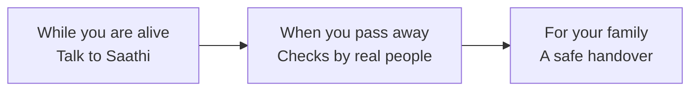

# Life-After: Concept

*Team Saathi · AI Builder Cup 2026 · BFSI track*

*An introduction to the idea. For how it is built, see [architecture.md](architecture.md); for what is available in each version, see [release-notes.md](release-notes.md).*

## In one sentence

**Life-After is an app with a friendly AI companion, Saathi, that helps a person record their stories, money matters and wishes while they are alive, and then hands everything over safely to the right family member when they pass away.**

## The problem

When someone dies suddenly, their family is left with questions nobody can answer:

- Which bank accounts, insurance policies and investments did they have?
- Who is the nominee? Where are the papers?
- What did they want to happen to the house, the savings, the watch?
- What are the passwords?

Because nobody knows, a lot of money is simply never claimed:

| Country | Money lost or unclaimed |
| --- | --- |
| India | About ₹72,000 crore in bank deposits, plus about ₹9,000 crore in insurance |
| Australia | About A$21.2 billion in superannuation |

Most people never write any of this down. Filling in forms is tedious, and thinking about death is uncomfortable.

## The idea

Make it as easy as **having a conversation**.

Instead of filling in forms, you simply talk to Saathi, a warm companion, the way you would talk to a trusted family friend. Saathi listens, asks gentle follow-up questions, and quietly builds up everything your family will need. You stay in control: nothing is kept until you say so.

## How it works, in three stages

### 1. While you are alive: talk to Saathi

- **Tap the microphone and just talk.** It feels like a phone call. Saathi answers out loud, and you can interrupt at any time.
- **Or type, or share a photo or document.** For example, snap a photo of an insurance policy and Saathi reads it for you.
- **Saathi suggests what to keep.** After each part of the conversation, small cards appear: a story, a piece of advice, a bank account, a family member. You tap **Keep** or **Not now**.
- **Next steps.** Saathi checks what your family would still be missing, such as "no nominee on this policy" or "no will for the flat", and gives you simple next steps with a button for each.
- **A secure vault.** Passwords and account details are locked on your own phone. Nobody else can read them, not even the Life-After team or the AI.
- **You choose who receives the vault**, usually a son, daughter or spouse. They accept in their own app, and you confirm a matching code.

### 2. When you pass away: careful checks

- A family member uploads the **death certificate**.
- The AI **pre-checks** it and flags anything suspicious. If it isn't a real certificate, it says so.
- **Two different people** on the Life-After team review the case: one confirms the death, another confirms the family member's legal authority.
- A **waiting period** follows. If the person is actually alive, one tap on their phone cancels everything.

### 3. For the family: a safe handover

- The chosen person **unlocks the vault on their own phone**.
- The family can **ask Saathi questions**, for example "What insurance did Papa have?". Saathi answers only from what was really recorded, shows where each answer came from, and says so when something was never recorded.
- Saathi prepares a **checklist and draft claim letters** for each bank and insurer.

## An example

> **Vikram, 58, Bengaluru**, taps the microphone one evening.
> *"My first job was at a textile mill in Mysore in 1987. I gave my whole first salary to my mother."*
> Saathi replies warmly and asks how his mother reacted. A card appears: **Story: First job and salary → Keep**.
>
> Later he mentions: *"I have an LIC policy ending in 4492. Please make Ajay the nominee."*
> Saathi adds the policy, asks *"Who is Ajay?"* ("my nephew"), and reminds him the change must also be submitted to LIC. It then appears in his **Next steps** with the exact steps.
>
> Years later, his daughter **Priya** receives the vault, asks *"What insurance did Papa have?"*, and gets the LIC policy, the nominee and a draft claim letter, all in her father's own words.

## What makes it different

| Most apps | Life-After |
| --- | --- |
| Long forms to fill in | A natural conversation, by voice or text |
| Memorial chatbots that imitate the person | **Never** clones a voice or invents answers; only the person's own words |
| Built after death, without the person's consent | Built **by the person, while alive**, with their approval for every item |
| A company can read your data | The vault is locked on the phone; neither the company nor the AI can open it |
| One person can unlock everything | Two reviewers, a waiting period, and the owner can cancel |

## Trust and safety, simply put

- **You decide.** Nothing is saved until you tap Keep.
- **No made-up answers.** If you never said it, Saathi says so.
- **No legal or financial advice.** Saathi points you to licensed partners (for example, for a will).
- **No voice cloning, no avatars.**
- **Your secrets stay locked** on your phone until the right person, and only that person, receives them after careful checks.
- **Other people's privacy.** Family members can ask to be added. While you are alive, only you can let them in.

## How the AI helps

The app isn't a set of screens with AI added on top. Each part is a small loop the AI runs, with clear limits:

| What the AI does | How much it decides |
| --- | --- |
| Listens, transcribes, reads documents, suggests cards | Does it on its own, within fixed rules |
| Anything that gets saved or shared | Only suggests; **you decide** |
| Checks death certificates and legal proof | Only helps; **a person decides** |
