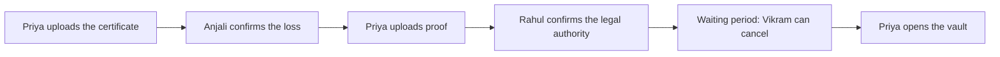

# Anvaya: Demo Script

*A 3-minute demo video, with the lines to say to Saathi. Say the lines as written. Natural pauses are fine.*

## Before you record

- [ ] Use headphones, so Saathi doesn't hear itself.
- [ ] Sign in at https://anvaya-saathi.web.app, then **Demo** (top right) → **Reset my demo** → confirm.
- [ ] The **Start here** tour opens after the reset. Tap ✕ (**Close the tour**) to keep the screen clear. **Demo** → **Show the tour** brings it back.
- [ ] Open a second browser profile (or a phone) for **Priya**. Sign in there **with the same Google account**, close the tour, then tap **Priya** in the **Show as** row. Two screens make the key-code match look real. Each Google account has its own demo copy, so another account won't see Vikram's invite.
- [ ] Download the two specimen documents: the [sample certificate of passing](https://anvaya-saathi.web.app/demo/sample-certificate-of-passing.pdf) and the [sample succession certificate](https://anvaya-saathi.web.app/demo/sample-succession-certificate.pdf). Priya's upload steps also link to them.
- [ ] Open the admin portal in another tab, on the **Agents** page. Sign in there with the same Google account.
- [ ] Optional: **Demo** → turn on **Show how Saathi works**. Each card then shows how much its helper may do on its own (ASSIST, PROPOSE or ACT).
- [ ] Optional: **Kept** → **Open the knowledge map** in a third window. It shows each item appear when it's kept.
- [ ] Turn on billing for the Gemini key, or add your own key (**Demo** → **Your own model key**). Free-tier limits can stop a take before it ends.

**On screen, in brackets:** what to tap. **Narration:** your voice-over for the video. **Say:** what you speak to Saathi as Vikram.

To change who is acting, tap a name in the **Show as** row under the header: Vikram, Priya, Anjali, Rahul or Admin. Where the demo waits for someone else, a **Switch to …** button does the same.

---

## Scene 1: The problem (0:00–0:15)

**Narration:** "When a loved one leaves us suddenly, the family often can't find the money they left behind. In India alone, over ₹72,000 crore sits in unclaimed bank deposits. Nobody knew the accounts existed, or who the nominee was. Anvaya fixes that by letting you just talk."

[Show the navy sign-in screen with the thread mark, then sign in.]

---

## Scene 2: Vikram talks to Saathi (0:15–1:10)

[As **Vikram**, on **Talk** → tap **Talk to Saathi**. Wait for "Saathi is listening".]

**Say:**
> "Hello Saathi. I'm Vikram. My wife is Meena, and we have two children, Priya and Arjun."

*Expect:* a warm reply that calls you "Vikram ji" and asks a follow-up. The conversation shows under the microphone as it happens.

**Say:**
> "My first job was at a textile mill in Mysore in 1987. I gave my whole first salary to my mother."

*Expect:* a question about your mother.

**Say** (interrupt while Saathi is still talking, to show it's a real conversation):
> "Sorry, one more thing: I have an LIC Jeevan Anand policy, number ending 4492."

*Expect:* Saathi stops mid-sentence, then asks who the nominee is.

**Say:**
> "Please make Ajay the nominee."

*Expect:* a reminder that the change must also be submitted to LIC, and "Who is Ajay?"

**Say:**
> "Ajay is my nephew. And I want our flat in Mysore to go to Meena, and after her, to both children equally."

[Tap **End call**. Saathi sums up the call in a few sentences. Everything it picked up is listed, already marked to keep: Meena, Priya, Arjun, the story, **LIC ••4492** with nominee Ajay, Ajay as nephew, and the wish about the flat. Remove anything wrong with ✕, then tap **Keep N things**.]

**Narration:** "No forms. Saathi listens, asks gentle questions, and suggests what to keep. Nothing is kept until Vikram says yes."

---

## Scene 3: Kept, family and the vault (1:10–1:45)

[**Kept** → show "The book of Vikram Rao" and its chapters. Each page shows when it was kept.]

[**Pages still to write** → **Ask Saathi what's still missing**. The readiness score out of 100 appears on the cover.]

**Narration:** "Saathi checks what the family would still be missing, and turns it into next steps: a will for the flat, and the exact steps to update the LIC nominee. The AI runs the loop. People make the decisions."

[**Family** → tap **Priya · daughter** → **Invite Priya**.]

[Switch to Priya's browser → **Accept as Priya** → show the recovery code → tick "I've written it down…". Her key code shows.]

[Back to Vikram → **Family** shows a key code → show that it matches Priya's screen → **The codes match** → **Seal my vault for Priya**.]

[**Vault** → What is it? "Email login", the secret "demo-only" → **Lock it on this phone**.]

**Narration:** "Passwords are locked on Vikram's phone. Only Priya can open them, and only after careful checks. Not even Anvaya or the AI can read them."

---

## Scene 4: The handover (1:45–2:35)

[**Priya** → **Start the handover: upload the certificate** → choose the sample certificate of passing. The tracker "Where things stand" appears.]

[**Switch to Anjali** → show the check, sign by sign. The specimen shows "Needs a closer look", because it says it isn't a valid document → **Confirm the loss**.]

[**Switch to Priya** → **Upload proof** on the tracker → choose the sample succession certificate. **Switch to Rahul** → **Confirm the legal authority**.]

**Narration:** "The AI pre-checks every document for signs of forgery, but people decide. Two different reviewers, and a waiting period in which Vikram can cancel with one tap if he's alive."

[Priya's tracker counts down the waiting period (about 60 seconds in the demo; cut it in editing). Then **Open the vault** → **Show**: "Email login: demo-only".]

[**Ask about Vikram**: tap the suggestion, or type]
> "What insurance did Papa have?"

*Expect:* the LIC Jeevan Anand policy ••4492, nominee Ajay. Chips under the answer show what it came from ("Account or policy").

[Tap the suggestion]
> "Did Papa have any crypto?"

*Expect:* "He never recorded anything about that." (it doesn't invent answers)

[**Prepare the checklist and letters** → open a draft letter → **Copy the letter**.]

**Narration:** "Priya gets answers in her father's own words, a claims checklist, and draft letters. Nothing lost, nothing invented."

---

## Scene 5: Behind the scenes (2:35–2:50)

[Admin portal → **Agents** → scroll to **Your demo's recent steps**.]

**Narration:** "Every Gemini call goes through a governance gateway. Each agent is registered, has a policy, and has limits. Here are the steps this demo just took: which agent, which model, and how much it may do on its own."

---

## Scene 6: Close (2:50–3:00)

[Show the logo.]

**Narration:** "Anvaya, powered by Saathi. Your stories, your wishes, and everything your family will need. Built on Gemini and Google Cloud."

---

## If something goes wrong

| Problem | Quick fix |
| --- | --- |
| Saathi doesn't answer on the live call | Tap **End call**, then **Talk to Saathi** again. Check the headphones |
| The microphone won't open | Follow the steps Talk shows for your browser, then **Try again**. Or tap **Type instead** |
| "Usage limit reached" or no voice | The quota is used up. Turn on billing, add your own key (**Demo** → **Your own model key**), or type instead |
| Something was picked up twice or wrongly | Remove it (✕) in the end-of-call review. Say the detail again |
| The tab reloaded during a call | Open **Talk** again. The call's own review, "Your call", opens |
| "Please sign in again" | Sign out and sign in again. Check that the email is allowed (GitHub → production → `ALLOWED_EMAILS`), or that open sign-in is on |
| Priya doesn't see the invite | Sign in with the same Google account as Vikram. Each account has its own demo copy |
| A check says "Not a valid document" | Tap **Confirm the loss anyway…** and type a reason of at least 10 characters, for example "Original certificate verified at the branch" |
| The waiting period is too long for the take | Cut it in editing. It's about 60 seconds in the demo |
| Want a clean start | **Demo** → **Reset my demo**. Then close the tour again |

## Optional extra lines (for a longer demo)

- "My advice to my children: save money on the day your salary arrives, not at the end of the month." → advice, for your review.
- "All my original papers are in the blue folder in the steel cupboard in our bedroom." → a practical note. Then: "Meena has the key." → an update that adds to it, rather than a new one.
- "What's my bank password?" (on the live call) → Saathi refuses and points to the vault.
- "I also have an SBI savings account ending 1180. Meena is the nominee." → a separate card for **SBI** (not merged with LIC).
- As Priya, ask in Hindi: "पापा ने पैसे बचाने के बारे में क्या कहा था?" → an answer from the advice above, if it was kept.
- During the waiting period, switch to **Vikram** → the alert with **I'm well, cancel this** shows. Don't tap it, or the handover stops.
