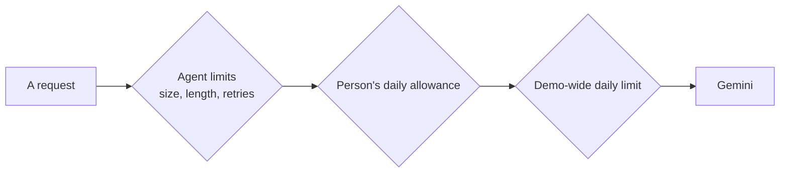

# Anvaya: Defined Limits

*Every limit the prototype sets on purpose: how long, how much, how often. Last updated 16 October 2026.*

These limits keep the demo safe, fair and affordable. Each one is enforced in code. Agent limits live in [`agents/policies.yaml`](../agents/policies.yaml), and a broken file stops the service at start-up. Other limits are constants in the code, named in the "Set in" column.

## Conversations and calls

| Limit | Value | Set in |
| --- | --- | --- |
| **Length of one live call** | **About 15 minutes in practice.** Our policy allows 20 minutes, but Gemini Live ends a voice session at about 15. Saathi then sums up the call as usual, and the owner can start a new one. Resuming sessions past 15 minutes is planned. | `saathi.voice: max_call_minutes: 20`; Gemini Live |
| A live call also ends | When the person's voice minutes for the day run out | `user_allowances` |
| Length of one spoken reply | 1,000 characters | `saathi.speech: max_characters` |
| Audio kept for one exchange of a call | 90 seconds, in memory only, to notice another voice and for the voice check. After an exchange without the owner's words, its last 3 seconds carry over to the next | `live.MAX_EXCHANGE_AUDIO`, `CARRY_OVER_AUDIO` |
| The voice check on a call | The first 5 seconds of the owner's speech in each exchange, after the silence before it. Less than 2 seconds gives no answer, and holds nothing back | `voiceprint.CLIP_SECONDS`, `MIN_SECONDS` |
| A voice that matches the owner's | A similarity of 0.35 or more with their voiceprint. A registration sample below 0.35 isn't kept | `voiceprint.MATCH_THRESHOLD` |
| Samples in a voiceprint | The check is on from 3; the oldest drops out after 10. One recording is at most 20 seconds | `voiceprint.SAMPLES_NEEDED`, `MAX_SAMPLES`, `MAX_UPLOAD_SECONDS` |
| "This conversation" | Saathi's last message counts as the same conversation for 30 minutes | `gaps.CONVERSATION_GAP` |
| The same question in one conversation | Asked once. A topic the owner talks past waits for the next conversation, and a reply that repeats a question is rewritten once | `planner.after_turn`, `loops.REPEAT_OVERLAP` (0.5) |
| Topics in the plan | Up to 5 that Saathi opens, and 3 that wait for the owner | `planner.MAX_SAATHI_STEPS`, `MAX_OWNER_STEPS` |
| Next steps shown on Kept | Up to 5 | `tasks.MAX_OPEN` |
| Wait for a call's review | At most about 12 seconds, with "Review now" after 4 | `web/src/v2/owner/Talk.tsx` |
| A call's review after the page reloads | Kept for 6 hours, in that browser | `Talk.tsx: CALL_KEPT_MS` |
| Checking something said with doubt ("I think…") | Comes up again after 14 days | `gaps.CONFIRM_AFTER_DAYS` |
| Re-checking accounts and policies | Once a year | `knowledge.STALE_AFTER_DAYS` |

## Cards say only what was said

| Limit | Value | Set in |
| --- | --- | --- |
| How close a quote must be to the owner's words | 85% | `grounding.QUOTE_MATCH` |
| Words of a value that must appear in what was said | Two thirds | `grounding.FIELD_SUPPORT` |
| Account and policy numbers | Only the last 4 digits are ever kept | `schemas.InventoryItem`, grounding |
| "N/A", "NA", "nil", "-" | Treated as empty: never shown or kept | `grounding.PLACEHOLDERS` |

## Daily allowances

Use is counted on the server for each signed-in account, and resets each day. Certificate checks and the guardian never count against any allowance, so checking a certificate always works. Calls on a person's own Gemini key don't count either.

| Who | Tokens | Voice minutes | Spoken replies |
| --- | --- | --- | --- |
| Owner | 300,000 a day | 30 a day | 50 a day |
| Family member | 200,000 a day | | |

| Limit | Value | Set in |
| --- | --- | --- |
| Warning in the app | At 80% of an allowance | `core.WARN_AT` |
| "Ask for more", at most | 300,000 tokens, 60 voice minutes or 100 spoken replies, for up to 72 hours. A person approves it, and nobody can approve their own request | `core.REQUEST_LIMITS`, `REQUEST_MAX_HOURS` |
| A judge approving their own copy's requests | At most 2 grants in any 24 hours, and none while the shared daily ceiling for that measure is past its optional pause line. Rejecting is never limited, and real approvers aren't held to this | `core.SELF_GRANTS_PER_DAY`, `self_grant_refusal` |

## The demo-wide daily limit

Shared by everyone, so the demo can't overspend. It resets at midnight UTC.

| Limit | Value | Set in |
| --- | --- | --- |
| Tokens a day | 10 million | `service_ceiling.tokens_per_day` |
| Voice minutes a day | 300 | `service_ceiling.voice_minutes_per_day` |
| Optional features pause | At 80% of the day: live voice, spoken replies and summaries first | `optional_pause_at: 0.8` |
| Reserved for safety | The last 10%: only certificate checks and the guardian | `safety_reserve: 0.1` |
| The hourly fraud cycle | Skips an hour once the fraud agents have used 20% of the day | `scheduled_fraud_share: 0.2` |
| Kill switch | A platform admin can stop all agents at once | Admin portal |

## Limits for each agent

Every Gemini call passes one gateway. A request larger than its input limit is refused before anything is spent. The output limit is sent with the request, so the model stops there. A failed call is retried, then tried once on the fallback model.

| Agent | Input tokens | Output tokens | Retries | Other |
| --- | --- | --- | --- | --- |
| `saathi.chat` (typed conversation) | 20,000 | 4,000 | 2 | |
| `saathi.voice` (live call) | | | | 20 minutes a call |
| `saathi.speech` (spoken replies) | | | | 1,000 characters |
| `capture.extractor` (cards) | 20,000 | 4,000 | 2 | |
| `saathi.summary` | 12,000 | 600 | 2 | |
| `documents.reader` | 8,000 | 2,000 | 2 | |
| `readiness.planner` | 30,000 | 4,000 | 2 | |
| `legal.needs` | 20,000 | 2,000 | 2 | |
| `activation.checker` (certificates) | 8,000 | 2,000 | 2 | Never limited by an allowance |
| `handover.assistant` (family questions) | 60,000 | 1,500 | 2 | 6 model calls per question |
| `settlement.planner` (checklist and letters) | 30,000 | 8,000 | 2 | |
| `guardian.detectors` | 8,000 | 1,000 | 1 | Never limited by an allowance |
| `fraud.researcher` | 8,000 | 2,000 | 1 | 8 model calls, 2 new patterns and 2 subjects per run |
| `fraud.dreamer` | 12,000 | 4,000 | 1 | 8 model calls, 2 sequences of up to 3 scenarios per run |
| `access.tester` (own-key test) | 100 | 16 | 0 | 10 tests a minute |

## The handover

| Limit | Value | Set in |
| --- | --- | --- |
| Reviewers | Two different people: one confirms the loss, the other the legal authority | `release.py` |
| Going against a "not valid" check | Needs a written reason of at least 10 characters, kept in the audit log | `release.py` |
| Waiting period | 60 seconds in the demo (days in a real service). The owner can cancel with one tap | `RELEASE_WAIT_SECONDS` |
| Certificate check caps | The wrong kind of document scores 0%; the wrong person at most 30%; a reviewed warning sign found at most 50% | `loops.review_summary` |
| Recovery code | 25 characters, 125 bits of randomness | `web/src/vaultCrypto.ts` |
| Family questions | More than 30 in an hour gets a quiet look from our team | `guardian_inputs.BURST_PER_HOUR` |

## The fraud module

| Limit | Value | Set in |
| --- | --- | --- |
| How often it runs | Every hour, through Cloud Scheduler | `deploy.yml` |
| Added on its own | Only what at least 2 independent websites confirm | `fraud_pipeline.AUTO_MIN_SOURCES` |
| A new warning sign | Always waits for a reviewer | `fraud_pipeline.py` |
| Spot checks | 1 in 10 added items | `SPOT_CHECK_EVERY` |
| Pausing | 2 removals in 7 days pause adding for that guide | `PAUSE_AFTER_REMOVALS`, `REMOVAL_WINDOW_SECONDS` |
| Unconfirmed ideas | Fade after 3 runs | `FADE_AFTER_RUNS` |
| A subject that finds nothing new | Rests for 7 days after 3 runs | `SUBJECT_REST_AFTER`, `SUBJECT_REST_SECONDS` |
| Length of one run | At most 35 minutes; a queued run is dropped after 2 hours | `RUN_TIMEOUT_SECONDS`, `QUEUED_TIMEOUT_SECONDS` |
| Web search | 5 results per search, 3,000 characters per page, 30-second timeout. A quote under 30 characters can't count as support | `web_search.py` |
| Common gaps used by dreaming | Counts of 5 or more owners only (an admin can raise this, never lower it); never who or what | `fraud_cues.FLOOR` |

## How long data is kept

| Data | Kept for | Set in |
| --- | --- | --- |
| The family's conversation with the assistant | 30 days, in that demo copy only | `executor_agent.TURNS_KEPT_DAYS` |
| Guardian action records | 30 days | `guardian.KEPT_DAYS` |
| Recent AI steps shown on the Agents page | 2 days (the last 24 hours shown, up to 50 steps) | `core.STEPS_KEPT_DAYS` |
| Hourly use for the charts | 14 days | `core.HOURS_KEPT_DAYS` |
| History of each kept item | Every change keeps its own record; the catalog lists the last 2,000 | `knowledge.MAX_EVENTS` |

## Admin portal lists

| Limit | Value | Set in |
| --- | --- | --- |
| Rows on one page | 20 by default; at most 100 | `paging.DEFAULT_SIZE`, `MAX_SIZE` |
| A search | At most 100 characters. It matches every word, in any case, in the words the portal already shows; never conversation text | `paging.MAX_QUERY`, `paging.search` |
| Dates | Whole days in UTC, from the start of the "from" day to the end of the "to" day | `paging.page_query` |

## Anonymous user keys

The admin portal and the logs show each person as a short key, never a name or email. The key is a hash of the person's sign-in ID and a salt.

| Limit | Value | Set in |
| --- | --- | --- |
| The salt | `anvaya-demo`, the public default. Production doesn't set its own | `USER_KEY_SALT` in `config.py` |
| What the key hides | Who a person is, from anyone who reads the portal or the logs. It is not a strong defence: anyone with a person's sign-in ID and this repo can work out their key. Sign-in IDs are random and never shown | `core.user_key`, `step_guard._digest` |
| Why it stays for now | The key is also the ID of each person's demo copy. A new salt cuts every person off from their demo copy, their use, their allowance and their requests. All demo data is synthetic, so the risk is low | Owner's decision, 16 October 2026 |
| Before real users | Set a secret `USER_KEY_SALT`, and start from fresh demo copies | Not yet done |

See also: [architecture](architecture.md) (design, security and governance) and the [release notes](release-notes.md).
