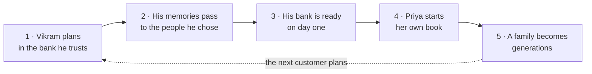

# Anvaya, for banks and insurers

*Team Saathi · BFSI track · Revision 7, 17 October 2026 · the full picture is in [concept.md](concept.md); for individuals, see [pitch-individuals.md](pitch-individuals.md); how it is built is in [architecture.md](architecture.md)*

> **Where this stands.** Anvaya runs today as a service people use directly: they talk with Saathi, keep a book for their family, lock their secrets on their own phone, and hand everything over through careful checks. Everything here that connects Anvaya to a bank or insurer is **a design we will build with our first institutional partners**. This pitch explains why you would offer it.

---

## The week that decides the relationship

Every institution will one day meet a family in the worst week of their lives. A customer has left them suddenly. The family doesn't know which accounts existed, who the nominee is, or where the papers are.

How that family is treated decides whether the next generation stays with you, or quietly moves everything elsewhere. And in India, that week now comes with a clock.

| What's at stake | |
| --- | --- |
| **A 15-day deadline** | Indian banks must settle claims within 15 days of a complete file, or pay interest of at least Bank Rate + 4%, and ₹5,000 a day for lockers.[^rbi-claims] Life insurers have 15 days from intimation.[^irdai] |
| **Money nobody claims** | ₹72,454 crore in Indian bank deposits[^in-bank] and ₹8,974 crore in insurance[^in-ins] wait to be claimed. Japan sent a record ¥129.2 billion to the treasury in one year because no heir came forward.[^jp] |
| **Missing nominees** | In Singapore, 2 in 5 people lost before 65 had named no nominee for their CPF savings.[^sg] India now allows up to four nominees per account, and most customers will never update theirs unprompted.[^nominees] |
| **Losing the heir** | An heir who goes through a painful claim takes the money elsewhere. |

## One customer becomes generations

This is the story our demo film ends with, and the reason to offer Anvaya.

| The story | What it means for you |
| --- | --- |
| **1 · Kept where his money already is.** Vikram, 58, has banked with you for thirty years. One evening, inside your app, he talks with Saathi about his family, his first job and his LIC policy, and names his nephew as nominee. | An engaged customer, with nominees reviewed while he is here and complete records |
| **2 · Passed to the people he chose.** When the time comes, careful checks and two different people confirm the loss and his daughter Priya's authority. A waiting period follows, so a mistake can be cancelled. | A claim you can trust, with fraud stopped before it reaches your desk |
| **3 · Ready on day one, and Priya stays.** Priya walks into your branch with one folder. Your team already has a complete, checked file. The 15-day clock is comfortable, not a race. | Settlement on time, fewer documents chased, and an heir with a reason to stay |
| **4 · She starts her own book.** A year later, Priya adds her own memories to her father's, for her daughter. | The next generation becomes your customer |
| **5 · A family becomes generations,** across cities and across Asia. | Customers for generations, at almost no cost to win |

**The family owns the thread. You host it.** You see counts, never names or words, and receive information only about your own products.

## After the handover: money well used

For you, a claim ends when the money is paid. For the family, that's when the hard part starts, and it's where the money stays or leaves.

Before he leaves, Vikram records a wish: *"A monthly income for Meena; the rest for the grandchildren's education."* After the handover, Saathi would stay with the family through four stages: **receive** every claim until it's paid; **protect** them from scams and rushed decisions; **settle** loans and taxes first; and **use the money as he wished**, with licensed advice. For you: deposits that stay, and products that fit, such as an annuity for income or a goal deposit for education. Saathi guides, licensed people advise, and the family decides.

## What you would get

| What you want | How Anvaya would deliver it | What a pilot measures |
| --- | --- | --- |
| **The next generation** | A kind, quick first experience for the heir, who then starts their own book with you | Heir retention; heirs who start their own book |
| **Faster settlement** | A complete, pre-checked claim file, so the clock starts sooner and ends on time | Days to a complete file; share settled within the deadline |
| **Complete nominations** | Saathi gently asks about missing nominees, and takes the customer into your own nominee journey | Nomination completeness, before and after |
| **Less fraud** | A guardian that watches the whole journey, not only the claim | Suspect cases caught before reaching you |
| **Fewer unclaimed balances** | Accounts found and checked at the source, and every account on the family's checklist | Accounts found that the customer hadn't mentioned |
| **Rule changes that land** | Each change becomes one gentle question: *"You can now name up to 4 nominees. Your account has 1."* | Share of affected customers up to date |

## How it would work with you

- **Bank-first, not bank-only.** Your accounts, deposits and lockers would arrive pre-filled, for the customer to confirm with **Keep**. Accounts held elsewhere stay private, for the family. You receive a claim file for your own products only.
- **Readiness at the source.** With the customer's consent, accounts and nominee status would be checked through India's Account Aggregator network, where your institution is the regulated recipient and Anvaya your technology service provider.[^fiu] This has to happen while the customer is here, because consent lapses with them.
- **Your journeys, your records.** Nominee updates go through your own journey. Saathi never changes your records.
- **Neutral by design.** When a customer needs a professional, Saathi shows a few vetted options in a neutral order. Your own products appear among them, clearly labelled as yours.
- **No core-system changes.** A branded app or screens inside your app, single sign-on, and claim files delivered to your claims system.

## Trust you can test

**Protecting every family today**
- Everything new the customer says passes a guardian before it can be kept. A password someone asked for, or a payment someone else wants, never becomes a record.
- Each certificate is checked for known signs of forgery. Two different reviewers decide, and overriding a check needs a written reason.
- The customer is told first, with a one-tap cancel, and a waiting period follows.
- Another voice on a call is noticed. A voice alone never authorises anything important. A voice check for the owner is being tested: a card that doesn't sound like the owner waits until they confirm on it that it was them.
- A fraud reference grows every hour. A new tactic is added only when two independent sources confirm it, and a reviewer can remove anything.
- The vault is encrypted on the customer's phone. Not Anvaya, not you, can read it. Each person sees only their own part.
- Every agent is registered, with only the models and tools it is allowed, and within a budget. Every decision is logged, and our team can follow one conversation end to end, by decisions only, never words.

**What we would add with you:** pressure and cloned-voice checks, cooling-off for new devices, random reviewer assignment, SMS and email alerts, Model Armor, per-bank encryption keys, India data residency, and your own governance dashboard and audit export.

**Built for regulated partners.** Anvaya is designed to be engaged under the RBI's rules on outsourcing technology services, with audit rights, and to meet the DPDP Act's consent requirements.[^rbi-outsourcing][^dpdp] A person decides every outcome that affects a claim. Anvaya is not yet certified: an independent penetration test comes before any live customer data, and ISO 27001 and SOC 2 are on the roadmap.

## The pilot we propose

| | |
| --- | --- |
| **Scope** | One segment, such as savings or life customers aged 50 and over, in two or three languages, for six months |
| **What we build together** | The branded app, pre-filling, the claim file, rule-change prompts and readiness checks, with no core-system changes |
| **Pricing** | A yearly licence per enrolled customer, indicatively ₹499 a year in India. A fixed pilot fee, credited against the first year if you continue. Families never pay for the handover |
| **Before live data** | Your security review, an independent penetration test, and data kept in-country where required |

## What exists today, and what we would build together

| Runs today (synthetic data) | We would build with you |
| --- | --- |
| Voice and typed conversation in the customer's language; Keep cards that say only what was said; the family book with next steps; the vault on the phone; two-reviewer checks with a waiting period and one-tap cancel; the family's questions answered with sources; checklists and draft letters; the guardian and an hourly fraud reference; governed agents and an admin portal | Anvaya inside your app; pre-filling from your records; the claim file and your bank view; rule-change prompts; Account Aggregator readiness checks; help with the money after the handover; your dashboard and audit export; the protections listed above |

## Let's talk

We are looking for one bank and one insurer to build the institutional side with us: to be the institutions families remember as the ones that helped, to meet the new deadlines with room to spare, and to keep the next generation.

## Sources

[^rbi-claims]: Reserve Bank of India, [*Commercial Banks – Responsible Business Conduct Directions, 2025*](https://www.rbi.org.in/Scripts/BS_ViewMasDirections.aspx?id=13140) (RBI/DOR/2025-26/170, 28 November 2025, updated 1 October 2026), the part on settlement of claims in respect of deceased customers. It replaced the separate *Settlement of Claims Directions, 2025*, which RBI withdrew on 28 November 2025; the deadlines and compensation are unchanged.
[^irdai]: IRDAI, [*Master Circular on Protection of Policyholders' Interests, 2024*](https://irdai.gov.in/document-detail?documentId=5625747) (5 September 2024).
[^in-bank]: Written reply by the Minister of State for Finance in Parliament, as reported in [Free Press Journal](https://www.freepressjournal.in/business/unclaimed-bank-deposits-in-rbis-dea-fund-reach-72454-crore-government-promotes-udgam-portal-multiple-nominations) (PTI), as of 28 January 2026.
[^in-ins]: Ministry of Finance, [Press Information Bureau](https://www.pib.gov.in/PressReleasePage.aspx?PRID=2244475), 24 March 2026, as of 28 February 2026.
[^jp]: Supreme Court of Japan figures for financial year 2024, reported by [Bloomberg](https://www.bloomberg.com/jp/news/articles/2025-12-08/T6Q1AWKGIFQM00), 8 December 2025.
[^sg]: CPF Board, [*CPF nominations*](https://www.cpf.gov.sg/member/infohub/reports-and-statistics/cpf-trends/cpf-nominations) (2023 data).
[^nominees]: Ministry of Finance, [*Key provisions relating to nomination under the Banking Laws (Amendment) Act, 2025*](https://www.pib.gov.in/PressReleasePage.aspx?PRID=2181734), 23 October 2025.
[^fiu]: Sahamati, [*Financial Information Users in the AA ecosystem*](https://sahamati.org.in/fiu/).
[^rbi-outsourcing]: Reserve Bank of India, [*Master Direction on Outsourcing of Information Technology Services*](https://www.rbi.org.in/scripts/BS_ViewMasDirections.aspx?id=12486) (10 April 2023).
[^dpdp]: Ministry of Electronics and Information Technology, [*DPDP Rules, 2025 notified*](https://static.pib.gov.in/WriteReadData/specificdocs/documents/2025/nov/doc20251117695301.pdf), November 2025.

---

*Nobody can choose when they leave. Anvaya makes sure the families you serve are not left without answers, and not left looking elsewhere.*
