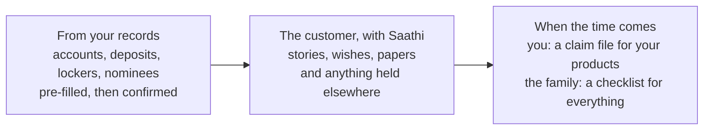
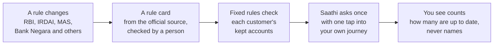
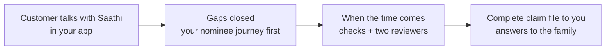

# Anvaya, for banks and insurers

*Team Saathi · BFSI track · Revision 5, 12 October 2026 · the full picture is in [concept.md](concept.md); the pitch to individuals is in [pitch-individuals.md](pitch-individuals.md); costs and margins are in [business-model.md](business-model.md); how it is built is in [architecture.md](architecture.md)*

---

## The moment that defines the relationship

Every institution will one day meet a family on the worst week of their lives. A customer has left them suddenly. There was no goodbye, and no folder on the shelf. The family doesn't know which accounts existed, who the nominee is, or where the papers are.

This doesn't only happen late in life. Across Asia, sudden loss takes people in their 20s, 30s and 40s, the years when a family depends on them most:

- **India:** at AIIMS Delhi, 57% of the sudden losses studied were people aged 18 to 45, most of them "apparently healthy".[^young-in] Adults aged 18 to 45 were 66.4% of those lost on India's roads in 2023.[^roads-in]
- **South Korea:** more than 5,000 people aged 50 or younger have a sudden cardiac arrest each year.[^young-kr]
- **Malaysia:** one in four patients with an acute heart attack is under 50.[^young-my]
- **South-East Asia:** road crashes are the leading cause of loss for people aged 5 to 29.[^roads-who]

A young customer has the least reason to have put things in order. Their family has the most to lose.

How that family is treated in that week decides whether the next generation stays with you, or quietly moves everything elsewhere. And more and more, it is also a matter of regulation. In India, since 2026, it comes with a clock and a penalty attached.

## Why now

Regulators across Asia are making the family's claim faster, simpler and measured. In India it is now a time-bound obligation.

**In India** *(the deadlines and penalties below are Indian rules; other countries follow)*

| What changed | What it means for you |
| --- | --- |
| **Indian commercial banks: a 15-day deadline (RBI).** Claims on the deposit accounts of a customer who is no longer here must be settled within **15 calendar days** of receiving all required documents.[^rbi-claims] | If the delay is the bank's, it pays interest of **at least Bank Rate + 4%** on the amount due, and **₹5,000 a day** for lockers and safe custody. The clock starts only when the file is complete, so incomplete files are where the time and the complaints go. |
| **Indian life insurers: 15 days from intimation (IRDAI).** Life claims not needing investigation must be settled **within 15 days of intimation**; those needing investigation, within 45 days.[^irdai] | Late settlement costs **bank rate + 2%** from the day of intimation. For an insurer, the clock starts before the documents arrive. |
| **Up to four nominees.** From 1 November 2025, Indian bank depositors can name up to four nominees, together with their shares or in order.[^nominees] | Every customer's nomination is worth revisiting, and most won't do it unprompted. |
| **Unclaimed money is a national priority.** RBI paid banks up to 7.5% of the amount to return inoperative and unclaimed deposits (October 2025 to September 2026)[^rbi-incentive], and a joint RBI, IRDAI and SEBI campaign returned ₹5,777 crore across 748 districts.[^in-ins] | The regulator measures how well you reunite money with families. Preventing the money going unclaimed in the first place is the cheapest way to do it. |
| **Data protection is arriving in phases.** India's DPDP Rules were notified on 13 November 2025, with consent managers from November 2026 and full obligations from May 2027.[^dpdp] | Any service touching customer data must be consent-first by design. Anvaya is built that way. |

**Across the rest of Asia** *(different rules, the same direction)*

| Where | What changed | What it signals |
| --- | --- | --- |
| **Hong Kong** | The HKMA backed a new banking practice (14 April 2025) letting banks pay estate administrators the actual balance without waiting for the grant to be amended, within set limits.[^hk] | Regulators want estate payouts simpler and faster |
| **South Korea** | Since 12 November 2024, life insurance payouts can be placed in trust, so family receive them on a schedule the policyholder chose.[^kr-trust] The regulator's campaign to return dormant insurance money has returned over ₩16.8 trillion since 2017.[^kr-fsc] | Policyholders are expected to plan how their family receives money, not just who |
| **Japan** | Heirs can ask one bank to locate the family member's accounts at other banks, where those accounts were linked to their My Number, for up to 10 years.[^jp-mynumber] | The state is building tools because families can't find the accounts |
| **Singapore** | Without a CPF nomination, savings go to the Public Trustee to distribute under intestacy law, after a fee and up to six months to identify the family.[^sg-cpf] | Nomination is the single biggest lever for a smooth handover |
| **Malaysia** | The Unclaimed Moneys (Amendment) Act 2024, in force 1 August 2024, moves unclaimed money to government revenue after 10 years instead of 15.[^my-act] | Less time for families to find what is theirs |

Regulators are also setting rules for automated decisions in finance: Korea's FSC guidelines take effect on 22 June 2026, and they require that people supervise automated decisions.[^kr-guide] Anvaya's checks already work this way: a person decides every outcome.

## The cost of families not knowing

| Where | What is waiting to be claimed | As of |
| --- | --- | --- |
| **India** | ₹72,454 crore in bank deposits, moved to the Reserve Bank of India's Depositor Education and Awareness Fund after ten years untouched[^in-bank] | 28 Jan 2026 |
| | ₹8,974 crore in insurance, still with the insurers[^in-ins] | 28 Feb 2026 |
| | ₹3,749 crore in mutual funds[^in-ins] | 28 Feb 2026 |
| **Japan** | ¥129.2 billion in estates handed to the national treasury because no heir came forward, the highest since records began in 2013[^jp] | Financial year 2024 |
| **South Korea** | More than ₩10 trillion in unclaimed insurance money[^kr] | 2026 |
| **Malaysia** | RM13.3 billion with the Accountant General; only about RM4 billion has ever been claimed back since 1977[^my] | April 2025 |
| **Australia** | A$21.2 billion in lost and unclaimed superannuation, across about 7.5 million accounts[^au] | 30 Jun 2026 |

And it is the sudden losses that leave families least prepared. In Singapore, **2 in 5 CPF members lost before the age of 65 had named no nominee**, against about 1 in 5 overall.[^sg]

These totals count all unclaimed money, not only what was left behind by someone who is gone. But every family who has lost someone suddenly knows how it happens: the one person who knew about the account is the one person they can no longer ask.

| For your institution | What it means |
| --- | --- |
| Settlement deadlines | In India, a 15-day clock, with interest or daily compensation when the delay is yours; elsewhere, regulators are pushing for faster, simpler estate payouts |
| Incomplete files | Families don't know what to submit, so files go back and forth and the clock can't start |
| Missing or outdated nominees | Claims that need legal heirship papers, take months and generate complaints |
| Fraud | Forged certificates, false heirs, and people quietly using the accounts of a customer who is no longer here |
| Unclaimed balances | Regulatory reporting, transfers to a regulator's fund, and scrutiny of how well you reunite money with families |
| Losing the next generation | Heirs who go through a painful claims experience take their money elsewhere |

## What Anvaya is

**Anvaya is a succession service you offer your customers under your brand. They talk with Saathi, Anvaya's warm companion, about their accounts, nominees and wishes. Saathi helps them close the gaps while they are here. When the time comes, the right family member receives a careful, fraud-checked handover, and you receive a complete, pre-checked claim file.**

## Bank-first, not bank-only

In many places, people stay loyal to one bank for life. They keep most of their money there, and they trust it more than any app. That makes your institution the natural place to offer Anvaya.

- **Pre-filled from your records.** Your accounts, deposits, lockers and nominees appear as cards. The customer confirms each one with **Keep**. There is nothing to discover and little to type.
- **Room for the rest.** The customer can also record an insurance policy, or an account at another institution. It stays private, for the family. **You never see it**, unless the customer agrees.
- **Each gets their part.** You receive a claim file for your own products only. The family receives a checklist and letters for everything, wherever it is held.

So you never have to promote a competitor, and your customer never has to hand a competitor their whole financial life. Because loyal customers keep most of their money with you, a bank-led Anvaya already covers most of what their family will need.

*Pre-filling from your records is pilot work. Today the prototype records what the customer says, types or shows in a photo.*

## What the claim packet saves your team

Anvaya doesn't replace your settlement process, and it doesn't certify legal heirship. Your staff still verify and decide, under your own policy. What changes is **what arrives on their desk**.

| Today | With Anvaya |
| --- | --- |
| The family doesn't know which of your products the customer held | The packet lists every account and policy the customer recorded with you |
| Documents arrive piecemeal and incomplete; the file goes back and forth | The family is guided to the exact documents your process needs before the file reaches you |
| Forged or wrong certificates are found late, by hand | Every certificate is checked for forgery, the wrong person and the wrong document, and **two independent reviewers** confirm the loss and the claimant's authority, each with a logged reason |
| Nominee details are missing or outdated | Nominees were reviewed with the customer while they were here, and Saathi can prompt a review when life changes, such as a marriage or a new grandchild |
| A mistaken or fraudulent report surfaces after payment | A **waiting period**, during which the customer's own phone can cancel the case, before anything is released |

**Who is responsible for what**

- **Anvaya** is responsible for its checks and reviews being carried out as described, with a complete audit record, and stands behind that under contract.
- **Your institution** remains responsible for the settlement decision, as the regulations require.
- **The family** receives guidance and draft letters, never legal advice. Legal help comes only from licensed partners.

## Readiness checked at the source

Today most succession planning relies on what a customer remembers. **What they forget is exactly what ends up unclaimed.** Anvaya checks at the source.

- **Discovery.** With the customer's consent, their accounts and policies are found at the source, through India's **Account Aggregator** network, which had 2.61 billion accounts enabled for sharing at the end of 2025.[^aa] Customers can also upload their own consolidated statements (NSDL or CDSL, or an e-insurance account statement).
- **A readiness check for each account:**
  - Is a nominee registered? Account Aggregator data carries the nominee status (`REGISTERED` or `NOT-REGISTERED`) for deposits, mutual funds and equities.[^rebit]
  - Is it the person the customer actually intends?
  - Is the account dormant (the step before it becomes unclaimed), has a policy lapsed, and are joint holders and contact details current?
- **Gaps become actions.** Each problem becomes a next step, or a gentle question from Saathi, with a link straight into **your** nominee-update journey.
- **Better claim files.** Your claim file shows which accounts were confirmed at the source, and how ready each one was.
- **Minimal and private.** Only account summaries and nominee status are requested, never transactions, and balances aren't kept.
- **Why it has to happen early.** Consent belongs to the customer and lapses with them, so this has to happen *while they're here*, which is exactly when Anvaya works.

**Why through you.** In the Account Aggregator network, the party receiving the data must be regulated by the RBI, SEBI, IRDAI or PFRDA.[^fiu] **Your institution is that regulated party. Anvaya is your technology service provider for the readiness check.** It's the safest route for customers, and a capability your customers can only get through you.

Elsewhere in Asia, the same check plugs into each country's consent-based network, such as Singapore's SGFinDex, Korea's MyData and Japan's My Number account links.

## When a rule changes, every affected customer hears

Rules on nominees, claims and accounts keep changing. Most customers never hear about a change, or never act on it. Anvaya turns each change into a gentle, personal check.

**An example.** From 1 November 2025, Indian bank depositors can name up to four nominees.[^nominees] A customer with one nominee on their savings account sees this, inside your app:

> **Rule change · RBI · from 1 November 2025**
> You can now name up to 4 nominees for a bank account. Your savings account has 1.
> *Talk about this · Skip · Read the rule*

- **From an official source only.** Each rule card links to the regulator's own notice, and a person checks it before any customer sees it.
- **Asked once, gently.** Saathi raises it once, in plain words. The customer can skip it.
- **Your journey, your records.** The change itself happens in your own nominee or account journey. Saathi never changes your records.
- **Counts, never names.** You see how many affected customers are up to date. You never see their conversations.
- **Safe by design.** The message appears only inside your app, and never asks for an OTP, a password or a PIN. Customers learn that a phone call about a "new RBI rule" is not how real changes reach them.

*Rule cards are pilot work. They build on what runs today: gaps found by fixed rules in code, a question asked only once, and the guardian, which turns away any request for an OTP.*

## Fraud protection at every step

Fraud doesn't only arrive with a forged certificate at the end. It can enter at any point in the journey. Anvaya runs a **guardian**: an independent layer of checks that watches every step and corrects course before anything takes effect.

| Where fraud can enter | What the guardian does |
| --- | --- |
| **Someone else on the customer's phone, or a cloned voice** | A voice alone never authorises anything important. Important actions need confirmation on the customer's own device, and high-risk requests need a spoken random phrase. Suspicious audio and new devices raise the risk level. |
| **Another voice in the customer's conversation** | Saathi notices when someone else joins, and warmly asks who is there. What was said then is marked before the customer decides to keep it, and our team gets a quiet note. Saathi never tries to identify the person and keeps no voiceprint. |
| **A secret passed on, or a payment someone else asked for** | Everything new the customer says passes the guardian first, before anything is offered to keep. It is checked against fixed rules and the fraud tactics our risk team approved. A secret passed on, or a payment or change someone else asked for, never becomes a record. |
| **Pressure on an elderly customer** | Signs that someone is pushing the customer to change their wishes or recipient put the change on hold. The customer is checked with privately, later. This is a duty of care your teams will recognise. |
| **A sudden change of recipient or nominee** | Changes from a new device, after a long quiet period, or while a case is open get a cooling-off delay and a separate confirmation. They are blocked during an open claim. |
| **A forged certificate or false claimant** | Checks tuned to each document type and country, and refreshed from research into new forgery tactics; fixed rules (customer active recently, impossible dates, wrong number format, a certificate used before); then two independent reviewers. |
| **A false report of passing** | The customer is told straight away, with a one-tap cancel link, and a waiting period follows. |
| **A family member probing for more than they're entitled to** | Questions about what the customer kept are answered freely, so the family is not over-restricted. Only a request for a vault secret, or words that try to steer the service, are turned away. A request for a fee or a change of bank details adds a helpful note for the family and a quiet check for our team. Hidden instructions in uploaded documents are caught. Every question is kept for audit. |
| **An insider** | Cases are assigned to reviewers at random. Reviewers linked to a case are excluded. Unusual reviewer patterns, such as frequent overrides or the same pair appearing repeatedly, trigger a third check. |

*Some of these checks are pilot work: the spoken random phrase, pressure on an elderly customer, the cooling-off delay, and insider patterns. [Where we are today](#where-we-are-today) shows which.*

**How it responds:** continue; add a check; reduce what the service may do on its own; pause for a reviewer and alert the customer; or block. **People decide.** Every intervention is explained, logged, open to review, can be reversed, and is measured. The service also red-teams itself: it regularly imagines new ways to get around each safeguard, and shows your risk team which safeguard catches each one, and which nothing catches yet.

**A fraud reference that grows every hour.** The checks draw on a fraud reference that the service researches every hour.
- **Confirmed before it is added.** A new tactic is added on its own only when at least two independent websites confirm it. Pages on one website, blogs and social sites don't count as independent. Anything with one source waits for a risk reviewer.
- **A person controls the checks.** A new warning sign for the certificate check always waits for a reviewer. The reference only adds; a reviewer can remove anything, and two removals in a week pause additions until someone resumes them.
- **No duplicates.** The same fraud is never added twice, even when it is worded differently, such as "forged seal" and "fake stamp".
- **Open and portable.** The reference is stored in an open format (Google Cloud's Open Knowledge Format), one file per warning sign, tactic, scenario and source, each with a history of every change.
- **Visible as a map.** Your risk team sees it as a connected map of guides, warning signs, tactics, sources and safeguards, with the gaps and items waiting for review marked.

**Auditable end to end.** Our team can follow one conversation from start to finish: what the guardian decided about each thing the customer said, the record it allowed, whether the customer kept it, how the conversation plan changed, and the next step taken. The trace holds only decisions, never what was said.

## What you get, and how we'll measure it

| What you want | How Anvaya delivers it | What a pilot measures |
| --- | --- | --- |
| **Rule changes that land** | Each change that affects a customer becomes one gentle question, with one tap into your own journey | Share of affected customers up to date after each change |
| **More complete nominations** | Saathi knows each policy should have a nominee, gently asks about a missing one when the moment is right, and takes the customer straight into your own nominee-update journey | Share of pilot customers with a complete nomination, before and after |
| **Faster settlement** | Complete, pre-checked files mean the settlement clock (15 days in India) starts sooner and finishes on time | Days from first contact to complete file; share settled within the regulatory deadline |
| **Fewer rejected or reopened claims** | Documents and authority are checked before the file reaches you | Share of files needing more documents |
| **Less fraud, at every step** | A guardian watches every step of the journey, not only the claim: a check on everything new before it is kept, forgery checks backed by a fraud reference that grows every hour, two independent reviewers, owner alerts, protection against pressure on elderly customers, cloned voices and insider collusion | Suspect cases caught before reaching you; guardian interventions and false-alarm rate |
| **Fewer unclaimed balances** | Accounts are discovered and checked at the source, not only remembered; dormant accounts and missing nominees are flagged early; every account lands on the family's checklist | Accounts found that the customer hadn't mentioned; dormant accounts reactivated; accounts claimed that the family didn't know about |
| **The next generation** | The heir's first real experience of your institution is a kind and helpful one | Heir retention after settlement |
| **Engaged customers** | A warm, useful reason to open your app, in the customer's own language | Sign-up and repeat use |
| **Control and transparency** | Governed agents with visible autonomy, a trace of every conversation, budgets you can see and approve, and a governance dashboard for your institution | Cost per active customer within budget; approvals handled |

## How it works

1. **While your customer is here.** They tap the microphone in your app and talk, by voice or text, in their own language. They can share a photo of a policy and Saathi reads it. One conversation plan decides what Saathi talks about next, and in what tone; for wishes, Saathi waits until the customer is ready. Saathi suggests what to record, and the customer taps **Keep** or **Not now**. It flags gaps, such as "no nominee on this policy", as simple next steps.
2. **Closing the gaps.** Nominee updates go through **your own journey**; Saathi guides the customer there but never changes your records itself. When a step needs a professional, such as a will writer or safekeeping, Saathi shows vetted options with prices. **Your own products appear first**, clearly labelled as yours.
3. **When the time comes.** A family member uploads the official certificate from the registrar. Automated checks look for forgery, the wrong person or the wrong document, and explain what they found. **Two different reviewers** then decide: one confirms the loss, the other confirms the family member's legal authority. Overriding the checks needs a written reason, and every step is logged. A waiting period follows, during which a mistaken case can be cancelled from the customer's own phone.
4. **The handover.** The chosen family member unlocks the customer's vault on their own phone, asks Saathi questions and receives a checklist and draft letters. **You receive the claim packet.**

## Integration

| Option | What it is | What we need from you |
| --- | --- | --- |
| **Branded app** | Anvaya under your brand, launched from your app or website | Your branding and sign-in (single sign-on) |
| **Inside your app** | Anvaya's screens embedded in your mobile app | Single sign-on, and a place in your app's menu |
| **Claims connection** | Claim packets delivered securely into your claims or case system | A secure intake point, and your document checklist |
| **Readiness at the source** | Account discovery and readiness checks through the Account Aggregator network, with your institution as the regulated recipient and Anvaya as your technology service provider | Your existing Account Aggregator integration as the recipient |
| **Your products** | Your nominee journey and products shown first | Links into your nominee-update journey and product pages |

Anvaya never needs access to your core banking or policy administration systems. Most pilots start with the branded app and the claims connection, and add in-app embedding later.

## Security, privacy and governance

We expect your risk, security and compliance teams to test every line of this section.

**Data: what is held where**

| Data | Where it lives | Who can read it |
| --- | --- | --- |
| Passwords and secrets (the vault) | Encrypted on the customer's phone | Only the customer, and after a verified handover, the one person they chose. Not Anvaya, not you |
| What the customer kept: accounts, nominees, family, wishes, stories | In an open, standard format (Google Cloud's Open Knowledge Format) in the customer's own folder. **Pilot design:** a store per region and **one per bank, encrypted with your own key**; a key per customer so their data can be erased completely. The prototype runs in Singapore; for Indian institutions, production data is kept in Google Cloud's India regions | The customer; after a verified handover, the chosen family member |
| The conversation itself | Account and card numbers hidden before storage; kept only while useful; never handed over; deleted on request | Only the customer, and Anvaya's service so Saathi can follow along. Never you, never the family |
| Voice recordings the customer chose to keep | Encrypted cloud storage | Released only to the verified recipient; never used to copy anyone's voice |
| What you receive | The claim packet for your own products only | Your claims team |

**What you see, and what you don't.** You receive information about your own products only. Accounts the customer holds elsewhere go on the family's checklist, not to you, unless the customer explicitly agrees.

**Processors.** Anvaya runs on Google Cloud, including Google's language and voice services, used on paid terms under which customer content is not used to improve Google's products.[^google-terms] We'll provide the full list of processors and data flows for your due diligence.

**Regulation.** *(India shown; for other countries we map the equivalent rules during due diligence.)*
- Anvaya is designed to be engaged as a technology service provider under the **RBI Master Direction on Outsourcing of IT Services**,[^rbi-outsourcing] including your right to audit, and access for the regulator.
- Consent is built in at every step, in line with the **DPDP Act and Rules**:[^dpdp] nothing reaches the family without the customer's Keep, nothing is shared with a partner without their agreement, and the customer can delete their conversation.
- Automated checks are governed to the standard of the **RBI's August 2025 framework for responsible automated decision-making**:[^rbi-free] a person decides every outcome that affects a claim, overrides need a written reason, every step is logged, and check accuracy is tested and reported.

**Governed automation.** Every part of the service that acts on its own is an **agent with an identity, one role, and only the tools and models it's permitted**. Anything else is refused and recorded.
- **Autonomy you can see.** Each record offered to keep, each next step and each certificate check shows how much its agent may do on its own: **Assist** prepares the facts for a person to decide, **Propose** suggests and the customer decides, and **Act** acts on its own within set limits. The label comes from the agent's policy. People decide every outcome that matters.
- **One plan for the conversation.** Gaps and next steps feed a single conversation plan, never Saathi directly. When the guardian turns something aside, the plan moves to the safe route first.
- **Budgets at every level:** per request, per agent, per customer and per institution. A daily allowance per customer means no one can use up capacity meant for others. **Safety work is never starved:** certificate checks and cancelling a false report draw on reserved capacity.
- **No cost overruns:** request limits, budget alerts, an automatic switch that pauses optional features first, and a hard ceiling at Google Cloud.
- **Extra budget needs approval.** **You approve your own customers' requests**; larger increases need two people on our side; every grant is time-limited and logged.
- **Your governance dashboard:** use against your licence, which agents act on your customers (role, autonomy, models, version), approvals, fraud flags on your claims, and your pilot outcomes. Small counts are hidden, and conversations are never shown. **An audit report you can download** for your regulator follows in the pilot.
- **Measured quality:** each automated step is measured on a test set (for example, certificate-check accuracy and how often family answers cite the right source), and published with each release.
- **On Google Cloud's own controls:** Model Armor screens messages and documents for hidden instructions and sensitive data. For the pilot, **Apigee** enforces token quotas with one API product per institution, matching your licence, and **Agent Gateway** gives every agent a verifiable identity, with access denied by default.

**Certification.** Anvaya is at prototype stage and is not yet certified. Before any pilot with live customer data, we will complete an independent penetration test; ISO 27001 and SOC 2 Type II are on the roadmap.

**Guardrails that protect your brand.**
- No legal or financial advice from Saathi; only licensed partners give it.
- No selling beyond your own clearly labelled products; no partner can pay for placement.
- Every record says only what the customer said. A record that quotes words they didn't say is left out, and a detail nobody said stays empty.
- Every kept item records where it came from, when it was kept, and that the customer confirmed it. A change keeps the earlier version.
- Answers to families come only from what the customer actually recorded, with each source shown by its kind, such as a policy or a story. Saathi says so when something was never recorded.
- Every typed reply is checked automatically before it is shown, for example for claiming something was saved when it wasn't, and rewritten if it breaks a rule. The same checks will extend to advice and selling before any pilot.
- No voice cloning, no avatars.

**Continuity.** A succession service must outlast its vendor. Our commitments:
- **Escrow** of the software and the keys needed for release, with an independent escrow agent, so a verified handover can still happen if Anvaya ceases to operate.
- **Export** of your customers' records at any time, in an open standard (Google Cloud's Open Knowledge Format).
- **Exit support**, with a defined transition period if you end the licence.

## Commercial model

| Who | How it works |
| --- | --- |
| **Your institution** | A yearly licence per enrolled customer, indicatively ₹499 a year in India.[^pricing] Outcome-linked pricing, such as a fee per complete claim file, is open for discussion |
| **Your customers** | Covered by your licence. They can upgrade to a family plan that brings their spouse and parents in |
| **Partners** | A flat listing fee, or per introduction where the rules allow; no commission where professional rules forbid it, such as legal advice |
| **Families** | **Never pay for the handover**, which includes a generous allowance of questions, checklists and letters; extras beyond it are optional |

## Getting customers to start

Nobody opens a succession app on a quiet Tuesday. Offering Anvaya through your institution solves the hardest problem in this category: **you already know the moments when the question comes up naturally.**

| Moment | Who sees it | Natural prompt |
| --- | --- | --- |
| Buying or renewing a life policy | Insurer | "Who should receive this, and do they know it exists?" |
| A rule change that affects the customer, such as India's four-nominee change (November 2025) | Either | "You can now name up to 4 nominees. Your account has 1." |
| An empty or outdated nominee field | Bank | "Your account has no nominee. It takes two minutes with Saathi." |
| Opening an account, a fixed deposit maturing, a home loan | Bank | A short step inside a journey the customer is already on |
| Marriage, a new child or grandchild, turning 50 or 60, retirement | Either | "Your family has grown. Let's make sure they're looked after." |
| Tax-filing season | Either | "While your papers are out, let's note where everything is." |

The framing is always about looking after the family and getting organised, never about the end. Prompts appear in your app, from your relationship managers, or at the branch, and each one opens straight into a conversation with Saathi about that one thing.

*Prompts linked to your journeys need notifications and signals from your systems; both are part of the integration work and not yet built.*

## Families across borders

**Families across borders.** Many families hold assets in more than one country, or more than one state: an engineer in Singapore with a flat in Karnataka and investments in Mumbai. Saathi gives no legal advice, so it doesn't decide which country's law applies. What it does:
- records **where each asset is**: the country and, in India, the state, since property transfer rules differ by state;
- flags the complexity plainly: *"You have assets in two countries; your family may need a lawyer in each"*;
- shows **partners licensed in each jurisdiction**, and cross-border estate specialists where available;
- groups the family's **checklist and letters by country**, so they can see what each place needs.

Which law applies, and in what order, stays with licensed lawyers.

## The pilot we propose

| | |
| --- | --- |
| **Scope** | One customer segment where the value is clearest, for example savings or life customers aged 50 and over, in two or three languages |
| **Length** | Six months |
| **Integration** | Branded app, the claims connection and readiness checks through your Account Aggregator integration; no core-system changes |
| **Success measures** | Guardian interventions and false-alarm rate, uptake at each trigger moment, nomination completeness, days to complete file, share settled within the regulatory deadline, files needing more documents, sign-up and repeat use, customer satisfaction |
| **Before live data** | Your security review, an independent penetration test, and data kept in-country where required (India regions for Indian institutions) |
| **Governance** | Your governance dashboard from day one; you set your customers' allowance within the licence and approve requests for more |
| **Pricing** | A fixed pilot fee, credited against the first year's licence if you continue |

## One story, from your side

> **Vikram, 58**, a long-standing customer, opens Anvaya inside your app one evening. Over a few conversations he records his accounts, and Saathi notices his policy has no nominee. It takes him into your nominee journey, and he adds his nephew Ajay. Prompted by Saathi, he also finds a will writer for the flat in Mysore.
>
> Years later, Vikram leaves us suddenly. His daughter **Priya** isn't ready; nobody ever is. She uploads the certificate, the checks find nothing suspicious, and two reviewers confirm.
>
> **Your claims team receives a complete, pre-checked file** on day one: the verified documents, the review record and the nominee details. India's 15-day clock is comfortable, not a race. Priya receives answers in her father's own words, and a checklist for every other institution.
>
> The goal: when Priya chooses where to keep what her father left her, she chooses you.

## Where we are today

| Live now | For the pilot |
| --- | --- |
| Voice and typed conversation; reading policy photos; one conversation plan; Keep cards that say only what was said; a readiness score with next steps; the vault on the phone; two-reviewer verification with a waiting period; the family's questions with sources; claims checklist and letters; the guardian's core checks (two real reviewers, owner alert with cancel, a check on everything new before it is kept, another voice noticed, fixed checks); **a fraud reference that grows every hour**, in the open format, shown as a map; **one conversation traceable end to end**; owner-only access to conversations with numbers hidden; kept knowledge in the open format with gentle gap questions; governed agents with allowances, visible autonomy and a governance dashboard; published quality measures | **Bank-first:** pre-filling from your records; **the claim file and your bank view**; **rule cards** that reach every affected customer; readiness checked at the source (statement upload, then a live Account Aggregator connection through your institution); your institution's own view of the governance dashboard; per-bank stores with your own key; your budgets and the audit export; Apigee and Agent Gateway; pressure, cloned-voice, cooling-off and insider-pattern checks; trigger-moment prompts; single sign-on and in-app embedding; India data residency; the full partner catalogue |

See [release-notes.md](release-notes.md).

## Let's talk

We are looking for one bank and one insurer to shape the pilot with us: to be the institutions families remember as the ones that helped, and to meet the new deadlines with room to spare. We'd welcome the chance to show you Anvaya running.

## Sources

[^rbi-claims]: Reserve Bank of India, [*Commercial Banks – Responsible Business Conduct Directions, 2025*](https://www.rbi.org.in/Scripts/BS_ViewMasDirections.aspx?id=13140) (RBI/DOR/2025-26/170, 28 November 2025, updated 1 October 2026), the part on settlement of claims in respect of deceased customers. It replaced the separate *Settlement of Claims Directions, 2025* (RBI/2025-26/82, 26 September 2025), which RBI withdrew on 28 November 2025 when it consolidated its rules; the deadlines and compensation are unchanged. Banks' own claim policies cite it this way, for example [Indian Bank's](https://indianbank.bank.in/documents/d/guest/death-claim-settlement-policy-for-fy-2026_29).
[^irdai]: IRDAI, [*Master Circular on Protection of Policyholders' Interests, 2024*](https://irdai.gov.in/document-detail?documentId=5625747) (5 September 2024), timelines for settlement of claims.
[^nominees]: Ministry of Finance, [*Key provisions relating to nomination under the Banking Laws (Amendment) Act, 2025*](https://www.pib.gov.in/PressReleasePage.aspx?PRID=2181734), Press Information Bureau, 23 October 2025.
[^rbi-incentive]: Reserve Bank of India, *Scheme for Facilitating Accelerated Payout: Inoperative Accounts and Unclaimed Deposits*, 1 October 2025 to 30 September 2026; summarised by [TaxGuru](https://taxguru.in/rbi/rbi-launches-scheme-payouts-settling-unclaimed-deposits.html).
[^dpdp]: Ministry of Electronics and Information Technology, [*DPDP Rules, 2025 notified*](https://static.pib.gov.in/WriteReadData/specificdocs/documents/2025/nov/doc20251117695301.pdf), November 2025.
[^rbi-outsourcing]: Reserve Bank of India, [*Master Direction on Outsourcing of Information Technology Services*](https://www.rbi.org.in/scripts/BS_ViewMasDirections.aspx?id=12486) (RBI/2023-24/102, 10 April 2023).
[^rbi-free]: Reserve Bank of India, [*FREE committee report and framework*](https://rbi.org.in/scripts/BS_PressReleaseDisplay.aspx?prid=59377), 13 August 2025.
[^google-terms]: Google, [Gemini API pricing and terms](https://ai.google.dev/gemini-api/docs/pricing): on the paid tier, content is not used to improve Google's products.
[^hk]: Hong Kong Monetary Authority, [circular of 14 April 2025](https://brdr.hkma.gov.hk/chi/doc-ldg/docId/getPdf/20250414-1-EN/20250414-1-EN.pdf) on the Hong Kong Association of Banks' practice for paying estate balances.
[^kr-trust]: Financial Services Commission, Korea, [press release on insurance claim trusts](https://www.fsc.go.kr/no010101/83363), effective 12 November 2024 (for general life cover of ₩30 million or more, for spouses and direct family).
[^kr-fsc]: Financial Services Commission, Korea, [campaign to return dormant insurance money](https://www.fsc.go.kr/eng/pr010101/80287), 27 June 2023.
[^kr-guide]: Financial Services Commission, Korea, [guidelines for the financial sector](https://www.fsc.go.kr/eng/pr010101/87140), effective 22 June 2026.
[^jp-mynumber]: Digital Agency of Japan, [My Number FAQ on the deposit-account system](https://www.digital.go.jp/en/policies/mynumber_faq_09).
[^sg-cpf]: CPF Board, [*What happens to my CPF savings if I did not make a CPF nomination*](https://www.cpf.gov.sg/service/article/what-happens-to-my-cpf-savings-if-i-did-not-make-a-cpf-nomination), and [*Making a CPF nomination*](https://www.cpf.gov.sg/member/account-services/providing-for-your-loved-ones/making-a-cpf-nomination).
[^my-act]: Unclaimed Moneys (Amendment) Act 2024, as summarised by [Skrine](https://www.skrine.com/insights/alerts/july-2024/unclaimed-moneys-amendment-act-2024-comes-into-ope); see also the [Accountant General's Department](https://www.anm.gov.my/en/public/unclaimed-money).
[^pricing]: Indicative; see [business-model.md](business-model.md).
[^in-bank]: Written reply by the Minister of State for Finance, Pankaj Chaudhary, in Parliament, as reported in [*Unclaimed bank deposits in RBI's DEA Fund reach ₹72,454 crore*](https://www.freepressjournal.in/business/unclaimed-bank-deposits-in-rbis-dea-fund-reach-72454-crore-government-promotes-udgam-portal-multiple-nominations), Free Press Journal (PTI). Public sector banks ₹60,571 crore, private banks ₹9,608 crore, foreign banks ₹2,275 crore.
[^in-ins]: Ministry of Finance, [*RBI, IRDAI and SEBI intensify measures to help citizens reclaim unclaimed deposits*](https://www.pib.gov.in/PressReleasePage.aspx?PRID=2244475), Press Information Bureau, 24 March 2026 (written reply in the Rajya Sabha).
[^jp]: Supreme Court of Japan figures reported in [*行き場なく国庫に納められた遺産は1292億円*](https://www.bloomberg.com/jp/news/articles/2025-12-08/T6Q1AWKGIFQM00), Bloomberg, 8 December 2025. See also the Japan Research Institute, [*相続人がいないため国庫帰属となる相続財産は約1,300億円*](https://www.jri.co.jp/page.jsp?id=112109).
[^kr]: Financial Services Commission and the insurance industry, reported in [*Korea insurers struggle to reduce unclaimed policy benefits*](https://www.insurancebusinessmag.com/asia/news/breaking-news/korea-insurers-struggle-to-reduce-unclaimed-policy-benefits-581883.aspx), Insurance Business Asia, 9 July 2026.
[^my]: Accountant General Nor Yati Ahmad, reported in [*RM13.3bil in unclaimed money as of April*](https://www.freemalaysiatoday.com/category/nation/2025/05/17/rm13-3bil-in-unclaimed-money-as-of-april), Free Malaysia Today, 17 May 2025.
[^au]: Australian Taxation Office, [*Total lost (fund-held) and ATO-held super*](https://www.ato.gov.au/about-ato/research-and-statistics/in-detail/super-statistics/super-accounts-data/super-data-lost-unclaimed-multiple-accounts-and-consolidations/total-lost-fund-held-and-ato-held-super), and the ATO media release [*$21 billion in lost super*](https://www.ato.gov.au/media-centre/21-billion-dollars-in-lost-super-find-yours).
[^aa]: Account Aggregator ecosystem figures as of 31 December 2025, reported in [*Account Aggregator Framework: 2026 Guide*](https://hyperverge.co/blog/account-aggregator-framework-rbi/).
[^rebit]: ReBIT, [*Account Aggregator deposit schema*](https://specifications.rebit.org.in/api_schema/account_aggregator/documentation/deposit.html): the holder's `nominee` attribute, `REGISTERED` or `NOT-REGISTERED`; the same field appears in the mutual fund and equities schemas.
[^fiu]: Sahamati, [*Financial Information Users in the AA ecosystem*](https://sahamati.org.in/fiu/).
[^young-in]: AIIMS and ICMR autopsy study at AIIMS Delhi, May 2023 to April 2024 (103 of 180 sudden losses were aged 18 to 45), reported in [*Sudden deaths among young Indians linked to undiagnosed heart disease*](https://health.medicaldialogues.in/latest-news/sudden-deaths-among-young-indians-linked-to-undiagnosed-heart-disease-aiims-icmr-study-161897), Medical Dialogues, January 2026. The government's summary found no link with COVID-19 vaccines: [Press Information Bureau](https://www.pib.gov.in/PressReleasePage.aspx?PRID=2141419), 2 July 2025.
[^roads-in]: Ministry of Road Transport and Highways, *Road Accidents in India 2023*, reported in [The Week](https://www.theweek.in/wire-updates/business/2025/08/28/del82-biz-road-accidents-report.html), 28 August 2025.
[^young-kr]: [*People in their 30s and 40s are not safe either*](https://en.fnnews.com/news/202609010918360205), Financial News, 1 September 2026 (people aged 50 or younger are 15 to 20% of acute cardiac arrest patients).
[^young-my]: [*When heart attacks strike early*](https://www.nst.com.my/lifestyle/heal/2026/08/1507871/health-when-heart-attacks-strike-early), New Straits Times, 10 August 2026.
[^roads-who]: World Health Organization, South-East Asia, [*Accelerate safety measures to reduce road traffic deaths*](https://www.who.int/southeastasia/news/detail/02-09-2024-accelerate-safety-measures-to-reduce-road-traffic-deaths-who), 2 September 2024.
[^sg]: CPF Board, [*CPF nominations*](https://www.cpf.gov.sg/member/infohub/reports-and-statistics/cpf-trends/cpf-nominations) (2023 data, updated 4 November 2024).

---

*Nobody can choose when they leave. Anvaya makes sure the families you serve are not left without answers, and not left looking elsewhere.*
