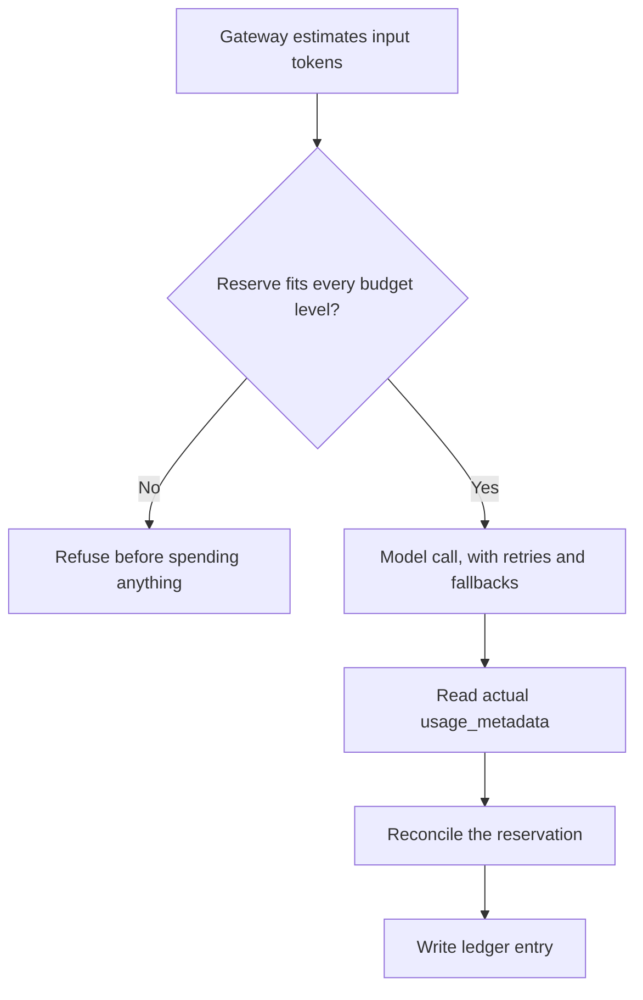

# Proposal: agent identity, permissions and budgets

*Team Saathi · Agreed, and mostly built (status in §7.1) · 3 October 2026 · relates to [architecture.md](../architecture.md) §4 and §4.1, and [business-model.md](../business-model.md)*

## Summary

This proposal sets these rules for every agent in Anvaya:

- Each agent is **identifiable**.
- Each agent has **one specific role**.
- Each agent is **authorised to use only specific tools and models**.
- Every model call counts against **token budgets** at each level: the platform, the agent, the tenant, the user and the single request.
- **One user must not be able to use up shared capacity.**
- **Safety-critical agents must keep working even when budgets run out.**
- Layered limits stop cost overruns. The last layer is a hard cap at the Google Cloud level.
- **Any extra budget goes through an approval.**

**Next step:** [agent-security.md](agent-security.md) splits the registry into two parts:

- an agent registry: what each agent is;
- agent policies: what each agent may do.

One decision point at the AI gateway and the tool gateway enforces them.

**Governance dashboards** give our team a view of the whole platform. They give each bank or insurer a view of its own customers (§6.1).

The proposal adds one control point, the **agent gateway**. Every model call must go through it. It sits next to the guardian (§4.1):

- The guardian watches *what* agents do, to find fraud.
- The gateway controls *who* may use *which* model and tools, and *how much*.

---

## 1. Current state (code review, 3 October 2026)

| # | Finding | Where | Risk |
| --- | --- | --- | --- |
| 1 | **There are 11 model call sites and no agent identity.** Eight loop steps, the live call, spoken replies and the ADK handover agent all use one shared client and one key. Nothing records which agent made a call. | `gemini.py`, `loops.py`, `live.py`, `speech.py`, `executor_agent.py` | Costs and failures can't be traced to an agent; there is no per-agent policy. |
| 2 | **Models are global settings.** Any code can call any model. Today `pro_model` is the same model as `flash_model`. The fallback switches silently to a different model. | `config.py`, `gemini.py:62` | The model can change and nobody sees it. No rule stops an upgrade to a more expensive model. |
| 3 | **No registry controls the tools.** Only the handover agent has tools (`search_archive`, `list_inventory`). They are wired in code. The other steps correctly switch tool calling off. | `executor_agent.py:88`, `gemini.py:57` | The future research agent (web search) and guardian detectors need explicit permission to use tools. |
| 4 | **Nothing reads token usage.** No code reads `usage_metadata`. There's no ledger, no budget and no per-user limit. | everywhere | Nobody sees the spend until the bill arrives. |
| 5 | **`/speech` reads out *any* text.** The limit is 1,000 characters. Any signed-in user can call it any number of times. | `main.py:217` | This is the easiest way to abuse capacity and cost. |
| 6 | **Live calls are unlimited.** A call lasts until Gemini's ~15-minute session limit. A user can restart it any number of times. | `live.py:36` | Voice is the largest cost line in the business model. |
| 7 | **Retries multiply calls.** Each call makes up to 4 attempts. Then a fallback model makes another 4. A reply that breaks the rules is regenerated once. One request can make up to **16 model calls**. | `gemini.py:24`, `loops.py:139` | One bad hour at the provider can multiply the cost. |
| 8 | **The handover agent has no step limit.** ADK's default is **500 model calls per run**. Sessions are kept in memory. The user is hard-coded as `"family"`. | `executor_agent.py`, `main.py:628` | An agent run that loops has almost no limit. |
| 9 | **Some steps re-run on demand.** Readiness, legal needs and settlement re-run in full on every POST. | `main.py:292`, `342`, `631` | Repeated clicks or a script repeat the cost. |
| 10 | **One shared key means one shared quota.** When the key reaches its rate limit, every user is affected. | deployment | One heavy user can block everyone, including safety checks. |
| 11 | **No spending alarm or hard cap in Google Cloud.** | project | No backstop against an overrun. |

---

## 2. Agent registry: identity, role, models, tools

Each agent has one entry in the **registry** (`agents/registry.yaml`). We review the registry like code. The gateway refuses any call that doesn't match the agent's entry.

### 2.1 What each entry declares

```yaml
- id: handover.assistant              # stable identity, used in logs, labels and the ledger
  role: Answers the family's questions from the kept knowledge, citing sources.
  owner: team-saathi                  # who is accountable for it
  autonomy: act_within_limits         # assist | propose | act_within_limits (architecture §4)
  models:
    primary: gemini-3.1-flash-lite
    fallback: [gemini-3.5-flash-lite] # same price class or cheaper only; never an upgrade
  tools: [read_bundle_index, read_concept, list_accounts]   # nothing else, ever
  data_scope: owner_bundle_after_release                     # combined with PR-6 tokens limited to one owner
  limits:
    max_input_tokens: 60000
    max_output_tokens: 800
    max_model_calls_per_run: 6        # replaces ADK's default of 500
    max_retries: 2
  budget_class: family                # which budget pool it draws from (§3)
  safety_critical: false
```

### 2.2 The agents

| Agent id | Role | Autonomy | Models | Tools | Budget class |
| --- | --- | --- | --- | --- | --- |
| `saathi.chat` | Typed or photo conversation with the owner | Act within limits | flash-lite | none | owner |
| `saathi.voice` | Live voice conversation | Act within limits | live model | none | owner (minutes) |
| `saathi.speech` | Speaks Saathi's own replies aloud | Act within limits | TTS models | none | owner |
| `saathi.summary` | Sums up one conversation in a few sentences when it ends (shown, never stored) | Assist | flash-lite | none | owner |
| `capture.extractor` | Turns each exchange into suggestion cards | Act within limits | flash-lite | none | owner |
| `documents.reader` | Reads a policy or statement photo into an account card | Act within limits | flash-lite | none | owner |
| `readiness.planner` | Next steps (later: gap questions from the knowledge graph, PR-7.10) | Act within limits | flash-lite | none | owner |
| `legal.needs` | Finds wishes that need a legal document | Propose | flash-lite | none | owner |
| `activation.checker` | Pre-checks certificates and proof of authority | Assist | flash-lite (vision) | read fraud guides | **safety** |
| `handover.assistant` | Answers the family from kept knowledge | Act within limits | flash-lite | read bundle index, read concept, list accounts | family |
| `settlement.planner` | Claims checklist and draft letters | Propose | flash-lite | none | family |
| `guardian.detectors` *(PR-2)* | Pressure, probing, synthetic audio, hidden instructions | Assist | flash-lite | none | **safety** |
| `fraud.researcher` *(PR-2.5)* | Searches for new fraud tactics | Propose | flash + **Google Search grounding** | Google Search (only agent with web access), write draft guide | platform (scheduled) |
| `fraud.dreamer` *(PR-2.6)* | Imagines attacks on our safeguards | Propose | flash + Google Search grounding | Google Search, write draft scenario | platform (scheduled) |

### 2.3 Rules

- **One gateway.** All model calls go through `gateway.call(agent_id, …)`. A CI check fails the build if any other module imports the Gemini client directly.
- **Identity on every call.**
  - Each request carries the labels `agent`, `tenant` and `env`. With these labels, the bill can show cost per agent (supported on Vertex AI).
  - Each call writes a ledger entry and a trace span with the agent id.
  - Owner IDs never go into labels. Ledger entries use a hashed user key.
- **Models are allow-listed.** A fallback must be in the same or a cheaper price class. To change a model, change the registry. We review that change like code.
- **Tools are allow-listed.** Each tool is bound to the owner in scope (PR-6). The vault is never a tool. Only the two fraud agents use Google Search grounding.
- **Workload separation.**
  - The scheduled fraud agents are the only agents with web access. They run as a **separate Cloud Run job with their own service account**. They can't read owner data. They only write draft guides.
  - The user-facing agents run in the API. The gateway and tokens limited to one owner keep them apart.

---

## 3. Token budgets

### 3.1 Budget levels

Each call must fit inside **every** level above it:

| Level | What it limits | Example default (to be tuned with pilot data) |
| --- | --- | --- |
| **Platform** | Total monthly spend | Set from the Google Cloud budget (§4) |
| **Agent** | Daily tokens and cost per agent | Proportional to the business-model assumptions |
| **Tenant** | Monthly allowance per bank or insurer, per direct-plan cohort, and per judges' demo | Set by the licence or plan |
| **User** | Daily and monthly allowance per owner or family member | Owner on a direct plan: **30 voice minutes a day, 150 a month**; 200 typed messages a day; 50 spoken replies a day. Family after handover: the included allowance (business model), then extras. Judge's demo: one generous fixed allowance per copy (PR-1.7). |
| **Session or request** | Per call | Live call: **20 minutes**; max input and output tokens per agent (registry); handover agent at most **6 model calls per run**; at most 2 retries |

The defaults match [business-model.md](../business-model.md) (120 voice minutes in year one). They leave room for heavy weeks. They are limits, not targets.

### 3.2 Fair use: one user can't use up shared capacity

- **Token-bucket rate limits** per user and per agent. They limit requests per minute and tokens per hour. The counters are in Firestore. Short bursts are allowed. Sustained heavy use is not.
- **Reserved capacity for safety.**
  - `activation.checker`, `guardian.detectors` and the owner's **cancel** flow use a **protected safety pool**. Users' conversation budgets can't drain this pool.
  - A user with no conversation budget left can still cancel a false report. Reviewers can still check certificates.
- **Separate quotas.** The safety agents and the scheduled fraud agents use a separate Gemini quota (separate key or Vertex AI quota). A spike in conversation can't starve them.

### 3.3 Counting



- **Before the call:**
  - The gateway estimates input tokens. It uses a token count, or a character-based estimate for speed.
  - It **reserves** the estimate against every budget level.
  - If any level would be exceeded, it refuses before spending anything.
- **After the call:**
  - The gateway reads the actual `usage_metadata`: input, output and cached tokens, and minutes for live audio.
  - It **reconciles** the reservation.
  - It writes a ledger entry: agent, user key, tenant, model, tokens, minutes and outcome.
- **No price table.** Dollars come only from Google's Cloud Billing export to BigQuery (PR-10.9). So they always match the bill. The ledger counts usage, never cost.
- **Retries and fallbacks count** against the same reservation. So the ledger counts every call.

### 3.4 When a budget runs low

The service turns features off step by step. It never fails silently. It always tells the user, kindly:

| Level of use | What happens |
| --- | --- |
| 80% of a user's allowance | A gentle notice ("You've talked a lot with Saathi today"). Spoken replies switch to on request only. |
| 100% of the voice allowance | Live voice pauses; typed conversation continues. |
| 100% of the user's allowance | Conversation pauses until the next day. The user can request more (§5). On a direct plan, the user can also top up. **Safety flows always continue.** |
| 100% of an agent's daily budget | That agent switches to its cheapest allowed model. If it is still over, it pauses. An alert goes to the team. |
| Platform at 90% of budget | Optional features stop first (spoken replies, then live voice), then non-essential agents. |

---

## 4. Stopping cost overruns

The controls are in layers, cheapest first. Each layer is a backstop for the layer before it:

1. **Limits per request** (registry): max tokens, max model calls per run, max retries, live-call length. These limits fix findings 6, 7 and 8.
2. **Close the holes:**
   - `/speech` only speaks **a reply Saathi actually gave**, by reply ID. It never speaks arbitrary text. It works only for the owner of that conversation.
   - Steps that can re-run on demand (readiness, legal needs, settlement) are **cached until the data changes**.
   - Live calls start with a **short summary**, not raw history.
   - The handover agent's bundle uses context caching (PR-7).
3. **Budgets and fair use** (§3).
4. **Alerts:**
   - a Google Cloud **budget with alerts at 50%, 90% and 100%**, including forecast alerts;
   - a daily **per-agent and per-user anomaly check** from the ledger. An example anomaly is spend more than three times the usual. Anomalies go to the guardian's review page.
5. **Kill switch:**
   - Budget alerts publish to Pub/Sub.
   - A small function then sets a **runtime flag**.
   - At 90%, the flag switches off optional features (spoken replies, then live voice).
   - At 100%, it switches off all non-safety agents.
   - The gateway reads the flag on every call.
   - To turn features back on, an approval is necessary (§5).
6. **Hard cap at the provider:** the **requests-per-minute and tokens-per-minute quotas** for Gemini (Vertex AI) have a ceiling that matches the monthly budget. If all the layers above fail, Google Cloud itself refuses calls beyond that rate.
7. **Cost report:** the billing export to BigQuery is the portal's only source of dollar figures (PR-10.9). It shows spend by day, service and SKU, up to yesterday. A breakdown by agent label needs Vertex AI (§8, question 5). Until then, agents and tenants show usage, not dollars.

---

## 5. Approving extra budget

| Who needs more | How they ask | Who approves | Rules |
| --- | --- | --- | --- |
| **A user on a direct plan** | Top-up or plan upgrade in the app | No approval; it's a purchase | The price covers the cost (business model) |
| **A user under a bank's licence, or on a free trial** | "Request more time with Saathi" | The tenant's admin (bank), or our team for trials | Approval is time-limited (for example 7 days) and logged |
| **A family beyond its included allowance** | Family extras in the app | No approval; it's a purchase | The handover itself is never charged |
| **A judge's demo copy** | "Need more?" in the demo | Our team | Approved in the team console, time-limited |
| **An agent's daily budget** (for example, a busy day) | Automatic request when it reaches 100% | **Two people:** an engineer and the budget owner | Never the person who asked; time-limited; logged with a reason |
| **The platform budget, or switching the kill switch off** | Request in the team console | **Two people**, including the budget owner | Logged; reviewed at the next weekly cost review |
| **A permanent change to limits or models** | A change to `registry.yaml` or `budgets.yaml` | Code review by someone other than the author | Version-controlled; the history shows who changed what and why |

Every request records:

- **who asked;**
- **for which agent, user or tenant;**
- **how much;**
- **why;**
- **until when.**

Every approval and rejection is logged. Grants **expire automatically**. A **Budgets** page in the team console shows pending requests, active grants, and burn by agent and tenant.

---

## 6. Observability

- **Every model call is a trace span.** The span has the agent id. It links to the user request that caused the call. We use Cloud Trace, and ADK's built-in tracing for the handover agent.
- **Per-agent dashboards:** calls, tokens, cost, latency, error rate, fallback rate and budget burn.
- **The ledger** is in Firestore, with a daily copy to BigQuery. It is the single source for per-user and per-tenant use. It never holds prompt or reply text.
- **The guardian sees budget anomalies** as events (§4.4). So we review unusual consumption like any other risk.

### 6.1 Governance dashboards: platform and tenant

There are two dashboards. Both use the same data: the ledger, guardian events, approvals and the registry. They differ in **who sees what**.

| | **Platform dashboard** (Anvaya governance team) | **Tenant dashboard** (a bank's or insurer's admin and risk officer) |
| --- | --- | --- |
| **Who** | Platform admin, budget approvers, risk reviewers | Tenant admin, tenant risk officer, read-only viewers |
| **Scope** | All tenants, all agents | Only that tenant's customers and claim files |
| **Spend and budget** | Month to date against budget, and forecast; spend by agent, model and tenant; kill-switch state; Gemini quota headroom | Licence use: enrolled versus active customers, use against allowance, forecast, cost per active customer |
| **Agents** | The registry: each agent's ID, role, autonomy, allowed models and tools, and version. Per agent: calls, tokens, cost, latency, errors, fallback rate. **Blocked attempts** (an agent asking for a model or tool it isn't allowed) | **Which agents act on their customers:** role, autonomy level, models and version. This is the transparency regulators ask for. |
| **Fair use** | Users at or near their limits (hashed keys only), rate-limit hits, unusual consumption | Their customers at their limits (counts), and their allowance policy within the licence |
| **Approvals** | All pending budget requests, active grants, grants about to expire, history; two-person approvals | **Approve or reject** their own customers' requests for more time; history |
| **Guardian and fraud** | Interventions by type, how many were reversed (false alarms), safeguard coverage map, reviewer patterns | Fraud flags and guardian interventions on **claims they receive**; the review record for each claim |
| **Outcomes** | Across tenants: nominations completed, handovers, claim files | Their pilot measures: nominations completed, claim files received, days to a complete file, share settled within the deadline (15 days in India), files needing more documents |
| **Data protection** | Data-access anomalies, break-glass events (later), conversation retention status | — |
| **Audit export** | Full governance report | **A downloadable audit report** for their regulator, supporting the RBI's audit rights for outsourcing |

**Privacy rules for both:**
- **No conversations, ever.**
- The tenant dashboard shows **aggregates**. It hides counts under 5, so nobody can pick out one person. The one exception is the claim files the tenant itself receives.
- The platform dashboard shows **hashed user keys**, not names. To see names, an admin needs a break-glass request (roadmap).
- Every dashboard action is logged, especially approvals.

**How it's built**
- **In the prototype:** API endpoints aggregate the ledger and guardian events. These endpoints feed both dashboards.
  - The platform dashboard is in a separate **platform admin portal** ([PR-12, #42](https://github.com/sachiachar/anvaya/issues/42)). The portal has its own address, admin-only endpoints and roles that the server enforces. The portal also holds:
    - budget approvals;
    - the guardian's interventions;
    - fraud research with the coverage map;
    - demo management;
    - the admin audit log.
  - The tenant dashboard is a **Governance** view inside the **Bank** role (PR-3). For the pilot, a separate tenant portal on the same codebase follows.
  - Judges reach both dashboards through the person switcher (PR-1). The switcher includes a platform admin person. Seeded data makes the charts look realistic.
- **Later:** a daily copy of the ledger in BigQuery, with Looker Studio for deeper platform analysis. The copy is joined with the billing export (cost per agent label).

---

### 6.2 Google Cloud products: what to use, and when

Google Cloud has two products that cover parts of this proposal. Neither covers all of it. Neither handles budget approvals.

| Product | What it gives | Limits for Anvaya today |
| --- | --- | --- |
| **Apigee as an AI gateway** ([token policies](https://docs.cloud.google.com/apigee/docs/api-platform/tutorials/using-ai-token-policies)) | **LLMTokenQuota** enforces token quotas in real time from the model's reported usage. Also: PromptTokenLimit, SanitizeUserPrompt and SanitizeModelResponse (Model Armor), semantic caching, analytics. Since July 2026 it can match MCP JSON-RPC requests to route, authorise and apply separate quotas ([release notes](https://docs.cloud.google.com/apigee/docs/release-notes)). An **API product per bank, with its own quota**, maps directly onto a bank's licence. | Its own environment and running cost. Needs Vertex AI behind it. It isn't confirmed that it can proxy the live-call WebSocket. |
| **Agent Gateway and Agent Registry** (Gemini Enterprise Agent Platform, [overview](https://docs.cloud.google.com/gemini-enterprise-agent-platform/govern/gateways/agent-gateway-overview)) | A **unique, secure ID (SPIFFE) for each agent**, with mutual TLS. A registry of approved agents, tools, MCP servers and endpoints. **Default deny:** "all connections are blocked unless an explicit IAM policy grants access". Covers client-to-agent, agent-to-tool (including MCP) and agent-to-agent traffic, and Model Armor screening. | Private preview from April 2026. The docs list **Agent Runtime** as the supported runtime, not Cloud Run, where our agents run today. **No token budgets.** |
| **Model Armor** (standalone, or through either product above) | Screens prompts and tool responses for prompt injection, sensitive-data leaks and harmful content. | None that block use now. |

**How they map to this proposal**

| Requirement | Prototype (by 18 October) | Bank pilot |
| --- | --- | --- |
| Agent identity, registry, tool permissions | Our registry (G-1), **shaped like Agent Registry**: the same concepts of agent, tool, MCP server, endpoint and permission | **Agent Gateway and Agent Registry**, after moving the handover and guardian agents to Agent Runtime |
| Model allow-list per agent | Our gateway check | Gateway check plus IAM |
| Token quotas per tenant and app | Our ledger (G-4) | **Apigee LLMTokenQuota**, one API product per bank |
| Per-user allowances, protected safety pool, graceful messages | Our ledger (G-4) | Our ledger; Apigee quotas keyed on the user as a backstop |
| Prompt injection and sensitive-data screening | Our own checks in code; Model Armor not now (G-8, decided 8 October 2026) | Model Armor through Apigee or Agent Gateway |
| Budget approvals with two people | Ours (G-6) | Ours: no Google product provides it |
| Dashboards | Ours (G-7) | Ours, plus Apigee analytics for tenant traffic |
| Platform alarm and hard cap | Cloud Billing budgets and Gemini quotas (G-5) | The same, plus the Pub/Sub kill switch |

**Why not adopt them for the prototype:** Apigee adds an environment and running costs. Agent Gateway needs Agent Runtime and possibly preview access. Both are too risky in the time left. Our registry and ledger match their concepts. So the later move is a configuration change, not a redesign.

## 7. Plan

### 7.1 Prototype release (about 4 days with dashboards and Model Armor)

The last column shows the status on 3 October 2026. [#24](https://github.com/sachiachar/anvaya/issues/24) and [#42](https://github.com/sachiachar/anvaya/issues/42) have the details. Costs now come only from the Cloud Billing export (PR-10.9), not a price table.

| ID | Item | Fixes | Status |
| --- | --- | --- | --- |
| G-1 | **Agent gateway and registry:** every call through `gateway.call(agent_id, …)`; models, tools and limits per agent from `registry.yaml`; CI check forbidding direct client use; labels on calls | 1, 2, 3 | Built (PR-10.1) |
| G-2 | **Limits per request:** max tokens, at most 2 retries, a cheaper-or-equal fallback, at most 6 model calls per handover run, 20-minute live calls | 6, 7, 8 | Built (PR-10.2) |
| G-3 | **Close the holes:** `/speech` only for Saathi's own replies; cache readiness, legal needs and settlement until the data changes; short summary for live calls | 5, 9 | Built (PR-10.3) |
| G-4 | **Token ledger and user budgets:** reserve and reconcile from `usage_metadata`; daily user allowances; fair-use rate limits; protected safety pool; graceful messages | 4, 10 | Built (PR-10.4); no rate limits yet |
| G-5 | **Backstops:** Google Cloud budget with alerts; lower Gemini quotas as a hard cap; a simple kill-switch flag read by the gateway | 11 | Kill switch built; budget alerts and quotas need a person (PR-10.5) |
| G-6 | **Approvals, minimal version:** "request more" for judges and users; approve or reject in the team console, time-limited and logged; two-person approval for agent budgets | — | Portal approvals built; "ask for more" in the app to come (PR-10.6) |
| G-7 | **Governance dashboards** (§6.1): the platform dashboard in a separate **platform admin portal** (PR-12) and a tenant Governance view for the Bank role, covering spend and budget, agents, approvals, guardian and outcomes, with seeded data for the demo. The tenant audit export follows after the deadline. | — | Platform portal built with real data only (PR-12); tenant view comes with the Bank role |
| G-8 | **Model Armor:** screen the owner's messages, uploaded documents and tool responses for hidden instructions (PR-2.3.6, PR-2.8.4) and sensitive data (helps PR-6.5), through the gateway | — | Not now (decided 8 October 2026): our own checks in code instead ([agent-security.md](agent-security.md) §8) |

### 7.2 After the deadline (finale and pilot)

- Move to **Vertex AI** in-region, with separate service accounts and quotas for the safety and fraud agents. This move also closes India data residency.
- Put **Apigee in front of Vertex AI** for tenant token quotas (an API product per bank), semantic caching, Model Armor and analytics. First check whether it can proxy live-call WebSockets.
- Move the handover and guardian agents to **Agent Runtime behind Agent Gateway**. This gives SPIFFE identities and default-deny access to tools and MCP servers. Our registry and policies stay the reviewed source. We export them to Agent Registry and Agent Gateway ([agent-security.md](agent-security.md) §6).
- Tenant budgets and a bank admin approval page.
- Pub/Sub-driven automatic kill switch.
- Per-agent dashboards.
- Daily anomaly detection fed to the guardian.
- The billing-export cost report broken down by agent label.

### 7.3 Decisions needed

1. **Approve the gateway and registry approach** (one control point, a registry reviewed like code).
2. **Default allowances** in §3.1: are 30 voice minutes a day and 150 a month right for owners? What should the fixed allowance per judge's demo be?
3. **Who are the budget owners and approvers?** Two people are needed for agent and platform budgets.
4. **Monthly platform budget** for the competition period, which sets the Google Cloud budget and the quota ceiling.
5. **Vertex AI now or later.** Per-agent billing labels need Vertex AI. Without it, the ledger still records usage per agent. But the Google bill can't split cost by agent.
6. **Google products:** agree the path in §6.2: Model Armor now; Apigee and Agent Gateway for the bank pilot.
7. **Who sees the dashboards.** Confirm:
   - the platform roles: admin, budget approver, risk reviewer;
   - the tenant roles: admin, risk officer, viewer;
   - the small-count threshold of 5.
8. **Schedule.** With the dashboards, this work adds about 4 days to a plan that is already full. Candidates to make room:
   - PR-2.10 (cloned-voice protection) as the second factor only;
   - PR-7.11 (coverage map) after the deadline.
