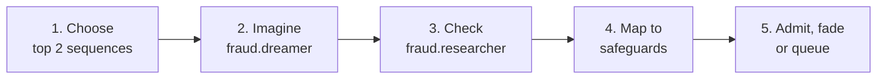

# Fraud foresight: imagine, check, keep

**Status:** agreed 3 October 2026. Partly built: the India guide (#71, PR-2.3), the pipeline (#73, PR-2.5, PR-2.6) and web checks with Exa (#77). OKF cues (§5) are built too. Still to come: automatic admission and learning (§7, §8) · **Issues:** PR-2.3 (#6), PR-2.5 (#8), PR-2.6 (#9), PR-2.7 (#12), PR-7 (#18) · **Owner review:** governance, registry, admin portal

## 1. In short

Anvaya imagines how a fraudster could beat its safeguards. It checks each idea against real sources and keeps only what holds up. Every item in the fraud reference guide says how we know it. What people confirm makes the certificate check stronger. It also makes Saathi raise the riskiest gaps sooner.

This is a working example of **Foresight Memory**: AI memory that imagines the future. It saves an imagined scenario only after the scenario passes an independent test.

## 2. Ideas we borrow

| Idea | What it teaches | What we build |
| --- | --- | --- |
| The brain's three networks | One network imagines (default mode). One checks against the outside world (central executive). One decides what matters and switches between them (salience). Creative work alternates between imagining and checking. | One pipeline that imagines, then checks. The guardian decides what runs next, with fixed rules. |
| Dreaming as threat practice | Dreams rehearse threats and are built from real experiences. Sometimes they are deliberately strange, so the brain doesn't overfit. | Scenarios start from real sequences and events. Each run includes one far-fetched variant. |
| Memory consolidation | New learning is kept separate, then merged slowly, so it doesn't overwrite old knowledge. | Research lands as a draft. The guardian's rules or a reviewer turn it into a new guide version. Old warning signs stay unless a reviewer retires them. |
| Dopamine | Learning comes from surprise (what happened minus what we expected). Threats count as much as rewards. | A learned value for each area that moves towards real outcomes. A curiosity bonus for areas not looked at recently. |
| Foresight Memory | Every item carries a knowledge label. Imagined content never feeds on itself. | Five labels and admission rules, enforced in code. |

## 3. Knowledge labels

Every item in a guide or the scenario list carries one label. The labels map to OKF trust tiers. So when the guides move into OKF later (PR-7.8), only the data moves.

| Label | Meaning | OKF trust tier |
| --- | --- | --- |
| `observed` | Seen in our own system: a guardian event, a confirmed case, or a gap count from the OKF graph | human-reviewed |
| `derived` | Found in cited sources by the research step | machine-confirmed |
| `simulated` | Imagined by the dreaming step, not yet checked | unverified |
| `validated` | A cited source supports its central claim. In addition, a reviewer approved it, or it met the guardian's rules for automatic admission (section 7) | human-reviewed, or machine-confirmed when admitted automatically |
| `invalidated` | Checked and found wrong, or rejected by a reviewer | (kept outside the bundle) |

## 4. Rules enforced in code

Each rule has a test. No rule lives only in a prompt.

1. **Imagined content never feeds on itself.** The dreaming step takes only `observed`, `derived` and `validated` items as starting points.
2. **Only checked knowledge reaches the certificate check.** The check receives `observed`, `derived` and `validated` items. `simulated` items never go in. `validated` projections are labelled "projection". They make up at most a third of the warning signs.
3. **"Confirmed" means a source supports the claim.** A scenario is confirmed only when a cited source supports its central claim. The sentence quoted from the page must really appear in the page (checked in code). A snippet that only mentions a word is not enough.
4. **People decide what matters; the guardian's fixed rules handle the rest.**
   - An item becomes `validated` through a reviewer or through the guardian's rules for automatic admission (section 7).
   - Those rules allow only changes that make Anvaya *more careful*.
   - Anything that loosens a check, retires a warning sign or touches a hard rule always goes to a person.
   - Learned values only change the order of work and propose changes. They never approve, block or change a hard rule.
   - The certificate check stays an assistant. A stronger guide can make a case "Needs a closer look", but the check never decides the case.
5. **Unchecked ideas fade.** A `simulated` scenario that is not validated within 3 runs is archived.
6. **Wrong ideas are remembered.** `invalidated` titles go to the dreaming step as "already ruled out".
7. **Limits per run** stay as in the issues:
   - 2 new tactics per guide;
   - 2 sequences, and 3 scenarios per sequence (2 close variants, 1 far-fetched).

## 5. Cues from the OKF graph (no private information)

The kept-knowledge graph (#18, PR-7.9 and PR-7.10) already finds gaps, such as a policy without a nominee. A fraudster would push at these gaps. So they are good starting points for dreaming.

- **A fixed-code extractor, not a model,** reads only `type`, typed links and `status` from each owner's bundle. It never reads the Markdown text or `sources`.
- **The output uses a closed list.** Each cue is a pattern from a list defined in code, plus a count. For example: `{"pattern": "policy.nominee_missing", "asset_class": "life_insurance", "owners": 7}`. A cue has no names, owner IDs or hashed keys, institutions, amounts or dates.
- **Only counts of 5 owners or more** are reported. Smaller counts are dropped.
- **The fraud steps never read bundles.** They receive only the cues. This keeps the rule in `agent-governance.md` that the fraud agents can't read owner data.
- **The privacy notice says so in one line:** "We count common gaps, never the details, to protect everyone."
- **The demo** seeds enough synthetic owners to reach the minimum count. There's no demo-only setting.

## 6. The pipeline

A run starts on request from the portal ("Research now", "Dream now"). The run is a background task in the API. It never runs on a request a user is waiting for. It uses the `platform` budget pool.

**Live mode and cost control.**

- The portal shows a run live: the stage it's in, each step as it happens, new scenarios as they're added, and the model calls used against the cap.
- A reviewer can press Stop. The run stops before its next model call and keeps what it has checked.
- Each agent has a cap on model calls per run in the registry (`max_model_calls_per_run`). A run that reaches the cap stops itself.
- The kill switch pauses both agents, because neither is safety-critical.

The steps:

1. **Choose what to look at.** Rank areas (a safeguard paired with a kind of tactic) by importance plus curiosity (section 8). Take the top 2 sequences.
2. **Imagine** (`fraud.dreamer`, no web access). Start from real material: the guide's sequences, the fixed list of safeguards, recent guardian events (agent, response and reason only), and OKF cues. Produce 2 close variants and 1 far-fetched variant per sequence. Label them `simulated`.
3. **Check** (`fraud.researcher`, web pages from Exa search). Exa replaced Google Search grounding on 3 October because of its quota. For each scenario, search for evidence and apply rule 3. The same step does PR-2.5's research on new tactics for a guide, labelled `derived`.
4. **Map to safeguards.** For each scenario, name the safeguard that catches it, or "none". Until the guardian core exists, the fixed list is: two reviewers, waiting period, owner alert and cancel link, key code, recipient invitation, certificate checks.
5. **Admit, fade or queue.** The guardian's rules (section 7) admit some items automatically, let others fade, and send the rest to the reviewer's queue. Admitted items go into a new guide version. Every run is logged with its limits and what happened to each item.

In the registry, `fraud.researcher` lists only `web_search`, and `fraud.dreamer` lists no tools. Saving drafts is our own code, not a model tool.

## 7. Autonomy: what goes to a person

We don't want a long queue of items waiting for people. So the guardian's fixed rules give the pipeline some autonomy, and only the rest goes to a person. The rules are in `agents/guardian-rules.yaml`, which is reviewed like the registry. They're fixed rules, never the model's judgement.

**Admitted automatically** (act within limits) when **all** of these are true:

- it only makes Anvaya more careful: it adds a warning sign or a scenario, or marks a case "Needs a closer look";
- its impact is low or medium in the impact table;
- at least 2 cited sources from different websites support its central claim;
- it doesn't contradict an existing `validated` item;
- automatic admission isn't paused for its area (see below).

The portal labels these items machine-confirmed. They count less in the certificate check than human-reviewed items. A reviewer can reverse any of them with one click.

**Fades without a person:** unconfirmed `simulated` scenarios with low importance. After 3 runs they're archived and counted, not queued.

**Goes to a person** (propose):

- high impact: anything about the vault, release, recipient changes or the handover;
- anything that loosens: retiring a warning sign, lowering a weight or threshold;
- a gap that nothing catches, with medium or high impact (it needs a decision on what to build);
- conflicts with existing knowledge;
- weight changes for Saathi's gap questions beyond one step up in rank.

**The queue has a limit.**

- At most 10 items wait for review, ordered by importance.
- When the queue is full, the pipeline stops dreaming and only checks the items it already has. That saves budget, and the queue doesn't grow.
- Items that wait more than 14 days fade back to `simulated`.
- The portal shows how many items were admitted automatically, faded or queued, so nothing disappears silently.

**Spot checks keep automatic admission honest.**

- A reviewer sees one in 10 automatically admitted items.
- If reviewers reverse 2 automatic admissions in the same area, the guardian **reduces autonomy** there. Everything in that area goes to a person until someone switches it back in the portal.

This is the guardian's own ladder (continue, add a check, reduce autonomy, pause, block), applied to the pipeline.

At the per-run limits (8 new items at most), we expect 1 to 3 items per run to reach a person.

## 8. What matters: importance and learning

**Importance** decides the order of work and the order of the reviewer's queue:

`importance = impact × evidence × novelty × exposure × value`

| Factor | Source |
| --- | --- |
| impact | A table of how harmful each kind of attack is. We drafted it, the product owner approved it, and it changes only through review |
| evidence | `observed` 1.5, confirmed 1.0, unconfirmed 0.3, far-fetched 0.1 |
| novelty | Not already in the guide or an earlier scenario (word overlap, as in `executor_agent._words`) |
| exposure | Nothing catches it 1.0, partly caught 0.5, covered 0.1; OKF cue counts raise it |
| value | Learned, below |

**Learning from surprise.** Each area keeps a value V. A real outcome r updates it: `V ← V + 0.2 × (r − V)`.

| Outcome | r |
| --- | --- |
| A real case caught by a signal from this area | +2 |
| A scenario approved, or an automatic admission that passes a spot check | +1 |
| An automatic admission reversed by a reviewer | −1 |
| Owners close a gap after a validated scenario raised its weight (per gap) | +1 |
| A scenario rejected | −0.5 |
| An intervention reversed (false alarm) | −1 |

Rewards come only from people and real outcomes. The model never scores its own work. Every update is logged with its cause.

**Curiosity.** `priority = importance + 0.5 × sqrt(log(total runs) / (runs in this area + 1))`. Every safeguard is looked at at least once every 5 runs.

**Prevention.**

1. A validated scenario about a common gap *proposes* a higher weight for that gap type in PR-7.10's ranking.
2. A person accepts the weight in the portal.
3. Saathi then raises that gap sooner. It still asks at most one question at a time, and it still respects "skip".

## 9. Work plan

One pull request each, in this order:

| # | Pull request | Issues | Depends on |
| --- | --- | --- | --- |
| 1 | The India certificate-of-passing guide with labels, versions and drafts; the certificate check uses it and reports named signs (PR-2.3.1–2.3.5 for this one guide) | #6 | — |
| 2 | The fraud pipeline: imagine, check, map, drafts, run log; real coverage map in the portal (PR-2.5.1–2.5.3, 2.5.5; PR-2.6.1–2.6.5) | #8, #9 | 1 |
| 3 | Guardian rules for automatic admission, the queue limit and spot checks; importance, learning from surprise, curiosity and proposed weights (new PR-2.7.x and PR-2.7.y) | #12 | 2 |
| 4 | OKF cues: the extractor, minimum count, privacy line, synthetic owners | #18 | PR-7.1–7.4, 7.9, 7.10 |

PR-7 itself (concept files, Keep as the commit, typed links, gap check) is its own work in #18. The fraud pipeline doesn't wait for it. Until #4 lands, the pipeline starts from guides, safeguards and guardian events only.

Before #2, check that `gemini-3.8-flash` accepts Google Search grounding and a JSON schema in the same call. If it doesn't, each check becomes two calls: a grounded search, then a structuring call.

## 10. How we check it

- Tests for each rule in section 4. They use the memory store and stub Gemini with fake grounding data.
- An attacker test for section 5. A synthetic bundle full of names, account numbers and quotes goes through the extractor and the pipeline. None of it appears in any prompt, cue or log.
- Tests for automatic admission:
  - an item that loosens a check, has high impact or has one source always goes to a person;
  - a full queue stops dreaming;
  - 2 reversals pause automatic admission for that area.
- Tests for the value update and the curiosity floor. Tests that values can't approve anything or change a hard rule.
- The demo shows: a dreamt scenario, its source check, reviewer approval, the coverage map, and a gap question Saathi raises sooner.

## 11. Decisions made (3 October 2026)

- Uses of kept knowledge as anonymous counts: agreed, with the privacy line above.
- Foresight Memory is the product owner's own idea, not patented. The judges' material can present it as such.
- The impact table: drafted by us, approved by the product owner.
- Runs in the API for the prototype. A separate Cloud Run job with its own service account follows later.
- Issue updates (#8, #9, #12, #18) are shown to the product owner before posting.
- No long queue for people. The guardian's fixed rules admit low-risk items that only make Anvaya more careful. The rest goes to a person (section 7). This changes PR-2.6.4, which said a reviewer approves every scenario.
