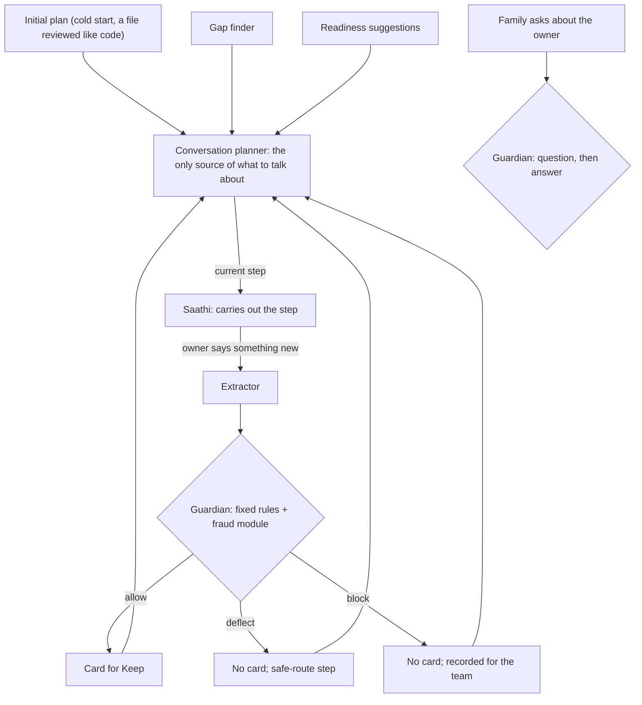

# Guardian-led conversations

Status: agreed with the owner on 10 October 2026. Requirements: PR-2.12, issue #185. Related: #12 (the guardian core).

## Why

Today, decisions about the owner's conversation are spread across five places. Saathi picks the gap
to raise and its own follow-up question. The web app picks "today's topic". The readiness planner
runs only when the owner taps "Find missing". The guardian sees a card only at Keep. Nobody can say
in one sentence who decided what was talked about, or why a card exists.

## The design

| Decision | Made by |
| --- | --- |
| What to talk about, from the first conversation | The conversation planner, starting from the initial plan |
| Gaps and readiness | Inputs to the planner only; Saathi never sees them |
| The wording of the current step | Saathi, inside the step |
| Whether new information becomes a card | The guardian: allow, deflect or block |
| What is kept | The owner (Keep); the guardian checks again at Keep |
| Whether a family question is answered, and whether the answer is shown | The guardian |

The guardian's inputs are fixed rules in code and the fraud module (tactics a reviewer approved).
A model-based detector (`guardian.detectors`) comes later.

## Audit trail

Every decision links to its cause by id: turn, guardian decision, card, Keep, plan version, next
step. The records hold ids, kinds, rule names and fixed reasons, never what anyone said (rule 4).
The words stay in the owner's own store.

## Steps

1. **The guardian as controller.** `owner_statement` before any card; the new response `deflect`;
   fixed rules and the fraud module as inputs. *(Built in PR-2.12.1.)*
2. **The conversation planner.** *(Built in PR-2.12.2.)* Each step says who starts it: Saathi opens
   with it, or Saathi waits for the owner to start (wishes, advice, low-harm gaps, suggestions).
   The initial plan file; one stored plan per owner, updated after
   each guardian decision, step outcome and Keep; gaps and readiness feed only the planner.
3. **Saathi as executor.** *(Built in PR-2.12.3, with tone and mood: each step has a tone, and the
   owner's mood, reported by the reader of each turn, changes the plan in code.)* Typed chat:
   extract, guardian, cards and plan, then the reply. Voice:
   `current_step()` and `report_step(outcome)` tools; the same reply checks as typed chat.
4. **The family side.** Every family question, and every answer before it is shown, through the
   guardian with the same rules.

## Trade-offs the owner accepted

- Typed chat gets 1 to 2 seconds slower per turn, so the guardian decides before Saathi replies.
- In voice, Saathi answers in real time; the guardian's decision applies from its next step. Cards
  always wait for the decision.
