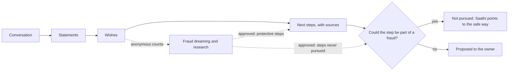
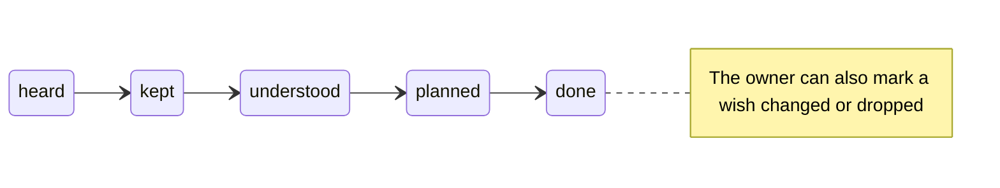
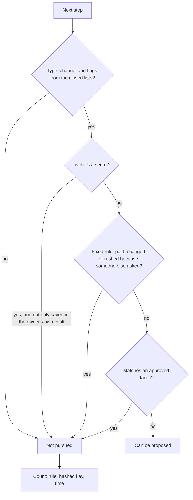

# Saathi listens: from what people say to safe next steps

**Status:** agreed 7 October 2026. Built: PR-13.1 (#148) and PR-13.3 (#150), except pressure in a wish (PR-13.3.7) · **Issues:** PR-13 (#146), PR-13.1 to PR-13.6 (#140 to #145) · **Owner review:** governance, the registry, the fraud guides, the admin portal · **Builds on:** kept knowledge (PR-7, `knowledge.py`), the gap check (PR-7.10, `gaps.py`), fraud foresight ([fraud-foresight.md](fraud-foresight.md))

## 1. In short

Saathi listens to anything the person says and helps fulfil their wishes. Saathi doesn't work through a checklist.

- **Listen.** Saathi turns every conversation into simple statements: who or what, what about it, and to whom or what ("Vikram · wants to give · the Mysore flat · to Sunita").
- **Notice wishes.** A statement that says what the person wants is a **wish**. Saathi follows it up gently. It continues until the wish is understood, planned and done, or until the person changes their mind.
- **Find out what a wish needs.** For each kept wish, Anvaya looks up what it takes to fulfil it, with sources. Then it proposes next steps.
- **Never pursue a risky step.** If a next step could be part of a fraud, Saathi never suggests it, asks about it or helps with it. Saathi points to the safe way instead.
- **Learn from fraud research.** Wishes give anonymous counts to fraud dreaming and research. When a reviewer approves a finding there, it comes back in two ways: as protective next steps, and as new steps that Saathi will never pursue.

People still decide everything. The owner keeps each card. A reviewer approves what fraud research finds.

## 2. What changes

| Today | Proposed |
| --- | --- |
| Capture sorts what was said into stories, advice, practical things, wishes, accounts and people. | Capture also returns **statements** (subject, predicate, object). Wishes come from statements whose predicate says what the person wants. |
| Saathi asks about fixed gaps (nominee, will, papers…) when the moment fits. | Saathi **follows the person**. It follows up their wishes. Saathi raises a fixed gap only when it touches what the person is talking about. |
| The readiness planner lists up to 5 gaps in one model call. | Next steps come from **each kept wish**, researched with sources. Readiness becomes **coverage**: how much of what matters is understood, planned and done. |
| Fraud cues come only from the shape of kept items ("a policy with no nominee"). | Cues also come from **wishes** ("wants a property to go to someone, no will kept"). Counts only, as today. |
| No fraud finding reaches an owner. | Approved findings become **protective steps** and **steps never pursued**. |

## 3. Listening: statements

Each exchange (typed chat or a live call) returns statements next to today's cards.

| Part | What it is | Example |
| --- | --- | --- |
| Subject | A person, an asset or a place. When it can, code links it to a kept item, with the same matching as today's links (`knowledge._resolve`). | Vikram |
| Predicate | One from a **closed list in code**, or `other` with the words kept. | wants to give |
| Object | A person, an asset, a place or a short phrase. Code links it the same way. | the Mysore flat → Sunita |
| Words | The person's own words, verbatim. | "The flat should go to Sunita." |
| Unsure | Whether they said they weren't sure. | no |

**The predicate list** is closed. The model picks one predicate. Code changes anything else to `other`.

- **Facts:** owns, holds at (an institution), nominee is, papers kept at, related to, knows about, owes, is owed.
- **Wishes (intents):** wants to give, wants done, wants the family to know, wants to change, wants to do (a wish for their own life, such as visiting Varanasi with Sunita), promised to.
- **Feelings:** worries about, is proud of.

Rules for statements:

- Statements stay on the card they came from. Thus the owner keeps one card, not one card per statement (the feedback from #94).
- Nothing is kept until the owner taps Keep (AGENTS.md rule 3).
- A wish predicate makes the card a wish. Code decides this.
- A follow-up never changes a wish back into a story.
- A kept statement becomes links in the kept-knowledge graph. `intended_for` already exists. The new predicates add `wants`, `promised_to` and `worries_about` links.

## 4. Wishes and follow-ups

A kept statement with a wish predicate becomes a **wish** with a simple state:

`heard → kept → understood → planned → done` (or `changed` or `dropped` by the owner)

- **Understood** means Saathi knows enough to look into the wish: who, what and, for an asset, which asset.
- **Follow-ups use the reminder timing that already exists** (`gaps.REMINDERS`):
  - never twice within 30 minutes;
  - at most one at a time;
  - slower after "not now";
  - never again after "skip".
- **Saathi listens first.** It follows up a wish only when the conversation allows it. It never follows up in the middle of a story.
- **The fixed gap rules stay as a safety net.** They protect the family even when nobody talks about them. But Saathi raises a fixed gap only when it touches what the person is talking about. For example, Saathi asks a nominee question when the person mentions that policy.

## 5. Finding out what a wish needs

A new agent, **`wish.planner`**, looks into one kept wish at a time. It has an entry in the agent registry and a policy (section 10).

- **What it returns:** next steps. Each step is **typed** (section 6) and has its sources. Each step also says in plain words why it helps.
- **What it searches with:** code builds the search from typed fields only: the predicate, the asset type and the country. An example is "transfer residential property to spouse India will". The search never uses names, numbers or the person's words.
- **Statements are checked:** the existing web search keeps only statements whose quotes really appear on the page (`web_search.quoted`).
- **When it runs:** only when a wish is kept or changes. The result is cached, as readiness is today.
- **No legal advice:** steps say what people usually do and who can do it. Steps never say what the law requires for this person.

**Readiness becomes coverage.** The score counts two things:

- wishes that are understood, planned and done;
- the key facts a family needs (nominees, papers, a vault recipient).

Coverage replaces the single model call of the readiness planner, and that planner is retired. Coverage also matches the "link coverage" idea in [architecture §5.1](../architecture.md).

## 6. Never pursue a risky step

**If a next step could be part of a fraud, Saathi never pursues it.** Saathi doesn't suggest it, ask about it, remind the person about it or help with it. Code checks this. The prompt only explains it.

**Steps are typed.** Each step has fields from closed lists in code:

- **What it does:** tell the family, record with the institution, make or update a legal document, keep the papers somewhere, add to the vault, gather information, talk more, plan with the family.
- **Channel:** the institution's official channel, a registered professional, a family member the owner named, the owner themselves, or the Anvaya app.
- **Flags:** involves a payment, involves a secret (an OTP, a password or a PIN), started by someone else, has a deadline.

**The check, in this order.** `step_guard.py` (#150) does the check. Code works out the flags from the step's fields and from its words. So the check doesn't depend on the model to set them.

1. **A step of an unknown type, channel or flag is not pursued.** When unsure, the answer is no.
2. **A step that involves a secret is never pursued.** Nobody needs an OTP or a password to fulfil a wish. There is one exception: a step that only saves the secret in the owner's own vault and names nobody else.
3. **Fixed rules apply before any tactic is tagged.** A step is not pursued in these cases:
   - someone else asked for a payment;
   - someone else asked for a change with an institution;
   - someone else is rushing the person.
4. **A step that matches an approved tactic is not pursued.** Each approved tactic in the fraud guides also lists the step types, channels and flags that it exploits. A reviewer tags these in the portal when they approve the tactic. Examples:
   - paying a fee to "release" a claim;
   - signing through an agent;
   - changing a nominee or bank details through someone who called;
   - moving money to a "safe" account.

**What Saathi does instead.** Saathi keeps listening to the wish itself. The wish isn't the problem, only that route is. If the person brings up the route, Saathi says there's a safer way and names it: "The insurer can record that directly", "A registered lawyer can draw that up". Saathi never names the fraud and never accuses anyone, family included.

**When the risk is in the wish.** Some things sound like pressure:

- someone else started it ("my nephew says I should sign the flat over now");
- there's a rush;
- someone asks for an OTP.

Then Saathi doesn't pursue any step for that wish, and doesn't take sides. Saathi gently suggests talking to someone they trust, or the official route. Code records a count only (section 7).

**A record for oversight.** Each step that isn't pursued leaves a record in `steps_not_pursued`. The record has no words and no names. It holds the rule or tactic that stopped the step, the copy's hashed key, and the time.

- The same step is counted once, even if the check drops it again on a later run.
- The portal overview shows the count for the last 30 days, so the team can see that the check works.
- If the fraud guides can't be read, no step is pursued.

**Saathi's own words.** Saathi's typed replies get the same check, and so does the topic that starts a conversation. A live call can't be rewritten, so in a live call the rule is in Saathi's instructions only.

## 7. Fraud cues from wishes

The fixed-code cue extractor (`fraud_cues.py`) gets new patterns from kept wishes and pressure signals. They are always counts, with the same minimum and rounding as today:

- `wish.property_to_person.no_will`: wants a property to go to someone, and no will is kept;
- `wish.nominee_change.not_done`: wants to change a nominee, and the step isn't done;
- `wish.informal_promise`: has promised money or an item, with nothing written down;
- `pressure.started_by_other`: a wish someone else started;
- `pressure.secret_asked`: someone asked for an OTP or a password.

Dreaming and research use these patterns as starting points, as they use today's cues. The fraud steps still never read a bundle.

## 8. Fraud findings back into next steps

This section makes [fraud-foresight §8](fraud-foresight.md) concrete.

- **A protective step.** A reviewer approves a scenario linked to a pattern. At the same time, they approve one protective step for it, in calm words. An example is "Ask the insurer to record the nominee; a promise isn't enough". A wish plan that matches the pattern includes that step and ranks it higher.
- **A step never pursued.** The tactic's tags (section 6) take effect for every owner at once.
- **People decide.** A ranking change of more than one step needs a person in the portal (fraud-foresight §7). Nothing makes a check less strict without a person.

## 9. Rules enforced in code

Each rule has a test.

1. Predicates, step types, channels and flags come from closed lists in code. Anything else is `other`, and nothing acts on it.
2. Nothing is kept without the owner's Keep. A wish is planned only after it's kept.
3. These steps never reach the owner, Saathi's instructions or the suggested topic: a step of an unknown type, a step with a secret, a step that breaks a fixed rule, or a step that matches an approved tactic.
4. Searches are built from typed fields only, with no names, numbers or the person's words.
5. Fraud steps get counts only, at or above the minimum, rounded down.
6. Records of steps not pursued carry no words and no names.
7. Nothing Saathi says to the owner talks about the owner's death (`tone.py`, #139).

## 10. Privacy and governance

- **Agent registry and policies.** PR-10.11 (#154) split them into two files ([agent-security.md](agent-security.md)). `wish.planner` goes into both files in PR-13.4:
  - **`agents/registry.yaml`, what the agent is:** purpose "Finds out what fulfilling one kept wish takes, with sources", kind `model_step`, status `active`, and its model order.
  - **`agents/policies.yaml`, what the agent may do:** autonomy `propose`; tool `web_search` with scope `external`; limits per call and per run; the owner pool for each person's daily allowance.
  - **Later fields:** the prompt and the output schema (`WishPlan`) come with PR-10.14. Who may start it (`invoked_by: [owner]`) and a daily cap for the agent come with PR-10.12, which enforces them.
  - `capture.extractor` and `saathi.chat` keep their models. They only return more (statements), so their entries don't change.
- **"Never" rules from this plan.** Code enforces two rules for every agent that writes to the owner (`saathi.chat`, `capture.extractor`, `readiness.planner` and later `wish.planner`):
  - never help with a step that could be part of a fraud (`step_guard`);
  - never talk about the owner's own death (`tone`).

  `saathi.voice` has these rules in its instructions only, because live audio can't be rewritten. PR-10.14 tags them `prompt`, and the portal lists them as a known gap.
- **Records:** a step not pursued is a refusal with a rule id (`unknown`, `secret`, `rule:…` or `tactic:…`) and no content. These records join the decision log when PR-10.12 builds it.
- **Cost:** research runs per kept wish, not per conversation, and is cached. Allowances, the gateway and the kill switch apply as today.
- **The portal** gets three things: the step tags on tactics (section 6), the protective step on approved scenarios (section 8), and the count of steps not pursued.
- **Overlap with the fraud review (#137):** this work changes `fraud_cues.py` and `fraud_guides.py`. FRD-1 to FRD-8 also change these files.
  - Section 7 waits for FRD-1.
  - Step tags on tactics are built after FRD-6, so one reviewer alone can't change them.

## 11. Work plan

| Item | What | Depends on |
| --- | --- | --- |
| PR-13.1 | Statements and wishes in capture, kept as links | none |
| PR-13.2 | Saathi listens first: wish follow-ups; fixed gaps only when relevant | PR-13.1 |
| PR-13.3 | Never pursue a risky step: typed steps and the check (section 6) | none |
| PR-13.4 | Researching a wish: `wish.planner`, next steps from wishes, readiness as coverage | PR-13.1, PR-13.3 |
| PR-13.5 | Fraud cues from wishes and pressure signals | PR-13.1, FRD-1 |
| PR-13.6 | Approved findings become protective steps and step tags | PR-13.3, PR-13.5, FRD-6 |

PR-13.3 ships before PR-13.4 or with it. No researched step reaches anyone without the check.

## 12. How we check it

- **The demo:** Vikram says "I want the Mysore flat to go to Sunita". A wish card appears. He keeps it. Next steps follow, with sources: make a will through a registered lawyer, and tell Sunita where the papers are.
- **Pressure:** the person says "My nephew says I should sign the flat over now". Saathi doesn't help with it and suggests a trusted person. The portal shows one more step not pursued.
- **Fraud in the loop:** a reviewer approves a scenario about informal promises. After that, Vikram's plan includes the protective step. A step that matches the tactic never appears.
- **Tests:** each rule in section 9.

## 13. Decisions made (7 October 2026)

1. **Predicates:** a closed list in code, with `other` keeping the words.
2. **Fixed gap rules:** kept as a safety net, raised only when relevant to what the person is saying.
3. **Wish research:** web search with sources, only for kept wishes, cached.
4. **Scope:** all six items in a simple form before 18 October.
5. **A step not pursued:** Saathi says there's a safer way and names it, never the fraud.
6. **Risky steps:** never pursued by Saathi, checked in code, unknown means no.
