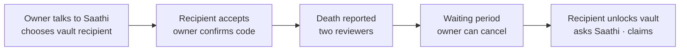

# Anvaya: Use Cases

*Team Saathi · updated 28 September 2026 · companion to [concept.md](concept.md) and [architecture.md](architecture.md)*

This document lists who uses Anvaya, what each person does, and what the AI does for them. The service is **AI-first**: the AI operates it as loops. People set the goals and make every decision that matters. Anvaya is an app (iOS and Android; a web app for the prototype).

**Status:** ✅ built in the prototype · 🔜 planned.

---

## 1. Roles

| Role | Who they are | When | Status |
| --- | --- | --- | --- |
| **Owner** | The person creating the legacy (demo: Vikram, 58, Bengaluru) | During their lifetime | ✅ |
| **Vault recipient** | The family member the owner chooses to receive the vault (demo: Priya, daughter) | Invited while the owner is alive; receives after release | ✅ |
| **Family member** | Anyone in the family, listed or not | Can request access at any time | ✅ |
| **Our team** | Anvaya reviewers | When a death is reported, or a request arrives after a death | ✅ |
| **Legal partner** | A licensed will or estate service | When the owner consents to share a summary | ✅ (mocked) |
| **Participant** | Anyone else heard in a conversation | During a live call | 🔜 consent tools |
| **Gift buyer, helper** | Adult child who pays or helps set up | Setup | 🔜 |

---

## 2. Ease-of-use principles

| Principle | In practice |
| --- | --- |
| **Talk first** | Tap **Talk to Saathi** once and talk, like a phone call. There are no record and stop buttons. You can interrupt. |
| **Cards, not forms** | Saathi suggests cards. The owner taps **Keep**, **Not now** or **Keep all**. Nothing is saved otherwise. |
| **One companion** | Saathi is always the same. It is warm, calls you "Vikram ji" and replies in your language. It never pretends to save or change things. |
| **Next steps, not scores** | Readiness shows up to 5 clear steps, each with a button that does something. |
| **Plain language** | Short sentences, no jargon, no technical labels. Customers meet Saathi and our team, never the machinery. |
| **Nothing lost** | Follow-up details add to what's saved. A recovery code restores a lost phone. |
| **Grief-aware** | Calm wording after a death. No marketing. A person is always involved. |

---

## 3. AI-first loops

| Loop | What the AI does | Autonomy |
| --- | --- | --- |
| **Conversation** (live voice, typing, photo, document) | Listens and replies. Asks one gentle follow-up. Suggests cards (stories, advice, wishes, accounts, family) | Act within limits |
| **Curation** | Merges repeats. Turns follow-ups into updates that keep earlier facts | Propose (owner keeps) |
| **Next steps** | Scores readiness. Keeps up to 5 actionable steps. Never repeats finished steps | Act within limits |
| **Planning** | Flags wishes that need a legal document. Prepares a consented summary | Propose |
| **Vault** | Encrypts on the phone. Checks key codes. Seals only for the approved person | Act within limits; owner approves recipient |
| **Activation** | Pre-checks the certificate and proof of authority. Gives a verdict and likelihood | Assist (two people decide) |
| **Handover** | Answers the family only from recorded words, with sources | Act within limits |
| **Settlement** | Claims checklist and draft letters | Propose |

---

## 4. Owner

**Goal:** leave stories, advice, wishes and practical knowledge for the family, as easily as talking.

| # | Use case | What the owner does | What the AI does | Status |
| --- | --- | --- | --- | --- |
| O1 | Talk live | Taps **Talk to Saathi** and talks naturally. Interrupts at any time | Replies out loud in ~1.5 s. Shows the conversation as it happens. At the end, sums it up and marks everything it picked up to save | ✅ |
| O2 | Type or share | Types, or shares a 📷 photo or 📄 document | Reads it. For a policy or statement, creates an account card. The card masks numbers and shows missing fields (for example "nominee") | ✅ |
| O3 | Keep what matters | Taps Keep, Not now, or Keep all | Saves only kept items. A repeat adds nothing. A follow-up becomes an **Update** card that adds to the saved text | ✅ |
| O4 | Build the family list | Says "My wife is Meena…" and keeps the family cards | Creates family cards. Asks "Who is Ajay?" when a new name comes up | ✅ |
| O5 | Record money matters | Mentions a policy or account, then gives details later ("make Ajay the nominee") | Updates the same card (same institution and last 4 digits). Reminds the owner to submit nominee changes to the institution | ✅ |
| O6 | Record wishes | "The flat should go to Meena, then both children" | Saves it as a wish card. Flags that it needs a will | ✅ |
| O7 | Follow next steps | Opens Kept → Pages still to write and taps **Talk about this** | Explains why each step matters. Gives concrete steps for bank or insurer tasks. **Talk about this** starts the conversation on that topic | ✅ |
| O8 | Get legal help | Checks which wishes need a legal document, then consents | Sends a pre-filled summary to the legal partner, never vault data | ✅ (partner mocked) |
| O9 | Choose the vault recipient | Picks a family member and invites them. Later confirms the matching key code | Only the invited person can accept. The vault can't be sealed until the owner approves | ✅ |
| O10 | Store secrets | Adds passwords and account access in the vault | Encrypts on the phone. The AI sees only labels the owner allows | ✅ |
| O11 | Control access | Allows or declines family access requests | Routes requests to the owner while alive | ✅ |
| O12 | Stop a false report | Taps "I'm OK" if someone reports their death | Cancels the release at once | ✅ |
| O13 | Leave sealed letters | Dictates a letter for a future date | Schedules delivery | 🔜 |
| O14 | After a diagnosis | Tells Saathi, or a care provider enrols them | Puts the most important stories and practical information first | 🔜 |

---

## 5. Vault recipient

**Goal:** be ready to receive the vault, and settle the estate through proper channels.

| # | Use case | What the recipient does | What the AI does | Status |
| --- | --- | --- | --- | --- |
| V1 | Accept the invitation | Sees "Vikram has chosen you", taps Accept and saves the recovery code | Creates the key on the phone. Backs up the private key, encrypted with the code. Shows the key code to compare with the owner | ✅ |
| V2 | New or lost phone | Enters the recovery code on the new phone | Downloads the encrypted backup and unlocks it on the phone | ✅ |
| V3 | Lost the code too | Creates a new key (only while the owner is alive) | Clears the old seal. The owner approves and re-seals | ✅ |
| V4 | Start the handover | Uploads the death certificate, then proof of legal authority | Pre-checks each document. Our team decides | ✅ |
| V5 | Unlock the vault | Taps Unlock after the waiting period | Decrypts on the recipient's phone only | ✅ |
| V6 | Ask Saathi | "What insurance did Papa have?" | Answers only from recorded words and items, with sources. Says "never recorded" when it doesn't know | ✅ |
| V7 | Settle the estate | Prepares the checklist and letters, reviews them and sends them | Builds a checklist and draft claim letters per institution. Names national unclaimed-asset searches | ✅ |

---

## 6. Family member

**Goal:** get access fairly, without exposing anyone's privacy.

| # | Use case | What they do | What the AI or system does | Status |
| --- | --- | --- | --- | --- |
| F1 | Request access | Sends name, relationship and contact | Gives the same neutral reply whether or not the person uses Anvaya. Routes the request to the owner while alive, and to our team after a death | ✅ |
| F2 | Browse and ask after release | Opens the family archive | Read-only access to stories and answers. Never the vault | 🔜 per-person access |

---

## 7. Our team

**Goal:** handle only the decisions that need a person, and leave an audit trail.

| # | Use case | What the reviewer does | What the AI or system does | Status |
| --- | --- | --- | --- | --- |
| T1 | Confirm a death | Enters their name, reviews the AI verdict and confirms | Gives a verdict (Looks valid / Needs a closer look / Not a valid document) with likelihood. Overriding "not valid" needs a written reason | ✅ |
| T2 | Confirm legal authority | A **different** reviewer confirms | Refuses the same reviewer. Starts the waiting period | ✅ |
| T3 | Access after a death | Checks proof of relationship, then allows or declines | Access covers stories and the assistant, never the vault | ✅ |
| T4 | Quality and safety | Approves changes to prompts, models and rules | Monitors accuracy, cost and complaints | 🔜 |

---

## 8. Legal partner

| # | Use case | What the partner does | What the system does | Status |
| --- | --- | --- | --- | --- |
| L1 | Receive a client summary | Prepares a will or other document | Sends only what the owner consented to. Never sends vault data | ✅ (mocked) |

---

## 9. Human boundaries (enforced in code)

- **Nothing is saved without the owner tapping Keep.**
- Saathi never claims to have saved, noted or changed anything. It never asks "shall I add". Typed replies are checked and rewritten if needed.
- It never invents answers, clones a voice, or speaks as the owner.
- It never gives legal or financial advice. It never asks for passwords or full account numbers.
- Only the person the owner invites can become the vault recipient, and only after the owner confirms the key code.
- Neither the AI nor Anvaya can read the vault.
- A person confirms a death. A **different** person confirms legal authority. Overriding the AI's "not valid" needs a written reason.
- Nothing is released before the waiting period ends. The owner can cancel.
- Family access while alive is the owner's decision only.
- Archive content is never used to train AI or for advertising.

---

## 10. Outcome measures

| Loop | Measure |
| --- | --- |
| Conversation | Share of suggested cards the owner keeps. Replies with no rule breaks |
| Curation | Duplicate and fragment cards per session (target: none) |
| Next steps | Steps completed. Readiness score over time |
| Planning | Share of flagged legal needs turned into signed documents |
| Vault | Owners with an approved recipient and a sealed vault |
| Activation | Time from report to release. Zero wrongful releases |
| Handover | Share of family questions answered from real sources |
| Settlement | Share of listed accounts and policies claimed |
